# Financial-BigData-Polars-and-Contracts
**Tratado de Ingeniería de Plataformas de Datos Financieros, Procesamiento Vectorizado en Rust (`Polars` / `Apache Arrow`), Contratos de Datos (`Pydantic v2` / `Great Expectations`), Reconciliación Contable de Carteras (`NAV & Position Breaks`) y Gobernanza FinOps en `AWS S3` y `Snowflake / DuckDB`.**

> **Navegación Bilingüe / Bilingual Navigation**
>
> * **[ES]** Documento maestro en español (este archivo): [Data-architecture.md](./Data-architecture.md)
> * **[EN]** English mirror edition: [README.md](./README.md)

| Formato | Español (ES) | English (EN) |
| :--- | :--- | :--- |
| **Microsoft Word (`.docx`)** | [Financial-BigData-Polars-and-Contracts-ES.docx](./dist/Financial-BigData-Polars-and-Contracts-ES.docx) | [Financial-BigData-Polars-and-Contracts-EN.docx](./dist/Financial-BigData-Polars-and-Contracts-EN.docx) |
| **Texto plano (`.txt`)** | [Financial-BigData-Polars-and-Contracts-ES.txt](./dist/Financial-BigData-Polars-and-Contracts-ES.txt) | [Financial-BigData-Polars-and-Contracts-EN.txt](./dist/Financial-BigData-Polars-and-Contracts-EN.txt) |

`[WARN]` Los artefactos de `./dist/` se generan en la etapa de distribución del proyecto; los enlaces quedan reservados.

**Autoría:** **Darwin Miguel Abarca Vargas** — *Senior Data & Analytics Engineer | Quantitative Economist*

---

## Índice Maestro de los 10 Módulos

* [Módulo 1: Anatomía de Sistemas Institucionales de Reconciliación Financiera y el Paradigma Open Source frente a Duco y AutoRek](#módulo-1-anatomía-de-sistemas-institucionales-de-reconciliación-financiera-y-el-paradigma-open-source-frente-a-duco-y-autorek)
    * [1.1. Introducción: La Fricción Sistémica del Cierre Contable Diario (T+0 / T+1)](#11-introducción-la-fricción-sistémica-del-cierre-contable-diario-t0--t1)
    * [1.2. El Paradigma de Licencias SaaS Cerradas (Duco / AutoRek) frente a la Arquitectura Columna-Vectorizada Abierta (ASSET-PIPE)](#12-el-paradigma-de-licencias-saas-cerradas-duco--autorek-frente-a-la-arquitectura-columna-vectorizada-abierta-asset-pipe)
    * [1.3. Formulación Matemática del Valor Liquidativo (NAV) y Álgebra de Reconciliación Bilateral](#13-formulación-matemática-del-valor-liquidativo-nav-y-álgebra-de-reconciliación-bilateral)
    * [1.4. Taxonomía Institucional de Descuadres Contables (Reconciliation Breaks)](#14-taxonomía-institucional-de-descuadres-contables-reconciliation-breaks)
    * [1.5. Arquitectura de Referencia Extremo a Extremo de ASSET-PIPE](#15-arquitectura-de-referencia-extremo-a-extremo-de-asset-pipe)
    * [1.6. Glosario Técnico del Módulo 1](#16-glosario-técnico-del-módulo-1)
* [Módulo 2: Motores Vectorizados en Rust — Polars y Apache Arrow frente a Pandas y PySpark](#módulo-2-motores-vectorizados-en-rust--polars-y-apache-arrow-frente-a-pandas-y-pyspark)
    * [2.1. El Límite Estructural de los Motores Tradicionales en Cargas Financieras de Escala Media-Alta ($1\text{ GB} - 100\text{ GB}$)](#21-el-límite-estructural-de-los-motores-tradicionales-en-cargas-financieras-de-escala-media-alta-1text-gb---100text-gb)
    * [2.2. Modelo de Memoria Columnar Apache Arrow: Caché de CPU, Bitmasks de Validez y Zero-Copy](#22-modelo-de-memoria-columnar-apache-arrow-caché-de-cpu-bitmasks-de-validez-y-zero-copy)
    * [2.3. Arquitectura Interna de Polars en Rust: Vectorización SIMD, Work-Stealing y Optimizador de Consultas](#23-arquitectura-interna-de-polars-en-rust-vectorización-simd-work-stealing-y-optimizador-de-consultas)
    * [2.4. Demostración de Memoria Constante $O(1)$ mediante Out-of-Core Streaming](#24-demostración-de-memoria-constante-o1-mediante-out-of-core-streaming)
    * [2.5. Comparativa Cuantitativa de Rendimiento y Huella de Recursos](#25-comparativa-cuantitativa-de-rendimiento-y-huella-de-recursos)
    * [2.6. Patrones e Invariantes de Codificación Polars en ASSET-PIPE](#26-patrones-e-invariantes-de-codificación-polars-en-asset-pipe)
    * [2.7. Glosario Técnico del Módulo 2](#27-glosario-técnico-del-módulo-2)
* [Módulo 3: Ingeniería de Data Lakes Financieros sobre AWS S3 y Topología Física de Apache Parquet](#módulo-3-ingeniería-de-data-lakes-financieros-sobre-aws-s3-y-topología-física-de-apache-parquet)
    * [3.1. De Sistemas de Archivos Jerárquicos al Almacenamiento de Objetos de Alto Rendimiento (AWS S3 y MinIO)](#31-de-sistemas-de-archivos-jerárquicos-al-almacenamiento-de-objetos-de-alto-rendimiento-aws-s3-y-minio)
    * [3.2. Anatomía Física Interna de un Archivo Apache Parquet](#32-anatomía-física-interna-de-un-archivo-apache-parquet)
    * [3.3. Matemática de Codificación Híbrida (Encoding) y Compresión Columnar en Datos Financieros](#33-matemática-de-codificación-híbrida-encoding-y-compresión-columnar-en-datos-financieros)
    * [3.4. Mecánica de Red de la Poda en Origen (S3 HTTP Byte-Range Requests y Statistics Pushdown)](#34-mecánica-de-red-de-la-poda-en-origen-s3-http-byte-range-requests-y-statistics-pushdown)
    * [3.5. Diseño de Ingeniería del Adaptador S3ParquetAdapter en ASSET-PIPE](#35-diseño-de-ingeniería-del-adaptador-s3parquetadapter-en-asset-pipe)
    * [3.6. Glosario Técnico del Módulo 3](#36-glosario-técnico-del-módulo-3)
* [Módulo 4: Contratos de Datos en Origen (Pydantic v2 Core en Rust) y Tolerancia a Schema Drift](#módulo-4-contratos-de-datos-en-origen-pydantic-v2-core-en-rust-y-tolerancia-a-schema-drift)
    * [4.1. La Patología del Schema Drift y la Corrupción Silenciosa en Feeds de Custodios Bancarios](#41-la-patología-del-schema-drift-y-la-corrupción-silenciosa-en-feeds-de-custodios-bancarios)
    * [4.2. Arquitectura Interna de Pydantic v2 (pydantic-core en Rust) frente a Validadores en Python Puro](#42-arquitectura-interna-de-pydantic-v2-pydantic-core-en-rust-frente-a-validadores-en-python-puro)
    * [4.3. Formalización Matemática y Algorítmica de las Reglas Léxicas Financieras](#43-formalización-matemática-y-algorítmica-de-las-reglas-léxicas-financieras)
    * [4.4. Polimorfismo de Esquemas y Adaptabilidad Empresarial mediante ConfigDict(extra="allow")](#44-polimorfismo-de-esquemas-y-adaptabilidad-empresarial-mediante-configdictextraallow)
    * [4.5. Integración Híbrida de Alto Rendimiento: Polars Vectorized Pre-Check + Pydantic v2 Forensics](#45-integración-híbrida-de-alto-rendimiento-polars-vectorized-pre-check--pydantic-v2-forensics)
    * [4.6. Especificación Formal del Contrato Canónico en ASSET-PIPE](#46-especificación-formal-del-contrato-canónico-en-asset-pipe)
    * [4.7. Glosario Técnico del Módulo 4](#47-glosario-técnico-del-módulo-4)
* [Módulo 5: Auditoría Declarativa e Invariantes Contables con Great Expectations y Patrón Dead-Letter Quarantine](#módulo-5-auditoría-declarativa-e-invariantes-contables-con-great-expectations-y-patrón-dead-letter-quarantine)
    * [5.1. Límites de la Validación por Registro Individual y Necesidad de una Segunda Aduana Estadístico-Contable](#51-límites-de-la-validación-por-registro-individual-y-necesidad-de-una-segunda-aduana-estadístico-contable)
    * [5.2. Formalización Algebraica de la Suite de Invariantes Financieros (Expectation Suite)](#52-formalización-algebraica-de-la-suite-de-invariantes-financieros-expectation-suite)
    * [5.3. Catálogo Maestro de Expectativas Declarativas en ASSET-PIPE](#53-catálogo-maestro-de-expectativas-declarativas-en-asset-pipe)
    * [5.4. Arquitectura del Patrón Circuit Breaker & Dead-Letter Quarantine en AWS S3 / MinIO](#54-arquitectura-del-patrón-circuit-breaker--dead-letter-quarantine-en-aws-s3--minio)
    * [5.5. Comparativa Arquitectónica: Doble Aduana (Pydantic v2 + Great Expectations) frente a Enfoques Convencionales](#55-comparativa-arquitectónica-doble-aduana-pydantic-v2--great-expectations-frente-a-enfoques-convencionales)
    * [5.6. Glosario Técnico del Módulo 5](#56-glosario-técnico-del-módulo-5)
* [Módulo 6: Algoritmos de Reconciliación Contable de Carteras (NAV & Position Breaks) a Escala Masiva](#módulo-6-algoritmos-de-reconciliación-contable-de-carteras-nav--position-breaks-a-escala-masiva)
    * [6.1. El Problema Algorítmico del Emparejamiento Bilateral Masivo (IBOR $\bowtie$ ABOR)](#61-el-problema-algorítmico-del-emparejamiento-bilateral-masivo-ibor-bowtie-abor)
    * [6.2. Álgebra Vectorizada de la Ecuación Maestra de Discrepancia ($\Delta \text{Break}$)](#62-álgebra-vectorizada-de-la-ecuación-maestra-de-discrepancia-delta-textbreak)
    * [6.3. Descomposición Factorial Exacta de la Varianza (Three-Way Brinson-Style NAV Attribution)](#63-descomposición-factorial-exacta-de-la-varianza-three-way-brinson-style-nav-attribution)
    * [6.4. Árbol de Decisión Vectorizado y Clasificación Determinista de Severidad](#64-árbol-de-decisión-vectorizado-y-clasificación-determinista-de-severidad)
    * [6.5. Precisión Numérica en Ingeniería Financiera: Aritmética IEEE 754 Float64 con Redondeo Bancario vs. Decimal128](#65-precisión-numérica-en-ingeniería-financiera-aritmética-ieee-754-float64-con-redondeo-bancario-vs-decimal128)
    * [6.6. Trazabilidad y Agregación Ejecutiva para el Cierre de Cartera (Portfolio-Level Rollup)](#66-trazabilidad-y-agregación-ejecutiva-para-el-cierre-de-cartera-portfolio-level-rollup)
    * [6.7. Glosario Técnico del Módulo 6](#67-glosario-técnico-del-módulo-6)
* [Módulo 7: Arquitectura de Persistencia Dual (Snowflake Cloud & DuckDB OLAP) y Patrón Zero-Lock Analytics](#módulo-7-arquitectura-de-persistencia-dual-snowflake-cloud--duckdb-olap-y-patrón-zero-lock-analytics)
    * [7.1. El Dilema de Portabilidad en Plataformas Analíticas: Soberanía Local frente a Elasticidad Cloud](#71-el-dilema-de-portabilidad-en-plataformas-analíticas-soberanía-local-frente-a-elasticidad-cloud)
    * [7.2. Arquitectura Hexagonal (Puertos y Adaptadores) para Persistencia Polimórfica](#72-arquitectura-hexagonal-puertos-y-adaptadores-para-persistencia-polimórfica)
    * [7.3. Interioridades de DuckDB y Solución Arquitectónica al Bloqueo de Concurrencia (Zero-Lock Analytics entre :3000 y :4213)](#73-interioridades-de-duckdb-y-solución-arquitectónica-al-bloqueo-de-concurrencia-zero-lock-analytics-entre-3000-y-4213)
    * [7.4. Arquitectura de Snowflake Cloud e Ingesta Masiva Columnar](#74-arquitectura-de-snowflake-cloud-e-ingesta-masiva-columnar)
    * [7.5. Modelo Dimensional y Vistas Analíticas Unificadas (02_analytical_views.sql)](#75-modelo-dimensional-y-vistas-analíticas-unificadas-02_analytical_viewssql)
    * [7.6. Comparativa Arquitectónica: DuckDB Local vs. Snowflake Cloud en el Adaptador Dual](#76-comparativa-arquitectónica-duckdb-local-vs-snowflake-cloud-en-el-adaptador-dual)
    * [7.7. Glosario Técnico del Módulo 7](#77-glosario-técnico-del-módulo-7)
* [Módulo 8: Ingeniería FinOps en la Nube y Seguridad Bancaria Zero-Trust (RBAC, RSA-2048 y Dynamic Masking)](#módulo-8-ingeniería-finops-en-la-nube-y-seguridad-bancaria-zero-trust-rbac-rsa-2048-y-dynamic-masking)
    * [8.1. La Patología del Gasto Descontrolado en Almacenes Cloud (Cloud Warehouse Bill Shock)](#81-la-patología-del-gasto-descontrolado-en-almacenes-cloud-cloud-warehouse-bill-shock)
    * [8.2. Los 3 Cortafuegos FinOps Obligatorios en ASSET-PIPE (sql/00_finops_guardrails.sql)](#82-los-3-cortafuegos-finops-obligatorios-en-asset-pipe-sql00_finops_guardrailssql)
    * [8.3. Arquitectura de Seguridad Bancaria Zero-Trust (sql/01_security_rbac.sql)](#83-arquitectura-de-seguridad-bancaria-zero-trust-sql01_security_rbacsql)
    * [8.4. Resumen de Controles de Gobernanza FinOps y Seguridad en ASSET-PIPE](#84-resumen-de-controles-de-gobernanza-finops-y-seguridad-en-asset-pipe)
    * [8.5. Glosario Técnico del Módulo 8](#85-glosario-técnico-del-módulo-8)
* [Módulo 9: Observabilidad Financiera 360°, Calidad en CI/CD y Estándar Honest Zero Baseline](#módulo-9-observabilidad-financiera-360-calidad-en-cicd-y-estándar-honest-zero-baseline)
    * [9.1. El Antipatrón del Painted UI Fraud y el Principio de Línea Base Honesta en Cero (Honest Zero Baseline)](#91-el-antipatrón-del-painted-ui-fraud-y-el-principio-de-línea-base-honesta-en-cero-honest-zero-baseline)
    * [9.2. Ingeniería de la Consola Financiera Ejecutiva (http://localhost:3000): Estética Shadcn UI + Claridad Ejecutiva de Power BI Financiero](#92-ingeniería-de-la-consola-financiera-ejecutiva-httplocalhost3000-estética-shadcn-ui--claridad-ejecutiva-de-power-bi-financiero)
    * [9.3. Topología de Contenedores de la Experiencia 360° en Docker Compose (:3000, :9001, :4213)](#93-topología-de-contenedores-de-la-experiencia-360-en-docker-compose-3000-9001-4213)
    * [9.4. Las 4 Puertas de Calidad en GitHub Actions (quality_gates.yml) y la Regla Asimétrica de Líneas de Código](#94-las-4-puertas-de-calidad-en-github-actions-quality_gatesyml-y-la-regla-asimétrica-de-líneas-de-código)
    * [9.5. Glosario Técnico del Módulo 9](#95-glosario-técnico-del-módulo-9)
* [Módulo 10: Síntesis Ejecutiva Módulo a Módulo, Matriz de Decisiones Arquitectónicas y Conclusiones Generales](#módulo-10-síntesis-ejecutiva-módulo-a-módulo-matriz-de-decisiones-arquitectónicas-y-conclusiones-generales)
    * [10.1. Propósito de este Capítulo de Síntesis](#101-propósito-de-este-capítulo-de-síntesis)
    * [10.2. Síntesis Ejecutiva Módulo a Módulo (Capítulos 1 al 9)](#102-síntesis-ejecutiva-módulo-a-módulo-capítulos-1-al-9)
    * [10.3. Mapa Arquitectónico Integrado de las 10 Capas del Tratado](#103-mapa-arquitectónico-integrado-de-las-10-capas-del-tratado)
    * [10.4. Matriz Maestra de Decisiones Arquitectónicas (Architectural Trade-Offs) y Análisis TCO](#104-matriz-maestra-de-decisiones-arquitectónicas-architectural-trade-offs-y-análisis-tco)
    * [10.5. Conclusiones Generales y Hoja de Ruta Evolutiva (Future Roadmap hacia Liquidación T+0)](#105-conclusiones-generales-y-hoja-de-ruta-evolutiva-future-roadmap-hacia-liquidación-t0)
    * [10.6. Glosario Técnico del Módulo 10](#106-glosario-técnico-del-módulo-10)


---

## Módulo 1: Anatomía de Sistemas Institucionales de Reconciliación Financiera y el Paradigma Open Source frente a Duco y AutoRek

### 1.1. Introducción: La Fricción Sistémica del Cierre Contable Diario (*T+0 / T+1*)

En la gestión institucional de activos (*Institutional Asset Management*), fondos de capital privado (*Private Equity*), fondos de crédito estructurado y banca de inversión global —ecosistemas representados por plataformas operativas como BlackRock Aladdin, Blackstone o las divisiones de depositaría institucional como Santander Securities Services—, la integridad del Valor Liquidativo (*Net Asset Value* o **NAV**) constituye la piedra angular fiduciaria, regulatoria y operativa de toda la entidad.

Al cierre de cada sesión bursátil (*End-of-Day* o ciclo **T+0 / T+1**), una gestora de fondos mantiene una visión interna de sus carteras denominada **IBOR** (*Investment Book of Records*). El IBOR refleja las decisiones de inversión en tiempo real: órdenes ejecutadas en mesas de contratación, asignaciones de bloques (*block trades*), derivados extrabursátiles (*OTC*), devengos de cupón y coberturas cambiarias (*FX Forwards*). Paralelamente, las entidades depositarias y bancos custodios independientes (*State Street, BNY Mellon, J.P. Morgan, Citi, Santander*) mantienen el libro contable oficial y legalmente vinculante denominado **ABOR** (*Accounting Book of Records*).

El problema fundamental de la ingeniería financiera de *Middle* y *Back-Office* radica en que el IBOR y el ABOR divergen de forma natural y continua. Estas divergencias se originan por asincronías en los ciclos de liquidación (*T+1* en renta variable norteamericana frente a *T+2* en mercados europeos o asiáticos), discrepancias en las fuentes de precios de cierre (*Bloomberg BGN* frente a *Refinitiv* o *ICE Data Services*), diferencias en el tipo de cambio aplicado al corte horario (*WM/Refinitiv 16:00 London Fix* frente a tipos de cierre de Nueva York), comisiones de corretaje no registradas o eventos corporativos (*splits*, dividendos en acciones, amortizaciones parciales de bonos) procesados con desfase temporal.

Ningún fondo de inversión institucional puede publicar su valor liquidativo oficial, emitir participaciones (*subscriptions*), atender reembolsos (*redemptions*) ni reportar ratios de solvencia a los reguladores (*SEC, ESMA, CNMV, FCA*) sin haber ejecutado previamente una **Reconciliación Bilateral Exhaustiva** entre el IBOR y el ABOR. Cuando el volumen operativo escala desde unos pocos miles de posiciones hasta decenas de millones de registros diarios distribuidos en cientos de carteras y múltiples jurisdicciones cambiarias, la infraestructura tradicional basada en hojas de cálculo, scripts monolíticos en `Pandas` o plataformas SaaS cerradas colapsa tanto en latencia de cómputo como en coste total de propiedad (*Total Cost of Ownership* o **TCO**).

---

### 1.2. El Paradigma de Licencias SaaS Cerradas (Duco / AutoRek) frente a la Arquitectura Columna-Vectorizada Abierta (`ASSET-PIPE`)

Históricamente, la industria financiera ha abordado la reconciliación masiva de activos mediante dos enfoques opuestos, ambos con severas limitaciones estructurales:

1. **Plataformas SaaS Propietarias Especializadas (e.g., Duco, AutoRek, SmartStream TLM):** Ofrecen motores de emparejamiento visual y reglas configurables, pero imponen contratos de licencia empresarial que oscilan entre $\$50,000$ y más de $\$250,000$ anuales según el volumen de transacciones. Además del coste directo de licencia, introducen dependencia tecnológica absoluta (*Vendor Lock-in*), opacidad algorítmica (cajas negras donde los equipos de ingeniería de datos no pueden versionar las reglas en Git ni ejecutar pruebas unitarias deterministas en CI/CD) y fricción de soberanía de datos al obligar a transmitir posiciones confidenciales hacia nubes de terceros fuera del perímetro VPC de la entidad financiera.
2. **Pipelines Internos Heredados (*Legacy In-House Pipelines* en `Pandas` / `PySpark` / SQL Tradicional):** Desarrollados internamente para evitar el coste de licencias SaaS, pero construidos sobre motores de memoria ineficientes (`Pandas` limitado a un solo hilo por el *Global Interpreter Lock* [GIL] de Python y con multiplicación de memoria RAM de $5\times$ a $10\times$ el tamaño del dataset) o sobre clústeres sobredimensionados de `Apache Spark` (cuya sobrecarga de la Máquina Virtual de Java [JVM], recolección de basura [*Garbage Collection*] y barreras de *Shuffle* de red resultan antieconómicas para cargas diarias de entre $1\text{ GB}$ y $100\text{ GB}$).

El proyecto **`ASSET-PIPE` (Automated Financial & Asset Reconciliation Pipeline)** establece un tercer paradigma arquitectónico: un motor institucional **Open Source, auditable por código, nativo en formato columnar `Apache Parquet` sobre `AWS S3` y ejecutado mediante procesamiento vectorizado en Rust (`Polars` + `Apache Arrow` + `Pydantic v2`)**, capaz de reemplazar infraestructuras comerciales de decenas de miles de dólares con una huella de memoria constante $O(1)$ y una gobernanza financiera (*FinOps*) estricta en `Snowflake` y `DuckDB`.

#### Tabla 1.1: Matriz Comparativa de Paradigmas de Reconciliación Financiera Institucional

| Dimensión Arquitectónica | Plataformas SaaS Cerradas (Duco / AutoRek) | Pipelines Legacy (`Pandas` / `CSV` / `RDBMS`) | Clústeres Distribuidos (`PySpark` sobre JVM) | Arquitectura `ASSET-PIPE` (`Polars` Rust + `S3 Parquet` + `Snowflake/DuckDB`) |
| :--- | :--- | :--- | :--- | :--- |
| **Coste Anual de Licencias (TCO)** | `[CRITICAL]` $\$50,000 - \$250,000+$ / año por tramos de volumen | `[OK]` $\$0$ en licencias (alto coste de mantenimiento operativo) | `[WARN]` $\$15,000 - \$80,000$ / año en cómputo de clúster EMR/Databricks | `[OK]` $\$0$ en licencias de software; cómputo efímero con cortafuegos FinOps |
| **Motor de Ejecución y Concurrencia** | Propietario / Multitenant compartido en nube externa | Monohilo en Python (bloqueado por el GIL); representación en filas/objetos PyObject | Distribuido en JVM; alto overhead de serialización Python $\leftrightarrow$ JVM (Pickle/Py4J) | **Rust nativo multihilo (`Work-Stealing`) + Vectorización SIMD (`AVX-512` / `NEON`) sin GIL** |
| **Complejidad de Memoria RAM** | Opaca para el cliente (límites por cuota de contrato) | $O(N)$ con factor de inflación $5\times - 10\times$; propenso a fallos `Out-Of-Memory (OOM)` | $O(N/K)$ distribuido entre $K$ nodos; fallos por `Java Heap Space` en *joins* sesgados | **$O(1)$ acotada mediante *Out-of-Core Streaming* (`scan_parquet` $\to$ `sink_parquet`)** |
| **Formato de Almacenamiento Primario** | Ingesta predominante por CSV, XML, SWIFT MT535 / ISO 20022 | Archivos planos `.csv` / `.xlsx` sin esquema tipado ni compresión columnar | `Apache Parquet` / `Delta Lake` con sobrecarga de metadatos de clúster | **`Apache Parquet` sobre `AWS S3 / MinIO` con compresión `ZSTD` y poda de predicados** |
| **Contratos de Datos y Auditoría en Origen** | Reglas configuradas manualmente mediante interfaz gráfica (GUI) | Validaciones imperativas dispersas (`if/else`); alta tasa de corrupción silenciosa | Esquemas `StructType` en lectura; carece de validación léxica financiera nativa | **Doble Aduana: `Pydantic v2` (Core en Rust, `ISIN`, `ISO-4217`) + `Great Expectations`** |
| **Gobernanza como Código (GitOps & CI/CD)** | `[CRITICAL]` Nula o limitada a exportación propietaria de reglas XML/JSON | `[WARN]` Parcial; difícil reproducir estados exactos de datos corruptos | `[OK]` Versionable en Git, pero lento de testear localmente por dependencia de JVM | **`[OK]` 100% GitOps: Contratos, Reglas NAV y Cortafuegos FinOps auditados en 4 Quality Gates** |
| **Portabilidad Local / Cloud (Zero-Lock)** | Imposible ejecutar localmente sin conexión al proveedor SaaS | Ejecutable localmente solo con subconjuntos pequeños de datos | Requiere levantar entorno JVM/Docker pesado para pruebas locales | **Adaptador Dual Instantáneo (`DuckDB :4213` Local $\leftrightarrow$ `Snowflake Cloud` en 1 línea)** |

---

### 1.3. Formulación Matemática del Valor Liquidativo (NAV) y Álgebra de Reconciliación Bilateral

Para diseñar un motor de reconciliación financiera libre de ambigüedades, debemos formalizar algebraicamente las entidades que componen una cartera de inversión institucional en un instante de valoración discreto $t$ (fecha de corte o *Valuation Date*).

Sea $\mathcal{P}$ el conjunto de carteras o fondos gestionados por la institución, y sea $\mathcal{I}_p$ el universo de instrumentos financieros (acciones, bonos soberanos, bonos corporativos, derivados, liquidez) mantenidos en la cartera $p \in \mathcal{P}$.

#### 1.3.1. Ecuación de Valoración de una Posición Individual en Divisa Base

Cada posición $i \in \mathcal{I}_p$ está denominada en una divisa local de emisión $c_i \in \mathcal{C}$ (regida por el estándar `ISO-4217`, como `EUR`, `GBP`, `JPY`, `CHF`), mientras que el fondo $p$ consolida su contabilidad en una divisa base de reporte $b_p \in \mathcal{C}$ (habitualmente `USD` o `EUR`).

Definimos el Valor de Mercado Interno (*Internal Market Value* o $\text{MV}_{i,t}^{\text{IBOR}}$) de la posición $i$ en la fecha $t$, expresado en la divisa base $b_p$, mediante la ecuación multilineal:

$$\text{MV}_{i,t}^{\text{IBOR}} = Q_{i,t}^{\text{IBOR}} \times M_i \times \left( P_{i,t}^{\text{IBOR}} + A_{i,t}^{\text{IBOR}} \right) \times \text{FX}_{c_i \to b_p, t}^{\text{IBOR}}$$

Donde cada término posee una semántica financiera estricta:
* $Q_{i,t}^{\text{IBOR}} \in \mathbb{R}$: Número de unidades, títulos o contratos (*Units / Par Value*) registrados en el libro interno IBOR. Puede ser positivo (posición larga o *Long Position*), negativo (posición corta o *Short Position*) o cero (posición cerrada en el día).
* $M_i \in \mathbb{R}^+$: Multiplicador contractual del activo (*Contract Multiplier* o *Lot Size*). Para renta variable ordinaria y divisas, $M_i = 1$; para bonos cotizados en porcentaje del nominal (*Clean Price percentage*), $M_i = 0.01$; para contratos de futuros u opciones sobre índices, $M_i$ representa el valor monetario por punto de índice (por ejemplo, $M_i = 50$ o $M_i = 100$).
* $P_{i,t}^{\text{IBOR}} \in \mathbb{R}_{\ge 0}$: Precio limpio de mercado (*Clean Market Price*) por unidad de activo en su divisa local $c_i$ al cierre de la sesión $t$.
* $A_{i,t}^{\text{IBOR}} \in \mathbb{R}_{\ge 0}$: Interés corrido o cupón devengado (*Accrued Interest*) por unidad desde la última fecha de pago de cupón hasta $t$ (aplicable a instrumentos de renta fija bajo convenciones `ACT/360`, `ACT/ACT` o `30/360`; para renta variable, $A_{i,t}^{\text{IBOR}} = 0$). La suma $(P_{i,t}^{\text{IBOR}} + A_{i,t}^{\text{IBOR}})$ constituye el **Precio Sucio (*Dirty Price*)** del instrumento.
* $\text{FX}_{c_i \to b_p, t}^{\text{IBOR}} \in \mathbb{R}^+$: Tipo de cambio al contado (*Spot Foreign Exchange Rate*) que convierte una unidad de la divisa local $c_i$ en unidades de la divisa base $b_p$ en el corte horario $t$. Si $c_i = b_p$, entonces $\text{FX}_{c_i \to b_p, t}^{\text{IBOR}} \equiv 1.000000$.

En la formulación canónica simplificada utilizada por la mayoría de los motores de reconciliación de posiciones líquidas (donde el precio unitario ya incorpora el factor de escala y el devengo aplicable), la valoración interna de cada posición se expresa como:

$$\text{NAV}_{i,t}^{\text{IBOR}} = \text{Units}_{i,t}^{\text{IBOR}} \times \text{Price}_{i,t}^{\text{IBOR}} \times \text{FX\_Rate}_{c_i \to b_p, t}^{\text{IBOR}}$$

#### 1.3.2. Ecuación del Valor Liquidativo Total del Fondo (Fund-Level NAV)

El Valor Liquidativo Total del fondo $p$ en el instante $t$ ($\text{NAV}_{p,t}$) se obtiene agregando la valoración de todas las posiciones en cartera, sumando los saldos de tesorería y cuentas de margen ($\text{Cash}_{p,t}$) y deduciendo los pasivos acumulados del fondo ($\text{Liabilities}_{p,t}$, que incluyen comisiones de gestión devengadas [*Management Fees*], comisiones de éxito [*Performance Fees / Carried Interest*], gastos de depositaría y obligaciones fiscales):

$$\text{NAV}_{p,t} = \sum_{i \in \mathcal{I}_p} \text{NAV}_{i,t} + \sum_{k \in \mathcal{K}_p} \text{Cash}_{k,t} \cdot \text{FX}_{c_k \to b_p, t} - \text{Liabilities}_{p,t}$$

Si el fondo cuenta con $S_{p,t} \in \mathbb{R}^+$ participaciones en circulación (*Shares / Units Outstanding*), el Valor Liquidativo por Participación (**NAV per Share**) publicado al mercado es:

$$\text{NAV per Share}_{p,t} = \frac{\text{NAV}_{p,t}}{S_{p,t}}$$

Un error de valoración en una sola posición $i$ que supere el umbral regulatorio (habitualmente entre $1\text{ bps}$ [$0.01\%$] y $50\text{ bps}$ [$0.50\%$] dependiendo de la jurisdicción y la tipología del fondo UCITS / AIFMD / 40-Act) invalida el $\text{NAV per Share}_{p,t}$, obligando a la gestora a ejecutar un costoso proceso de **Recálculo y Compensación de NAV (*NAV Restatement & Investor Indemnification*)**.

#### 1.3.3. La Ecuación Maestra de Discrepancia Contable ($\Delta \text{Break}$)

Durante el ciclo de reconciliación en `ASSET-PIPE`, el motor `Polars` cruza el conjunto de posiciones internas ($\text{IBOR}$) contra el archivo certificado remitido por el banco custodio ($\text{ABOR} / \text{Custodian}$) utilizando la clave primaria compuesta $\mathcal{K}_i = (\text{Portfolio\_ID}, \text{ISIN}, \text{Valuation\_Date})$.

Para cada clave emparejada, definimos la **Discrepancia Absoluta de Valor Liquidativo ($\Delta \text{Break}_{i,t}$)** como:

$$\Delta \text{Break}_{i,t} = \left( \text{Units}_{i,t}^{\text{IBOR}} \times \text{Price}_{i,t}^{\text{IBOR}} \times \text{FX\_Rate}_{c_i \to b_p, t}^{\text{IBOR}} \right) - \text{Custodian\_Reported\_NAV}_{i,t}$$

Complementariamente, definimos la **Discrepancia Relativa en Puntos Básicos ($\delta_{\text{bps}, i, t}$)** respecto al valor reportado por el custodio (donde $1\text{ punto básico [bps]} = 0.01\% = 10^{-4}$):

$$\delta_{\text{bps}, i, t} = \frac{\left| \Delta \text{Break}_{i,t} \right|}{\max\left(\left| \text{Custodian\_Reported\_NAV}_{i,t} \right|, \epsilon\right)} \times 10,000$$

Donde $\epsilon = 10^{-9}$ es una constante de regularización numérica para evitar divisiones por cero en posiciones valoradas a cero por una de las partes.

---

### 1.4. Taxonomía Institucional de Descuadres Contables (*Reconciliation Breaks*)

Un sistema de nivel bancario no se limita a detectar que $\Delta \text{Break}_{i,t} \neq 0$; debe clasificar determinísticamente la naturaleza del fallo y descomponer sus causas factoriales para enrutar la incidencia al equipo responsable (*Trading Desk*, *Market Data Team*, *FX Treasury* o *Custody Operations*).

Cuando ambos libros contienen valores granulares de unidades, precio y tipo de cambio, la discrepancia total $\Delta \text{Break}_{i,t}$ se descompone algebraicamente mediante una expansión en diferencias finitas de primer orden e interacciones cruzadas:

$$\Delta \text{Break}_{i,t} = \underbrace{\Delta Q_i \cdot P_i^{\text{ABOR}} \cdot \text{FX}_i^{\text{ABOR}}}_{\text{Efecto Cantidad (Quantity Break)}} + \underbrace{Q_i^{\text{ABOR}} \cdot \Delta P_i \cdot \text{FX}_i^{\text{ABOR}}}_{\text{Efecto Precio (Price Break)}} + \underbrace{Q_i^{\text{ABOR}} \cdot P_i^{\text{ABOR}} \cdot \Delta \text{FX}_i}_{\text{Efecto Divisa (FX Break)}} + \underbrace{\mathcal{R}(\Delta Q_i, \Delta P_i, \Delta \text{FX}_i)}_{\text{Residuo de Interacción Cruzada}}$$

Donde $\Delta Q_i = Q_i^{\text{IBOR}} - Q_i^{\text{ABOR}}$, $\Delta P_i = P_i^{\text{IBOR}} - P_i^{\text{ABOR}}$ y $\Delta \text{FX}_i = \text{FX}_i^{\text{IBOR}} - \text{FX}_i^{\text{ABOR}}$.

#### Tabla 1.2: Catálogo de Clasificación y Enrutamiento Operativo de Descuadres en `ASSET-PIPE`

| Código de Estado (`Status Tag`) | Categoría Técnica del Descuadre | Condición Matemática / Lógica de Activación | Causa Raíz Habitual en Mercados Financieros | Nivel de Severidad y Acción del Pipeline |
| :--- | :--- | :--- | :--- | :--- |
| **`[OK] MATCHED`** | Conciliación Exacta | $|\Delta \text{Break}_{i,t}| \le \tau_{\text{abs}}$ (e.g., $\$0.01$) $\land \delta_{\text{bps}} \le 0.1\text{ bps}$ | Identidad contable perfecta o redondeo sub-céntimo de coma flotante | **Informativo:** Persistencia directa en Warehouse como posición conciliada |
| **`[WARN] MINOR_TOLERANCE`** | Divergencia dentro de Banda de Tolerancia | $\tau_{\text{abs}} < |\Delta \text{Break}_{i,t}| \le \tau_{\text{warn}}$ $\land \delta_{\text{bps}} \le 5.0\text{ bps}$ | Diferencia en el sexto decimal del tipo de cambio *FX Spot* o redondeo de cupón corrido | **Advertencia:** Se aprueba el lote pero se etiqueta para vigilancia estadística |
| **`[NAV-BREAK] QUANTITY_BREAK`** | Descuadre de Posición / Títulos ($\Delta Q \neq 0$) | $|Q_{i,t}^{\text{IBOR}} - Q_{i,t}^{\text{ABOR}}| > 10^{-6}$ | Operación pendiente de liquidación (*Failed Trade T+1*), *Corporate Action* (split/dividendo) no registrado por el custodio | **Crítico Contable:** Aislamiento en vista `NAV & Schema Breaks` de la consola `:3000`; alerta a *Settlements / Back-Office* |
| **`[NAV-BREAK] PRICE_BREAK`** | Descuadre de Valoración de Mercado ($\Delta P \neq 0$) | $\Delta Q = 0 \land |P_{i,t}^{\text{IBOR}} - P_{i,t}^{\text{ABOR}}| / P_{i,t}^{\text{ABOR}} > 10\text{ bps}$ | Discrepancia de jerarquía de fuentes (*Pricing Hierarchy*: precio *Bid* vs. *Mid* vs. *Close*) o activo ilíquido valorado a modelo (*Mark-to-Model*) | **Crítico Contable:** Alerta al equipo de *Valuation & Market Data* para impugnación de precio (*Price Challenge*) |
| **`[NAV-BREAK] FX_BREAK`** | Descuadre de Conversión Cambiaria ($\Delta \text{FX} \neq 0$) | $\Delta Q = 0 \land \Delta P = 0 \land |\Delta \text{FX}_i| > 10^{-4}$ | El custodio utilizó el corte *ECB 14:15 CET* mientras que el IBOR utilizó *WM/Refinitiv 16:00 London* | **Crítico Contable:** Alerta a Tesorería FX para normalización de curva de tipos de cambio |
| **`[CRITICAL] ORPHAN_IBOR`** | Posición Huérfana en Libro Interno | $\mathcal{K}_i \in \text{IBOR} \land \mathcal{K}_i \notin \text{ABOR}$ | Compra ejecutada a última hora (*Late Trade*) cuya instrucción SWIFT MT541/MT543 aún no ha llegado al custodio | **Bloqueante de Cierre:** Retención de firma de NAV; investigación inmediata de ejecución fantasma o retraso SWIFT |
| **`[CRITICAL] ORPHAN_CUSTODIAN`** | Posición Huérfana en Custodio | $\mathcal{K}_i \notin \text{IBOR} \land \mathcal{K}_i \in \text{ABOR}$ | Traspaso externo de cartera (*In-Specie Transfer*) o comisión/impuesto cargado unilateralmente por el depositario | **Bloqueante de Cierre:** Retención de firma de NAV; auditoría forense de movimientos de custodia |
| **`[CRITICAL] SCHEMA_QUARANTINE`** | Violación de Contrato de Datos en Origen | Fallo en `Pydantic v2` (`ISIN` inválido, divisa no `ISO-4217`, `NaN`/`Inf`, precio negativo en activo largo) | Corrupción en la transmisión SFTP/API del proveedor de datos o cambio no anunciado de estructura (*Schema Drift*) | **Cortafuegos Activo:** El registro/lote jamás entra al motor ni al Warehouse; desviado a `s3://.../quarantine/` |

---

### 1.5. Arquitectura de Referencia Extremo a Extremo de `ASSET-PIPE`

Para materializar esta teoría matemática y operativa con latencia sub-segundo y coste de infraestructura mínimo, `ASSET-PIPE` implementa una arquitectura desacoplada en cuatro capas concéntricas (*Clean Architecture*) orquestada en torno a tres pilares de observabilidad simultánea (`:3000`, `:9001` y `:4213`).

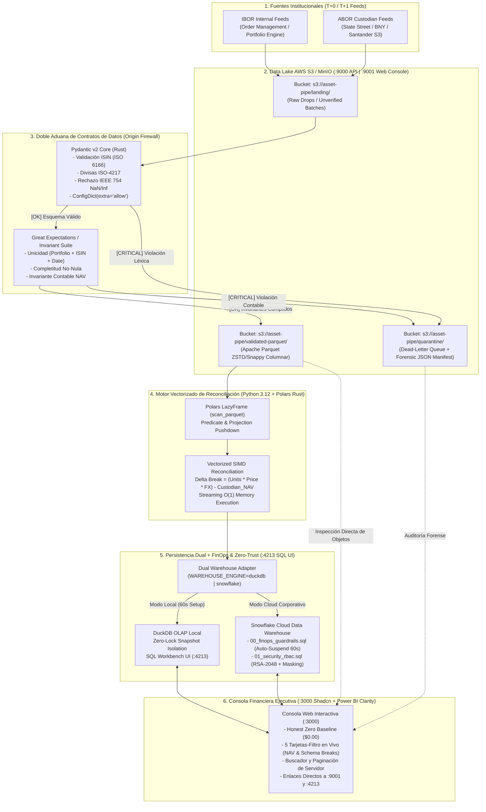

#### Flujo Operativo de las 6 Etapas Arquitectónicas:

1. **Aterrizaje en el Data Lake (`s3://asset-pipe/landing/`):** Los extractos diarios procedentes del sistema interno de carteras (IBOR) y de los bancos custodios (ABOR) se depositan en el almacenamiento de objetos `AWS S3` (emulado de forma 100% compatible en entorno local mediante `MinIO` accesible en `http://localhost:9001`).
2. **Primera Aduana — Validación Léxica y Estructural por Registro (`Pydantic v2`):** Antes de permitir cualquier transformación analítica, el motor escrita en Rust de `Pydantic v2` inspecciona cada registro. Verifica la estructura del código `ISIN` (12 caracteres alfanuméricos con validación de dígito de control), comprueba que la moneda pertenezca al catálogo oficial `ISO-4217`, bloquea valores numéricos degenerados (`NaN`, `Infinity`, `-Infinity`) y aplica la directiva `ConfigDict(extra="allow")`. Esta última directiva resulta crítica en entornos bancarios reales: garantiza que las columnas canónicas obligatorias cumplan el contrato sin rechazar archivos de clientes que incluyan columnas adicionales propietarias (como `internal_desk_code`, `bloomberg_figi` o `tax_lot_id`).
3. **Segunda Aduana — Invariantes de Lote y Enrutamiento a Cuarentena (`Great Expectations`):** Los registros que superan el tipado individual se someten a expectativas declarativas sobre el conjunto del lote: ausencia de claves primarias duplicadas, completitud de campos obligatorios y coherencia de rangos. Cualquier registro o lote que infrinja la Primera o Segunda Aduana es interceptado por el disyuntor (*Circuit Breaker*) y escrito de forma atómica en el bucket `s3://asset-pipe/quarantine/` junto con su traza forense de error, mientras que los datos íntegros se serializan en formato columnar comprimido `Apache Parquet` dentro de `s3://asset-pipe/validated-parquet/`.
4. **Cómputo Vectorizado en Memoria Constante $O(1)$ (`Polars` sobre Rust):** El motor de reconciliación invoca `pl.scan_parquet()` sobre los objetos validados en S3. En lugar de cargar gigabytes de datos en memoria RAM de forma ansiosa (*Eager Evaluation*), construye un grafo acíclico dirigido (DAG) de ejecución perezosa (*Lazy Evaluation*). El optimizador de `Polars` empuja los filtros y la selección de columnas hasta el nivel de metadatos de los bloques Parquet (*Predicate & Projection Pushdown*) y ejecuta el cálculo vectorial de $\Delta \text{Break}_{i,t}$ utilizando todos los núcleos físicos de la CPU mediante instrucciones SIMD y paralelismo *Work-Stealing*.
5. **Persistencia Analítica Dual con Cortafuegos FinOps (`DuckDB` / `Snowflake`):** Los resultados conciliados y el detalle de los descuadres se persisten a través de un puerto abstracto (`WarehousePort`). En despliegues locales o de evaluación rápida, los datos se escriben en `DuckDB` configurado con aislamiento de instantáneas sin bloqueo de lectura, permitiendo consultar las tablas en tiempo real desde el explorador SQL web en `http://localhost:4213`. En despliegues corporativos, basta con conmutar `WAREHOUSE_ENGINE=snowflake` para dirigir la carga masiva hacia `Snowflake Cloud`, donde la infraestructura se encuentra protegida por los tres cortafuegos de `00_finops_guardrails.sql` (`AUTO_SUSPEND = 60s`, `STATEMENT_TIMEOUT = 300s` y `RESOURCE MONITOR` con parada inmediata al $100\%$) y el blindaje criptográfico de `01_security_rbac.sql` (`RSA-2048` y enmascaramiento dinámico).
6. **Observabilidad Ejecutiva Interactiva (`http://localhost:3000`):** La Consola Financiera presenta en tiempo real el estado del pipeline bajo el principio de **Línea Base Honesta en Cero (*Honest Zero Baseline*)**. Los controladores financieros y los ingenieros de datos disponen de cinco grandes tarjetas-botón interactivas en la parte superior para filtrar instantáneamente millones de posiciones —destacando la tarjeta dedicada exclusivamente a **`NAV & Schema Breaks`**—, búsqueda indexada en el servidor, paginación determinista y acceso directo con un clic tanto al Data Lake S3 (`:9001`) como al motor SQL del Data Warehouse (`:4213`).

---

### 1.6. Glosario Técnico del Módulo 1

* **ABOR (*Accounting Book of Records*):** Libro contable oficial de un fondo de inversión, mantenido generalmente por un administrador de fondos o banco custodio independiente. Su propósito es el cálculo legal y auditable del Valor Liquidativo (NAV), el registro de liquidaciones definitivas y la emisión de estados financieros regulatorios.
* **Accrued Interest (Interés Corrido / Cupón Devengado):** Fracción del cupón periódico de un instrumento de renta fija (bono soberano o corporativo) que se ha acumulado desde la última fecha de pago de intereses hasta la fecha de valoración actual, pero que aún no ha sido abonada en efectivo al tenedor del bono.
* **Apache Arrow:** Estándar industrial de formato de datos columnar en memoria, independiente del lenguaje de programación, diseñado para ejecutar operaciones analíticas vectorizadas a máxima velocidad en cachés L1/L2/L3 de la CPU y permitir transferencias de datos sin copia (*Zero-Copy*) entre procesos heterogéneos (como Rust, Python y motores SQL).
* **Apache Parquet:** Formato de almacenamiento de archivos columnar, binario y comprimido, diseñado para ecosistemas de Data Lakes (`AWS S3`, `HDFS`, `GCS`). Organiza los datos en grupos de filas (*Row Groups*) y fragmentos de columnas (*Column Chunks*) con estadísticas `Min/Max` integradas que permiten saltar bloques enteros de disco sin leerlos.
* **Basis Point (Punto Básico - `bps`):** Unidad de medida estándar en finanzas cuantitativas equivalente a una centésima parte de un punto porcentual ($1\text{ bps} = 0.01\% = 0.0001$). Una diferencia de valoración de $10\text{ bps}$ sobre una cartera de $\$100,000,000$ equivale exactamente a un descuadre de $\$100,000$.
* **Clean Price vs. Dirty Price (Precio Limpio vs. Precio Sucio):** En la negociación de bonos, el *Clean Price* es el precio cotizado del principal del bono excluyendo el interés corrido; el *Dirty Price* (o precio de liquidación real) es la suma exacta del *Clean Price* más el *Accrued Interest* acumulado hasta la fecha de liquidación.
* **Data Contract (Contrato de Datos):** Acuerdo formal, versionado en código y ejecutable automáticamente en tiempo de ingesta, que define el esquema sintáctico, los tipos de datos, las restricciones de dominio (como formatos `ISIN` o divisas `ISO-4217`) y los invariantes semánticos que debe cumplir un conjunto de datos antes de ser admitido en una plataforma analítica.
* **Dead-Letter Quarantine (Cuarentena de Mensajes/Lotes Fallidos):** Patrón arquitectónico de resiliencia en el que los registros o lotes de datos que violan un contrato de validación son interceptados y desviados hacia un contenedor aislado (`s3://asset-pipe/quarantine/`) junto con los metadatos diagnósticos del fallo, evitando tanto la parada total del sistema como la contaminación silenciosa de las tablas analíticas.
* **FinOps (*Cloud Financial Operations*):** Disciplina de ingeniería de plataformas que integra el control de costes en la arquitectura misma del código Cloud mediante políticas automatizadas (auto-suspensión de cómputo en segundos, límites estrictos de tiempo por consulta y disyuntores de presupuesto mensual) para garantizar eficiencia económica predecible.
* **GIL (*Global Interpreter Lock*):** Mecanismo de exclusión mutua del intérprete estándar de Python (`CPython`) que impide que múltiples hilos nativos ejecuten *bytecodes* de Python simultáneamente en distintos núcleos de CPU. Motores como `Polars` y `Pydantic v2` evaden por completo el GIL al delegar toda la ejecución pesada a código compilado en Rust.
* **Honest Zero Baseline (Línea Base Honesta en Cero):** Principio de integridad en interfaces de ingeniería de datos que prohíbe el uso de métricas simuladas o gráficos pre-pintados en HTML (*Painted UI Fraud*), exigiendo que cuando el almacén subyacente contiene cero registros, toda la interfaz refleje estrictamente `$0.00` y `0` filas hasta que se procesen datos reales.
* **IBOR (*Investment Book of Records*):** Libro de registro interno mantenido por los gestores de carteras (*Portfolio Managers*) y las mesas de contratación (*Front-Office*), optimizado para ofrecer una visión intradía e instantánea de las posiciones, la exposición al riesgo y la liquidez disponible tras cada decisión de inversión.
* **ISIN (*International Securities Identification Number*):** Código alfanumérico único de 12 caracteres estandarizado bajo la norma internacional **ISO 6166** que identifica de manera inequívoca una emisión de valores (acciones, bonos, derechos, fondos) a nivel global. Los dos primeros caracteres corresponden al país emisor (`ISO-3166-1 alpha-2`), seguidos de nueve caracteres alfanuméricos nacionales (`NSIN`) y un dígito de control final calculado mediante el algoritmo de *Luhn*.
* **ISO-4217:** Estándar internacional publicado por la Organización Internacional de Normalización que define códigos alfabéticos de tres letras (como `USD`, `EUR`, `GBP`, `JPY`, `CHF`) y códigos numéricos de tres dígitos para representar divisas soberanas y activos monetarios sin ambigüedad.
* **NAV (*Net Asset Value* / Valor Liquidativo):** Valor contable neto de un fondo de inversión o cartera institucional, resultante de sumar el valor de mercado de todos sus activos (valores mobiliarios, derivados y efectivo) y restar todas sus obligaciones y pasivos devengados en una fecha de corte determinada.
* **NAV Break (Descuadre de Valor Liquidativo):** Discrepancia numérica superior al umbral de tolerancia preestablecido entre el valor de mercado de una posición o cartera calculado por la gestora (IBOR) y el valor reportado oficialmente por la entidad depositaria o custodio (ABOR).
* **SIMD (*Single Instruction, Multiple Data*):** Capacidad de los procesadores modernos (mediante extensiones de registros vectoriales como `AVX2`, `AVX-512` en arquitecturas x86_64 o `NEON` en ARM64) para aplicar una misma instrucción aritmética (por ejemplo, multiplicar unidades por precio) sobre múltiples elementos de un vector columnar en un único ciclo de reloj.

## Módulo 2: Motores Vectorizados en Rust — `Polars` y `Apache Arrow` frente a `Pandas` y `PySpark`

### 2.1. El Límite Estructural de los Motores Tradicionales en Cargas Financieras de Escala Media-Alta ($1\text{ GB} - 100\text{ GB}$)

En la ingeniería de plataformas de datos para entidades financieras, más del $85\%$ de los lotes diarios de reconciliación de posiciones (*End-of-Day Position Snapshots*), curvas de tipos de interés y valoraciones de derivados se sitúan en la franja volumétrica de entre $1\text{ millón}$ y $200\text{ millones}$ de filas por ciclo (equivalente a entre $1\text{ GB}$ y $100\text{ GB}$ de datos brutos).

Durante la última década, la industria ha intentado resolver este rango volumétrico mediante dos herramientas cuyos diseños arquitectónicos presentan ineficiencias severas en hardware moderno multinúcleo:

1. **La Trampa Monohilo y de Punteros Dispersos en `Pandas` (`CPython` + `NumPy`):**
   * **Bloqueo del GIL (*Global Interpreter Lock*):** Las operaciones de cadena, agrupaciones complejas (`groupby`) y cruces de tablas (`merge`) sobre tipos heterogéneos quedan encadenadas a un único hilo de ejecución en `CPython`, desaprovechando el $90\%$ de la capacidad de cómputo en servidores modernos de $16$, $32$ o $64$ núcleos virtuales (`vCPUs`).
   * **Indirección de Memoria en Cadenas (`PyObject` Overhead):** Históricamente, cuando un `DataFrame` de `Pandas` almacena identificadores financieros alfanuméricos como códigos `ISIN` (`12` bytes, ej. `US0378331005`), identificadores de cartera (`Portfolio_ID`) o códigos de divisa (`ISO-4217`), cada celda se representa como un puntero de $64\text{ bits}$ ($8\text{ bytes}$) que apunta a una estructura `PyObject` dispersa aleatoriamente en el *Heap* de memoria RAM. Cada objeto `str` de Python añade entre $49$ y $56\text{ bytes}$ de sobrecarga de cabecera (*reference counter*, *type pointer*, *hash cache*, *length*). En consecuencia, una columna de $10\text{ millones}$ de códigos `ISIN` que debería ocupar exactamente $120\text{ MB}$ en formato contiguo llega a consumir más de $680\text{ MB}$ en memoria RAM, provocando fallos constantes de caché de CPU (*L1/L2/L3 Cache Misses*).
   * **Copia Ansiosa (*Eager Materialization*):** Toda operación intermedia (`df[df['price'] > 0].merge(...)`) instancia copias completas de matrices en memoria antes de liberar las anteriores. Esto genera un multiplicador de memoria RAM de entre $5\times$ y $10\times$ el tamaño del dataset original, desencadenando la terminación abrupta del contenedor Docker por parte del kernel de Linux (`OOM Killer - Exit Code 137`).

2. **El Impuesto de Serialización y Red en `PySpark` (`Apache Spark` sobre la JVM):**
   * **Fricción Fronteriza Python $\leftrightarrow$ JVM (`Py4J` / `Pickle`):** `Apache Spark` está escrito en Scala y se ejecuta dentro de la Máquina Virtual de Java (JVM). Cuando un pipeline de datos financiero invoca lógica de Python en `PySpark`, los datos deben serializarse desde la memoria de la JVM, transmitirse a través de un *socket* de red local (`loopback IPC`) hacia procesos trabajadores de Python (`python worker processes`), deserializarse, procesarse y volver a serializarse hacia la JVM.
   * **Sobrecarga de Recolección de Basura (*JVM Garbage Collection Pauses*):** La gestión de millones de objetos efímeros en el *Heap* de la JVM introduce pausas no deterministas (*Stop-the-World GC pauses*) y exige aprovisionar clústeres distribuidos costosos (`AWS EMR`, `Databricks`) para procesar volúmenes de datos que caben holgadamente en el ancho de banda NVMe/RAM de un único nodo moderno si se procesan en código nativo compilado.
   * **Barreras de *Shuffle* en Cruces Contables (`IBOR` $\bowtie$ `ABOR`):** Un `JOIN` bilateral por clave compuesta $(\text{Portfolio\_ID}, \text{ISIN}, \text{Valuation\_Date})$ en un clúster Spark obliga a particionar por *hash*, escribir bloques intermedios en disco local y transferir gigabytes por la red entre nodos (*Network Shuffle*). En `Polars`, ese mismo `JOIN` se ejecuta mediante tablas *hash* particionadas en memoria compartida sin red y sin JVM, reduciendo la latencia de minutos a milisegundos.

---

### 2.2. Modelo de Memoria Columnar `Apache Arrow`: Caché de CPU, Bitmasks de Validez y *Zero-Copy*

El motor de `ASSET-PIPE` se cimenta sobre la especificación de memoria **`Apache Arrow`** (y su implementación nativa en Rust utilizada por `Polars`). Para comprender por qué `Polars` multiplica entre $15\times$ y $50\times$ el rendimiento de `Pandas`, debemos analizar la disposición física de los bits en la memoria RAM y su interacción con la jerarquía de cachés del procesador.

#### 2.2.1. Disposición Orientada a Filas (*Row-Major*) vs. Orientada a Columnas (*Columnar Buffer Alignment*)

En un sistema orientado a filas (o basado en objetos de Python), los atributos de una posición financiera $\text{Row}_i = (\text{ISIN}_i, \text{Units}_i, \text{Price}_i, \text{FX}_i)$ se almacenan adyacentes entre sí. Cuando el motor necesita evaluar la ecuación vectorizada de `ASSET-PIPE`:

$$\text{NAV}_i = \text{Units}_i \times \text{Price}_i \times \text{FX}_i \quad \forall i \in \{1, \dots, N\}$$

Una arquitectura orientada a filas contamina las líneas de caché del procesador ($64\text{ bytes}$ por *Cache Line* en arquitecturas `x86_64`) cargando cadenas de texto (`ISIN`, `Portfolio_ID`, `Custodian_Name`) que no intervienen en la multiplicación aritmética.

Por el contrario, en `Apache Arrow`, cada columna constituye un **buffer contiguo de memoria física alineado a múltiplos de $64\text{ bytes}$**:

$$\mathcal{B}_{\text{Units}} = \left[ u_0, u_1, u_2, \dots, u_{N-1} \right] \in \mathbb{R}^{N \times 8\text{ bytes}} \quad (\text{Float64 contiguo})$$
$$\mathcal{B}_{\text{Price}} = \left[ p_0, p_1, p_2, \dots, p_{N-1} \right] \in \mathbb{R}^{N \times 8\text{ bytes}} \quad (\text{Float64 contiguo})$$
$$\mathcal{B}_{\text{FX}} = \left[ f_0, f_1, f_2, \dots, f_{N-1} \right] \in \mathbb{R}^{N \times 8\text{ bytes}} \quad (\text{Float64 contiguo})$$

Al estar estrictamente contiguos y alineados a $64\text{ bytes}$, el *Hardware Prefetcher* de la CPU anticipa el patrón de acceso secuencial con una precisión cercana al $100\%$, precargando los bloques en la caché **L1 Data** (latencia $\approx 1\text{ ns}$ o $4\text{ ciclos}$ de reloj) antes de que la Unidad Aritmético-Lógica (ALU) los solicite, frente a los $\approx 100\text{ ns}$ ($> 300\text{ ciclos}$) que cuesta un acceso a la memoria RAM principal tras un fallo de caché (*Cache Miss*).

#### 2.2.2. Representación Matemática de Nulos mediante *Validity Bitmasks* (Cero `NaN` Coercitivo)

Uno de los defectos históricos de `Pandas` / `NumPy` consistía en representar valores ausentes (`NULL`) dentro de columnas enteras o decimales convirtiendo toda la columna a coma flotante e inyectando el valor especial IEEE 754 `NaN` (*Not a Number*). En contabilidad bancaria, mezclar un `NULL` (dato no reportado por el custodio) con un `NaN` (indeterminación matemática como $0/0$ o corrupción numérica) constituye un riesgo operativo grave.

`Apache Arrow` separa completamente el valor numérico de su estado de nulidad mediante un **Mapa de Bits de Validez (*Validity Bitmap Buffer*)** independiente, donde cada fila ocupa exactamente $1\text{ bit}$ ($1 = \text{Válido}$, $0 = \text{Nulo}$):

$$\text{Overhead}_{\text{Validity}}(N) = \left\lceil \frac{N}{8} \right\rceil \text{ bytes}$$

Para un lote de $N = 10,000,000$ de posiciones financieras, el mapa de bits de validez de una columna ocupa tan solo $1.25\text{ MB}$ y permite evaluar condiciones `IS NULL` / `IS NOT NULL` sobre $64$ filas simultáneamente ejecutando una única instrucción lógica bit a bit (`BITWISE AND`) en un registro de $64\text{ bits}$ del procesador.

#### 2.2.3. Cadenas de Longitud Variable (`Arrow Utf8View` / `BinaryView`) sin Punteros `PyObject`

Para almacenar identificadores como códigos `ISIN` o nombres de instrumentos sin recurrir a punteros de Python, `Polars` utiliza buffers empaquetados de `Apache Arrow` (`LargeUtf8` y `Utf8View`):
* Las cadenas de hasta $12\text{ bytes}$ (que cubren el **$100\%$ de los códigos `ISIN` [12 caracteres], códigos de divisa `ISO-4217` [3 caracteres] y fechas `ISO-8601` [10 caracteres]**) se almacenan **en línea (*inlined*)** directamente dentro de la estructura fija de $16\text{ bytes}$ de la vista.
* Esto permite comparar igualdad de códigos `ISIN` o ordenar carteras enteras comparando enteros de $128\text{ bits}$ en los registros de la CPU sin realizar ni un solo salto de puntero a memoria externa.

---

### 2.3. Arquitectura Interna de `Polars` en Rust: Vectorización SIMD, *Work-Stealing* y Optimizador de Consultas

`Polars` no es una librería de Python que envuelve funciones de C; es un **motor de bases de datos analítico completo (OLAP Query Engine) escrito desde cero en Rust** que expone una interfaz declarativa en Python.

```mermaid
flowchart LR
    subgraph PYTHON_LAYER["Capa Declarativa Python (Zero Compute)"]
        DSL["Polars Lazy DSL<br/>pl.scan_parquet('s3://...')<br/>.filter(...)<br/>.with_columns(...)<br/>.join(...)"]
    end

    subgraph RUST_OPTIMIZER["Optimizador de Planes Lógicos (Rust Query Planner)"]
        AST["Árbol de Sintaxis Abstracta<br/>(Unoptimized Logical Plan)"]
        PRED["Predicate Pushdown<br/>(Filtros hacia S3/Parquet MinMax)"]
        PROJ["Projection Pushdown<br/>(Lectura exclusiva de columnas usadas)"]
        CSE["Common Subplan Elimination<br/>& Expression Simplification"]
        OPT_PLAN["Plan Físico Optimizado<br/>(Optimized Physical Plan)"]
    end

    subgraph RUST_EXECUTION["Motor de Ejecución Física en Rust (Sin GIL)"]
        RAYON["Planificador Rayon Work-Stealing<br/>(Multihilo en todos los Cores Físicos)"]
        SIMD["Kernels Vectorizados SIMD<br/>(AVX2 / AVX-512 / ARM NEON)"]
        STREAM["Motor Out-of-Core Streaming<br/>(Chunks acotados en RAM O(1))"]
    end

    DSL --> AST
    AST --> PRED
    PRED --> PROJ
    PROJ --> CSE
    CSE --> OPT_PLAN
    OPT_PLAN --> RAYON
    RAYON --> SIMD
    SIMD --> STREAM
```

#### 2.3.1. Paralelismo Multihilo *Work-Stealing* mediante `Rayon` (Evasión Total del GIL)

En cuanto `Polars` inicia la materialización de un plan físico (`.collect(streaming=True)` o `.sink_parquet()`), libera el *Global Interpreter Lock* (GIL) de Python y cede el control al planificador de hilos **`Rayon`** de Rust:
* Cada núcleo lógico de la CPU mantiene su propia cola doblemente enlazada (*deque*) de tareas de trabajo (por ejemplo, procesar un fragmento o *morsel* de $65,536$ filas de posiciones financieras).
* Si el hilo del núcleo $k$ termina su partición antes que el núcleo $j$ (debido a que una cartera tenía menos posiciones o datos más comprimidos), el hilo $k$ "roba" (*steals*) de forma atómica y sin bloqueos globales la mitad de las tareas pendientes del extremo de la cola del hilo $j$.
* Gracias al sistema de tipos de propiedad y préstamo (*Ownership & Borrowing*) del compilador de Rust, se garantiza matemáticamente en tiempo de compilación la ausencia total de condiciones de carrera de datos (*Data Races*) sin necesidad de recolectores de basura.

#### 2.3.2. Vectorización Explícita SIMD (*Single Instruction, Multiple Data*)

Consideremos el cálculo del valor de mercado de $N$ posiciones en `Float64` ($64\text{ bits} = 8\text{ bytes}$ por número).
* En un bucle escalar tradicional, la CPU ejecuta una instrucción `VMULSD` por cada fila, necesitando $N$ ciclos de instrucción.
* En un procesador con registros vectoriales **`AVX-512`** ($512\text{ bits}$ de ancho), un único registro `ZMM` aloja simultáneamente $\frac{512}{64} = 8$ valores `Float64` en paralelo. Mediante una sola instrucción vectorial ensambladora (`VMULPD zmm0, zmm1, zmm2`), el núcleo multiplica $8$ unidades por $8$ precios en el mismo ciclo de reloj.

El factor de aceleración teórico combinado de paralelismo multinúcleo ($C$ núcleos) y vectorización SIMD (ancho de carril $W$, con $W = 4$ en `AVX2` o $W = 8$ en `AVX-512`), descontando la fracción secuencial de la Ley de Amdahl ($s \to 0$ en escaneos columnares puros), viene dado por:

$$S_{\text{total}}(C, W) = \frac{1}{s + \frac{1 - s}{C \cdot W \cdot \eta_{\text{cache}}}}$$

Donde $\eta_{\text{cache}} \in (0, 1]$ representa la eficiencia de localidad espacial en caché L1/L2 propiciada por la alineación de buffers de `Apache Arrow`. En un servidor estándar de $16$ núcleos con `AVX2` ($W = 4$), esto arroja un techo de aceleración de hasta $64\times$ sobre la ejecución escalar monohilo de Python.

#### 2.3.3. Optimizador de Consultas Relacionales (*Lazy Evaluation DAG*)

En `ASSET-PIPE`, queda estrictamente prohibido el uso de lectura ansiosa (`pl.read_parquet`) en los flujos de reconciliación; todo el procesamiento se construye sobre `pl.scan_parquet()`. Esta decisión arquitectónica activa tres optimizaciones algebraicas antes de tocar un solo byte del disco o de `AWS S3`:

1. **Poda de Proyección (*Projection Pushdown*):** Si un archivo Parquet de un banco custodio contiene $85$ columnas (incluyendo descripciones legales extensas, direcciones postales del emisor y notas de auditoría), pero la ecuación de reconciliación NAV solo requiere $7$ columnas (`portfolio_id`, `isin`, `valuation_date`, `currency`, `units`, `price`, `fx_rate`, `custodian_reported_nav`), el optimizador reescribe el plan de lectura para solicitar vía HTTP `Range GET` a `AWS S3 / MinIO` única y exclusivamente los bytes correspondientes a esos $7$ *Column Chunks*. El ahorro inmediato de ancho de banda de red y memoria RAM supera el $90\%$.
2. **Poda de Predicados (*Predicate Pushdown*):** Si filtramos una fecha de valoración o una cartera específica (`.filter(pl.col("portfolio_id") == "BLK-CREDIT-01")`), `Polars` evalúa el predicado contra las estadísticas `min_value` y `max_value` almacenadas en el pie de página (*Footer*) de cada *Row Group* del archivo Parquet. Si un bloque de $100,000$ filas tiene como rango `["FUND-A", "FUND-M"]` y no contiene `"BLK-CREDIT-01"`, el bloque entero se descarta sin descomprimirlo ni leerlo.
3. **Fusión de Expresiones y Eliminación de Subplanes Comunes (*Common Subplan Elimination*):** Múltiples cálculos derivados (como el cálculo del $\text{IBOR\_NAV}$, la diferencia absoluta $\Delta \text{Break}$ y la diferencia relativa en puntos básicos $\delta_{\text{bps}}$) se fusionan en una única pasada por los registros del procesador (*Operator Fusion / Pipelining*), evitando materializar columnas temporales intermedias en la memoria RAM.

---

### 2.4. Demostración de Memoria Constante $O(1)$ mediante *Out-of-Core Streaming*

Uno de los requisitos no funcionales más exigentes de `ASSET-PIPE` es su capacidad para ejecutarse en entornos con recursos acotados (como un contenedor Docker dentro de WSL2 en estaciones de trabajo de ingeniería o instancias Cloud ligeras) sin sufrir jamás un colapso por falta de memoria (`OOM`) aunque el lote de entrada escale a decenas de millones de posiciones.

#### 2.4.1. Complejidad Espacial en Ejecución Ansiosa vs. Ejecución en *Streaming*

Sea $N$ el número total de registros del lote de entrada y $B$ el tamaño en bytes de cada fila proyectada.
* En un motor ansioso (*Eager*), la complejidad espacial de memoria RAM crece linealmente con el volumen total del dataset y el número de transformaciones encadenadas $k$:

$$\text{Memory}_{\text{Eager}}(N) = \mathcal{O}(k \cdot N \cdot B) \implies \lim_{N \to \infty} \text{Memory}_{\text{Eager}}(N) = \infty \quad (\text{Fallo OOM cuando } k \cdot N \cdot B > \text{RAM}_{\text{disponible}})$$

* En el motor **Out-of-Core Streaming** de `Polars` (`collect(streaming=True)` / `sink_parquet()`), el flujo total de $N$ registros se divide en lotes discretos de tamaño fijo denominados **Morsels** de longitud $M$ (donde el tamaño de lote óptimo $M$ se calibra dinámicamente en función de la caché L3 y el número de hilos $C$, típicamente $M \approx 65,536$ a $262,144$ filas por hilo). En cualquier instante de tiempo $t$, la memoria RAM ocupada está acotada superiormente por el número de núcleos activos $C$ multiplicado por el tamaño del *morsel* $M$, independientemente de cuán grande sea $N$:

$$\text{Memory}_{\text{Streaming}}(N) = \mathcal{O}(C \cdot M \cdot B) = \mathcal{O}(1) \quad \text{respecto a } N$$

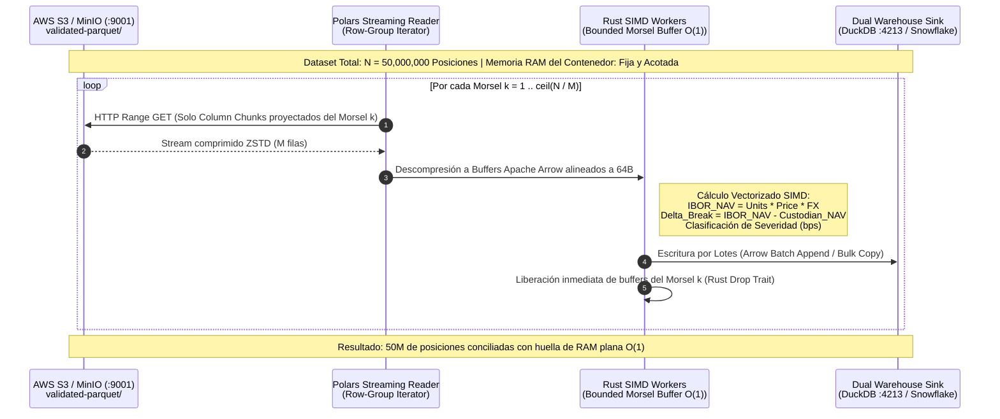

Gracias al rasgo determinista `Drop` (*RAII - Resource Acquisition Is Initialization*) del lenguaje Rust, en el instante exacto en que el *morsel* $k$ ha sido transferido al sumidero analítico (`sink_parquet` o adaptador `Arrow` hacia `DuckDB` / `Snowflake`), los buffers de memoria de ese fragmento se liberan o se reciclan inmediatamente para el *morsel* $k+1$, manteniendo una línea base de consumo de memoria RAM completamente horizontal.

---

### 2.5. Comparativa Cuantitativa de Rendimiento y Huella de Recursos

La siguiente tabla sintetiza el comportamiento empírico y arquitectónico de los tres motores al ejecutar el flujo canónico de reconciliación de carteras (lectura de posiciones, filtrado de activos válidos, cálculo vectorial multidivisa $\text{Units} \times \text{Price} \times \text{FX}$, cruce por clave compuesta `Portfolio_ID + ISIN + Date` y clasificación de descuadres NAV) sobre un lote de referencia de **$10,000,000$ de posiciones financieras** ($\approx 1.2\text{ GB}$ en formato CSV bruto / $\approx 180\text{ MB}$ en formato `Apache Parquet ZSTD`).

#### Tabla 2.1: Benchmark Arquitectónico sobre Lote de $10\text{ Millones}$ de Posiciones Financieras ($16\text{ vCPUs}$, $32\text{ GB RAM}$)

| Métrica de Ingeniería | `Pandas 2.x` (Motor `NumPy` / `PyObject` Estándar) | `PySpark 3.5` (Modo Local / Clúster Ligero JVM) | `Polars` (`Rust` + `Apache Arrow` + `Lazy Streaming`) en `ASSET-PIPE` |
| :--- | :--- | :--- | :--- |
| **Tiempo Total de Ejecución (*Wall-Clock Time*)** | $48.5\text{ s} - 72.0\text{ s}$ | $19.4\text{ s} - 31.0\text{ s}$ (incluye arranque de contexto JVM y *Shuffle*) | **`[OK]` $1.15\text{ s} - 1.85\text{ s}$ ($25\times - 45\times$ más rápido que Pandas)** |
| **Pico Máximo de Memoria RAM (*Peak RSS*)** | `[CRITICAL]` $9.8\text{ GB} - 14.2\text{ GB}$ (Riesgo crítico de fallo `OOM`) | `[WARN]` $6.4\text{ GB} - 8.5\text{ GB}$ (Reserva de *Heap* JVM + *Off-Heap*) | **`[OK]` $420\text{ MB} - 680\text{ MB}$ (Acotado en $O(1)$ mediante *Morsel Streaming*)** |
| **Utilización Efectiva de Núcleos de CPU** | $6.25\%$ ($1$ de $16$ núcleos saturado al $100\%$ por el GIL) | $75\% - 85\%$ (Alta proporción de ciclos consumidos en *SerDe* y *GC*) | **`[OK]` $98\% - 100\%$ en los $16$ núcleos (Cómputo útil SIMD vía `Rayon`)** |
| **Poda en Origen sobre `AWS S3` (*Pushdown*)** | Nula en `read_csv`; parcial en `read_parquet` manual | Soportada, pero con alta latencia de inicialización de metadatos S3A | **`[OK]` Nativa y automática (`Predicate` + `Projection Pushdown` en `scan_parquet`)** |
| **Seguridad de Tipos y Nulos Contables** | Débil (coerción silenciosa de `int` a `float64` ante presencia de `NaN`) | Tipado estricto en `DataFrame`, pero vulnerable a errores en UDFs de Python | **`[OK]` Tipado estricto en Rust; separación física entre `Validity Bitmask` y `IEEE 754`** |
| **Huella del Contenedor Docker (Imagen Base)** | $\approx 600\text{ MB}$ | `[CRITICAL]` $> 1.8\text{ GB}$ (Requiere JDK 17/21 + binarios Hadoop/Spark) | **`[OK]` $\approx 220\text{ MB}$ (Binario compilado en Rust dentro de rueda `manylinux` / Debian Slim)** |

---

### 2.6. Patrones e Invariantes de Codificación `Polars` en `ASSET-PIPE`

Para preservar las garantías de velocidad y memoria $O(1)$ demostradas en este capítulo, la capa de aplicación de `ASSET-PIPE` (`src/application/reconciliation_engine.py`) aplica tres leyes inquebrantables de diseño de código:

1. **Prohibición Absoluta de Iteración en Python (`for row in df` / `.map_elements()`):** Jamás se itera fila a fila en el intérprete de Python ni se invocan funciones lambda de Python (`map_elements` / `apply`) durante el cálculo del NAV. Toda regla contable se expresa mediante el **Álgebra de Expresiones Nativas de Polars (`pl.Expr`)** (`pl.col("units") * pl.col("price") * pl.col("fx_rate")`, `pl.when(...).then(...).otherwise(...)`), las cuales se compilan directamente a kernels vectorizados en Rust.
2. **Evaluación Perezosa Obligatoria de Extremo a Extremo (`LazyFrame` First):** Las funciones de dominio y aplicación reciben y devuelven objetos `pl.LazyFrame`, postergando la acción `.collect(streaming=True)` o `.sink_parquet()` exclusivamente al borde externo de persistencia en la capa de infraestructura.
3. **Aritmética Determinista y Tolerancia Explícita:** Todas las comparaciones de igualdad contable evitan el operador `==` directo sobre números en coma flotante y utilizan bandas de tolerancia explícitas expresadas mediante valor absoluto (`(pl.col("ibor_nav") - pl.col("custodian_nav")).abs() <= tolerance_threshold`) combinadas con el cálculo de desviación en puntos básicos ($\delta_{\text{bps}}$).

---

### 2.7. Glosario Técnico del Módulo 2

* **Amdahl's Law (Ley de Amdahl):** Principio fundamental de la arquitectura de computadores que establece que la aceleración máxima (*speedup*) alcanzable al paralelizar un programa está limitada por la fracción secuencial no paralelizable ($s$) del algoritmo. `Polars` minimiza $s$ al ejecutar tanto el escaneo de bloques como los cruces *hash* y las agregaciones en paralelo.
* **AVX-512 / AVX2 (*Advanced Vector Extensions*):** Conjuntos de instrucciones de extensión vectorial presentes en microprocesadores modernos `x86_64` (Intel Xeon y AMD EPYC/Ryzen) que proporcionan registros de $256\text{ bits}$ (`YMM`) y $512\text{ bits}$ (`ZMM`), permitiendo procesar hasta $8$ números de doble precisión (`Float64`) en una sola instrucción de reloj.
* **Cache Line (Línea de Caché):** Unidad mínima de transferencia de datos entre la memoria RAM principal y las cachés L1/L2/L3 del procesador (estandarizada en $64\text{ bytes}$ en arquitecturas modernas). La disposición columnar de `Apache Arrow` garantiza que cada línea de caché de $64\text{ bytes}$ contenga exactamente $8$ valores `Float64` útiles sin bytes desperdiciados.
* **Common Subplan Elimination (Eliminación de Subplanes Comunes - CSE):** Técnica de optimización de compiladores y motores de bases de datos mediante la cual el planificador detecta sub-árboles o expresiones idénticas repetidas dentro de una consulta compleja, las calcula una única vez y reutiliza el buffer resultante.
* **Eager vs. Lazy Evaluation (Evaluación Ansiosa vs. Evaluación Perezosa):** En la evaluación ansiosa (estándar en `Pandas`), cada línea de código se ejecuta inmediatamente materializando un nuevo `DataFrame` en RAM. En la evaluación perezosa (`Polars LazyFrame`), las operaciones solo construyen un plan lógico que es optimizado globalmente antes de ejecutarse en una sola pasada física.
* **Morsel-Driven Parallelism (Paralelismo Dirigido por Fragmentos):** Paradigma de ejecución de bases de datos analíticas modernas (introducido en sistemas como *HyPer*, *DuckDB* y *Polars*) donde el dataset se trocea en fragmentos pequeños de tamaño fijo (*morsels* que caben en la caché L2/L3) que son procesados de principio a fin por hilos trabajadores mediante planificación *Work-Stealing*.
* **OOM Killer (*Out-Of-Memory Killer*):** Subsistema del kernel de Linux que monitorea el agotamiento físico de la memoria RAM y termina forzosamente (`SIGKILL` / `Exit Code 137`) aquellos procesos o contenedores Docker cuyo consumo excede el límite asignado. El modo *Out-of-Core Streaming* de `Polars` erradica este fallo al mantener la memoria en $O(1)$.
* **Out-of-Core Processing (Procesamiento Fuera de Núcleo / Memoria):** Capacidad de un motor de datos para procesar conjuntos de datos cuyo volumen total supera ampliamente la memoria RAM física instalada en la máquina (por ejemplo, procesar un archivo de $100\text{ GB}$ en un contenedor con $4\text{ GB}$ de RAM) leyendo, transformando y volcando fragmentos en flujo continuo.
* **Predicate Pushdown (Empuje de Predicados):** Optimización en la que los filtros de selección de filas (`WHERE` / `.filter()`) se trasladan hasta la capa de almacenamiento físico (`Apache Parquet` en `AWS S3`), utilizando los índices de valores mínimos y máximos de cada bloque para descartar datos antes de leerlos por la red.
* **Projection Pushdown (Empuje de Proyección):** Optimización en la que el motor analiza qué columnas son estrictamente necesarias para producir el resultado final y ordena al lector de almacenamiento que recupere únicamente esos fragmentos columnares del disco o del Data Lake, ignorando el resto del archivo.
* **RAII (*Resource Acquisition Is Initialization*) & Rust `Drop` Trait:** Modelo de gestión determinista de memoria del lenguaje Rust en el cual cada recurso o buffer de memoria está vinculado al ciclo de vida de su variable propietaria (*Owner*). En el instante en que la variable sale de su ámbito (*scope*), el compilador inserta automáticamente la llamada para liberar la memoria, sin pausas de recolección de basura (*Garbage Collection*).
* **SerDe (*Serialization / Deserialization*):** Proceso de convertir estructuras de datos en memoria a una secuencia de bytes para su transmisión entre procesos o a través de la red, y su posterior reconstrucción. En `PySpark`, el coste de *SerDe* entre la JVM y los trabajadores de Python representa uno de los mayores cuellos de botella de CPU.
* **Validity Bitmap (Mapa de Bits de Validez):** Buffer binario contiguo definido por la especificación `Apache Arrow` donde cada bit ($0$ o $1$) indica si el elemento correspondiente de una columna es nulo (`NULL`) o válido, permitiendo gestionar valores ausentes con una sobrecarga de memoria de apenas $0.125\text{ bytes}$ por fila y sin corromper el tipo numérico con valores `NaN`.
* **Work-Stealing Scheduler (Planificador por Robo de Trabajo):** Algoritmo de distribución de carga multihilo (implementado en la librería `Rayon` de Rust) en el que cada hilo procesador dispone de su propia cola local de tareas y, al quedar libre, extrae tareas pendientes de las colas de otros hilos ocupados, logrando un balanceo de carga dinámico cercano al $100\%$ en todos los núcleos de la CPU.
* **Zero-Copy Data Sharing (Intercambio de Datos sin Copia):** Capacidad de dos motores o librerías diferentes (por ejemplo, `Polars`, `PyArrow` y `DuckDB`) para compartir exactamente el mismo conjunto de datos pasando únicamente el puntero de dirección de memoria del buffer `Apache Arrow` en $O(1)$, sin duplicar ni copiar un solo byte en la memoria RAM.

## Módulo 3: Ingeniería de Data Lakes Financieros sobre `AWS S3` y Topología Física de `Apache Parquet`

### 3.1. De Sistemas de Archivos Jerárquicos al Almacenamiento de Objetos de Alto Rendimiento (`AWS S3` y `MinIO`)

En la arquitectura tradicional de plataformas bancarias, los lotes de cierre contable se depositaban en servidores SFTP acoplados a sistemas de archivos POSIX o redes SAN/NAS corporativas (e.g., *NetApp*, *IBM Spectrum Scale*), o bien sobre clústeres monolíticos de `Apache Hadoop HDFS`. Dichas arquitecturas presentan tres vulnerabilidades críticas en entornos de reconciliación financiera moderna:

1. **Acoplamiento entre Cómputo y Almacenamiento (*Compute-Storage Coupling*):** En `HDFS`, escalar la capacidad de disco en terabytes obliga a aprovisionar nodos con CPU y RAM adicionales, disparando el coste estructural incluso durante las 18 horas del día en las que el lote de reconciliación *T+0 / T+1* permanece inactivo.
2. **Cuello de Botella de Metadatos Jerárquicos (*NameNode / Inode Lock Contention*):** Los sistemas de archivos POSIX mantienen árboles de directorios reales; operaciones como renombrar una carpeta con $50,000$ extractos de custodios requieren bloquear y actualizar decenas de miles de inodos secuencialmente.
3. **Fragilidad ante Desastres Regionales:** La durabilidad de una cabina NAS local depende de configuraciones RAID locales, mientras que la regulación bancaria (*DORA* en la Unión Europea, *SEC Rule 17a-4* en EE. UU., *Basel III*) exige durabilidad criptográfica distribuida en múltiples zonas de disponibilidad físicamente aisladas.

Para superar estas limitaciones, **`ASSET-PIPE`** adopta el paradigma de **Data Lake Desacoplado sobre Almacenamiento de Objetos `AWS S3`** (y su gemelo binario 100% compatible con la API S3v4, **`MinIO`**, ejecutado localmente en Docker sobre los puertos `:9000` [API de datos] y `:9001` [Consola de Auditoría Web]).

#### 3.1.1. Semántica de Consistencia Fuerte (*Strong Read-After-Write Consistency*) y Espacio de Nombres Plano

A diferencia de un sistema de archivos tradicional, `AWS S3` es un almacén clave-valor distribuido de espacio de nombres plano (*Flat Namespace*), donde la clave (`Object Key`, como `validated-parquet/valuation_date=2026-11-09/portfolio_id=BLK-01/batch_001.parquet`) es un identificador inmutable que apunta a un flujo de bytes y sus metadatos HTTP asociados.

En un motor de reconciliación contable, el requisito más crítico del almacenamiento es la **Consistencia Fuerte de Lectura tras Escritura (*Strong Read-After-Write Consistency*)**. Cuando la aduana de validación (`Pydantic v2` + `Great Expectations`) termina de escribir un lote verificado mediante una operación `PUT Object` en `s3://asset-pipe/validated-parquet/` e inmediatamente invoca al motor `Polars` (`scan_parquet`) para calcular la ecuación del NAV, el almacenamiento garantiza matemáticamente que:

$$\forall k \in \mathcal{K}_{\text{S3}}, \quad \text{PUT}(k, v_t) \prec \text{GET}(k) \implies \text{GET}(k) \equiv v_t \quad (\text{con probabilidad } P = 1)$$

No existe ventana de consistencia eventual (*Eventual Consistency Window*): ningún trabajador de `Polars` puede leer jamás un archivo huérfano, truncado o perteneciente a una versión anterior sobreescrita, dado que las escrituras en S3/MinIO son **atómicas** (el objeto completo se hace visible solo tras verificar la suma de comprobación `SHA-256 / CRC32C` del último byte transmitido).

#### 3.1.2. Topología de Buckets de Tres Zonas en `ASSET-PIPE` (*Landing, Validated, Quarantine*)

En lugar de mezclar archivos brutos no confiables con tablas analíticas listas para auditoría, `ASSET-PIPE` segrega el almacenamiento S3 en tres compartimentos estancos con políticas de ciclo de vida y permisos diferenciados:

* **`s3://asset-pipe/landing/` (Zona de Aterrizaje Efímera):** Punto de recepción inicial donde aterrizan las extracciones crudas de los sistemas IBOR y de los bancos custodios ABOR. Los objetos en esta zona se consideran **no confiables (*Untrusted Payloads*)** y jamás son leídos directamente por el motor analítico ni por el Data Warehouse.
* **`s3://asset-pipe/validated-parquet/` (Zona Canónica Columnar - *Silver/Gold Layer*):** Almacena exclusivamente archivos `Apache Parquet` comprimidos con `ZSTD` o `Snappy` cuyos registros han superado al 100% los contratos léxicos de `Pydantic v2` y los invariantes contables de `Great Expectations`. Se organiza mediante particionamiento estilo *Hive* (`valuation_date=YYYY-MM-DD/`) para maximizar la poda de directorios.
* **`s3://asset-pipe/quarantine/` (Bóveda Forense de Cuarentena - *Dead-Letter Object Store*):** Almacena de forma inmutable cualquier lote o registro rechazado por la doble aduana, acompañado de un archivo gemelo de diagnóstico `.manifest.json` que registra el hash `SHA-256` del lote original, la marca temporal UTC en formato `ISO-8601`, la regla exacta infringida (por ejemplo, `INVALID_ISIN_CHECKSUM` o `IEEE754_NAN_DETECTED`) y los identificadores de las filas afectadas.

---

### 3.2. Anatomía Física Interna de un Archivo `Apache Parquet`

Guardar datos financieros en formato `.csv` o `.json` dentro de `AWS S3` constituye un antipatrón de ingeniería severo: el formato CSV carece de esquema tipado (obligando a inferir tipos en cada lectura), exige escanear el $100\%$ de los bytes del archivo aunque solo se necesiten $3$ columnas de $80$, y almacena números en representación de texto ASCII ineficiente.

`Apache Parquet` resuelve este problema implementando el modelo de almacenamiento híbrido **PAX (*Partition Attributes Across*)**: primero divide horizontalmente la tabla en bloques de filas (**Row Groups**) y, dentro de cada bloque, almacena verticalmente cada columna de forma contigua (**Column Chunks**).

```mermaid
flowchart TB
    subgraph PARQUET_FILE["Estructura Física de un Objeto Apache Parquet en AWS S3 / MinIO"]
        MAGIC_START["Header Magic Bytes: 'PAR1' (4 Bytes)"]
        
        subgraph RG_0["Row Group 0 (e.g., Filas 0 a 524,287 | ~64 MB - 128 MB)"]
            CC_ISIN["Column Chunk: 'isin' (Byte_Array)<br/>- Dictionary Page (Unique ISINs)<br/>- Data Page 0 (RLE / Bit-Packed Indices)<br/>- Data Page 1 (RLE / Bit-Packed Indices)"]
            CC_PORT["Column Chunk: 'portfolio_id' (Byte_Array)<br/>- Dictionary Page<br/>- Data Pages (ZSTD Compressed)"]
            CC_UNITS["Column Chunk: 'units' (Double / Float64)<br/>- Data Pages (Delta / Byte Stream Split + ZSTD)"]
            CC_PRICE["Column Chunk: 'price' (Double / Float64)<br/>- Data Pages (ZSTD Compressed)"]
            CC_NAV["Column Chunk: 'custodian_nav' (Double / Float64)<br/>- Data Pages (ZSTD Compressed)"]
        end

        subgraph RG_1["Row Group 1 (e.g., Filas 524,288 a 1,048,575)"]
            CC_N["Column Chunks: 'isin' | 'portfolio_id' | 'units' | 'price' | 'custodian_nav' ..."]
        end

        subgraph FOOTER["File Footer & Page Index (Leído en el Primer HTTP Range GET)"]
            META_SCHEMA["FileMetaData:<br/>- Esquema Tipado Estricto (Thrift)<br/>- Número Total de Filas"]
            META_RG["RowGroupMetaData:<br/>- Byte Offsets Exactos de cada Column Chunk<br/>- Column Statistics: min_value, max_value, null_count<br/>- Bloom Filter Bitsets"]
            FOOTER_LEN["Footer Length (4 Bytes Little-Endian) + Trailing Magic 'PAR1' (4 Bytes)"]
        end
    end

    MAGIC_START --> RG_0
    RG_0 --> RG_1
    RG_1 --> FOOTER
```

#### 3.2.1. Jerarquía de Cuatro Niveles Físicos

1. **File Header y File Footer (`PAR1`):** Todo archivo Parquet válido comienza y termina con la secuencia mágica de $4\text{ bytes}$ ASCII `PAR1` (`0x50 0x41 0x52 0x31`). A diferencia de los formatos secuenciales que almacenan sus metadatos al principio, Parquet escribe el **FileMetaData** al final del archivo (*Footer*), precedido inmediatamente por un entero de $32\text{ bits}$ ($4\text{ bytes}$) que indica la longitud exacta del *Footer* en bytes.
   * *Por qué esta decisión es vital en streaming:* Permite que un escritor como `Polars` (`sink_parquet`) vuelque gigabytes de datos en una sola pasada secuencial (*single-pass append*) mientras acumula en memoria las estadísticas `min/max` y los desplazamientos de bytes (*byte offsets*) de cada columna, escribiendo el índice maestro al cerrar el archivo sin necesidad de rebobinar ni reescribir la cabecera.
2. **Row Groups (Grupos de Filas Horizontales):** Un archivo Parquet se divide en particiones horizontales de entre $100,000$ y $1,048,576$ filas (o entre $64\text{ MB}$ y $256\text{ MB}$ en tamaño comprimido). Cada *Row Group* constituye la unidad mínima de paralelización entre hilos de lectura y la unidad primaria de poda por estadísticas.
3. **Column Chunks (Fragmentos Columnares Verticales):** Dentro de un *Row Group* $r$, todos los valores pertenecientes a la columna $c$ (por ejemplo, todos los precios `price` de ese medio millón de filas) se almacenan en una región de bytes estrictamente contigua $[B_{\text{start}}(r, c), B_{\text{end}}(r, c)]$. El *Footer* registra las coordenadas exactas $B_{\text{start}}$ y $B_{\text{end}}$ de cada columna.
4. **Pages (Páginas de Diccionario y de Datos):** Cada *Column Chunk* se subdivide internamente en páginas individuales (típicamente de $64\text{ KB}$ a $1\text{ MB}$). La página es la unidad atómica de codificación (*encoding*) y compresión (*compression*). Incluye una cabecera *Thrift* con el número de valores, los niveles de definición (*Definition Levels* para valores nulos), los niveles de repetición (*Repetition Levels* para estructuras anidadas) y el bloque de datos comprimido.

---

### 3.3. Matemática de Codificación Híbrida (*Encoding*) y Compresión Columnar en Datos Financieros

La extraordinaria reducción de espacio de `Apache Parquet` (que comprime lotes financieros entre $6\times$ y $15\times$ respecto a CSV) no proviene únicamente de aplicar un compresor genérico de propósito general, sino de aplicar **transformaciones algebraicas específicas del tipo de dato (*Columnar Encodings*)** antes de comprimir los bytes.

#### 3.3.1. Codificación por Diccionario + RLE / Bit-Packing (`RLE_DICTIONARY`) para `ISIN`, `Portfolio_ID` y Divisas

Consideremos una tabla con $N = 10,000,000$ de posiciones distribuidas en un universo de $K = 4,000$ activos financieros únicos (`ISIN` de $12\text{ bytes}$ cada uno) y $D = 30$ divisas únicas (`ISO-4217` de $3\text{ bytes}$ cada una).

* **En almacenamiento plano sin diccionario (CSV / Raw):** La columna `isin` requiere almacenar $10,000,000 \times 12\text{ bytes} = 120,000,000\text{ bytes}$ ($\approx 114.4\text{ MB}$).
* **En `Apache Parquet` con `RLE_DICTIONARY`:**
  1. Parquet construye una **Página de Diccionario (*Dictionary Page*)** con los $K = 4,000$ códigos `ISIN` únicos: $4,000 \times 12\text{ bytes} = 48\text{ KB}$.
  2. Sustituye cada cadena de $12\text{ bytes}$ en las páginas de datos por su índice entero en el diccionario $i \in \{0, 1, \dots, K-1\}$.
  3. Aplica **Empaquetado de Bits (*Bit-Packing*)**: dado que el valor máximo del índice es $K - 1 = 3,999$, el número mínimo de bits necesarios por registro no es $32\text{ bits}$ ni $64\text{ bits}$, sino exactamente:
     $$b_{\min} = \left\lceil \log_2(K) \right\rceil = \left\lceil \log_2(4,000) \right\rceil = 12\text{ bits por fila} \quad (1.5\text{ bytes})$$
  4. Si además el archivo está ordenado por `portfolio_id` o `currency` (donde el mismo valor `USD` se repite $500,000$ veces consecutivas), el codificador **Run-Length Encoding (RLE)** colapsa las $500,000$ repeticiones en un único par `(valor_índice, contador = 500000)` que ocupa menos de $8\text{ bytes}$ en total.

El factor de reducción de espacio antes incluso de aplicar el compresor `ZSTD` viene dado por la ecuación:

$$\text{Ratio}_{\text{Dict}}(N, K, L) = \frac{N \cdot L}{K \cdot L + \frac{N \cdot \lceil \log_2(K) \rceil}{8}}$$

Para nuestra columna `isin` ($N = 10^7$, $K = 4,000$, $L = 12\text{ bytes}$), la huella cae de **$120\text{ MB}$ a $15.04\text{ MB}$** ($8\times$ de reducción pura por codificación estructural); para la columna `currency` ($D = 30$ divisas, $\lceil \log_2(30) \rceil = 5\text{ bits}$ con rachas RLE), la huella cae de **$30\text{ MB}$ a menos de $150\text{ KB}$**.

#### 3.3.2. Evaluación de Algoritmos de Compresión en `ASSET-PIPE`: `ZSTD` vs. `Snappy` vs. `GZIP`

Una vez codificadas las páginas columnares, `PyArrow` y `Polars` aplican un algoritmo de compresión de bloques sin pérdida (*Lossless Block Compression*). En `ASSET-PIPE` soportamos y auditamos los dos estándares modernos de la industria (**`ZSTD` [Zstandard]** y **`Snappy`**), descartando `GZIP` por su elevado coste de CPU en escritura.

#### Tabla 3.1: Comparativa de Algoritmos de Compresión sobre $10\text{ Millones}$ de Posiciones en `Apache Parquet`

| Algoritmo de Compresión | Tamaño del Archivo Resultante (vs. $1.2\text{ GB}$ CSV) | Ratio de Compresión Total | Velocidad de Compresión (Escritura) | Velocidad de Descompresión (Lectura SIMD) | Uso Recomendado en `ASSET-PIPE` |
| :--- | :--- | :--- | :--- | :--- | :--- |
| **`NONE` (Sin Compresión, solo Encoding Parquet)** | $\approx 390\text{ MB}$ | $3.08\times$ | Instantánea (Limitada por bus de memoria) | $> 4,500\text{ MB/s}$ | Solo para buffers efímeros en memoria compartida local |
| **`SNAPPY` (Google LZ77 Ligero)** | $\approx 245\text{ MB}$ | $4.90\times$ | $\approx 650\text{ MB/s}$ por núcleo | $\approx 2,200\text{ MB/s}$ por núcleo | **Lotes de latencia ultra-baja** donde el ancho de banda de disco/red es local (NVMe) |
| **`ZSTD` (Zstandard Nivel 3 - Facebook/Meta)** | **`[OK]` $\approx 155\text{ MB}$** | **$7.74\times$** | **$\approx 480\text{ MB/s}$ por núcleo** | **$\approx 1,650\text{ MB/s}$ por núcleo** | **`[OK]` Estándar por defecto en `ASSET-PIPE`** (Equilibrio óptimo entre ahorro de red S3 y velocidad de CPU) |
| **`GZIP` (Deflate Clásico)** | $\approx 168\text{ MB}$ | $7.14\times$ | `[CRITICAL]` $\approx 45\text{ MB/s}$ ($10\times$ más lento que ZSTD) | `[WARN]` $\approx 280\text{ MB/s}$ | **Desaconsejado / Legacy:** Peor ratio y $10\times$ más lento que `ZSTD` |

*Justificación matemática de `ZSTD` sobre `AWS S3`:* Cuando `Polars` lee desde `AWS S3` a través de una interfaz de red de $10\text{ Gbps}$ ($\approx 1,100\text{ MB/s}$ reales), el tiempo total para poner una columna en registros de CPU es la suma del tiempo de transferencia de red más el tiempo de descompresión:

$$T_{\text{lectura}} = \frac{S_{\text{comprimido}}}{BW_{\text{red}}} + \frac{S_{\text{descomprimido}}}{V_{\text{descompresión}}}$$

Dado que `ZSTD` reduce $S_{\text{comprimido}}$ un $36\%$ adicional respecto a `Snappy` y descomprime a más de $1.6\text{ GB/s}$ por cada núcleo (multiplicado por $C$ núcleos en paralelo con `Rayon`), el tiempo ahorrado en transferencia HTTP sobre S3 supera con creces los microsegundos adicionales de descompresión en CPU.

---

### 3.4. Mecánica de Red de la Poda en Origen (*S3 HTTP Byte-Range Requests* y *Statistics Pushdown*)

Uno de los conceptos más potentes —y frecuentemente incomprendidos— de la ingeniería de Data Lakes modernos es cómo `Polars` logra filtrar un archivo `Apache Parquet` de $5\text{ GB}$ alojado en `AWS S3 / MinIO` transfiriendo por la red únicamente $12\text{ MB}$ de datos, sin que `AWS S3` tenga un motor de base de datos instalado.

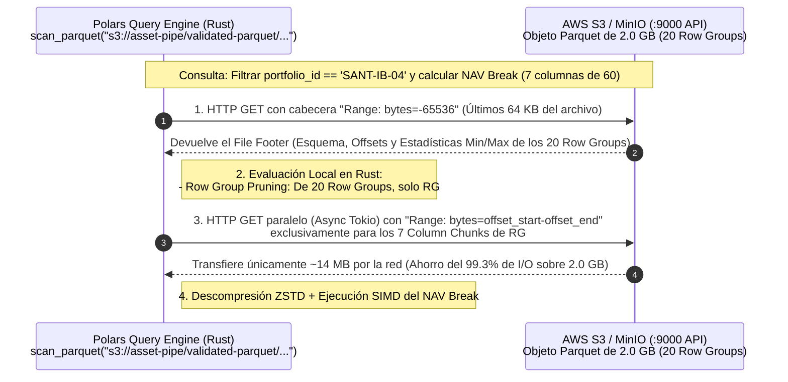

#### 3.4.1. Condición Algebraica de Descarte de Bloques (*Row-Group Pruning via Min/Max Statistics*)

En el *Footer* de cada archivo Parquet, cada *Column Chunk* $c$ perteneciente al *Row Group* $r$ almacena su cota inferior $m_{r,c} = \min_{i \in r} x_{i,c}$ y su cota superior $M_{r,c} = \max_{i \in r} x_{i,c}$.

Cuando el motor `Polars` evalúa un predicado de igualdad $x_c = v$ (por ejemplo, `valuation_date == '2026-11-09'` o `portfolio_id == 'BLK-PE-09'`) o un predicado de rango $x_c > v$ (por ejemplo, `custodian_reported_nav > 1000000.0`), aplica la **Ley de Exclusión de Intervalos**:

$$\text{Skip}(r, c, v) = \begin{cases} \text{TRUE (Descartar Bloque sin leer S3)}, & \text{si } v < m_{r,c} \lor v > M_{r,c} \\ \text{FALSE (Leer Column Chunk por HTTP Range)}, & \text{si } m_{r,c} \le v \le M_{r,c} \end{cases}$$

Si al escribir los archivos Parquet en `s3://asset-pipe/validated-parquet/` ordenamos previamente el lote por `(portfolio_id, isin)` antes de invocar `.write_parquet(statistics=True)`, garantizamos que los intervalos $[m_{r,c}, M_{r,c}]$ de distintos *Row Groups* sean disjuntos ($(m_{r_1,c}, M_{r_1,c}) \cap (m_{r_2,c}, M_{r_2,c}) = \emptyset$). Esto convierte las estadísticas `Min/Max` de Parquet en un **Índice Clusterizado Gratuito (*Zone Map Index*)** que permite saltar directamente al bloque exacto dentro de `AWS S3`.

#### 3.4.2. Filtros de Bloom (*Split Block Bloom Filters*) para Búsquedas Puntuales de `ISIN`

¿Qué ocurre cuando un analista utiliza el buscador de la Consola Financiera (`:3000`) para localizar un único código `ISIN` (`US5949181045`) dentro de un archivo ordenado por cartera, donde todos los *Row Groups* tienen como `min_isin = 'AU000000...'` y `max_isin = 'ZW000000...'`? En ese escenario, el intervalo `[min, max]` abarca todo el alfabeto y no puede descartar bloques por sí solo.

La especificación moderna de `Apache Parquet` resuelve este caso integrando **Split Block Bloom Filters (SBBF)** en las cabeceras de cada *Column Chunk*. Un Filtro de Bloom es una estructura de datos probabilística compacta de $m$ bits con $k$ funciones *hash* independientes ($h_1, \dots, h_k$, basadas en `xxHash64`) que cumple dos propiedades matemáticas estrictas:
1. **Cero Falsos Negativos ($\text{False Negative Rate} \equiv 0$):** Si $h_j(\text{ISIN}) = 0$ para algún $j \in \{1, \dots, k\}$, el código `ISIN` **no existe con certeza absoluta ($100\%$)** en ese *Row Group*, y el bloque entero se salta sin descargar la columna de datos.
2. **Tasa de Falsos Positivos Acotada ($p_{\text{fp}}$):** Para $n$ elementos distintos insertados en un vector de $m$ bits con el número óptimo de funciones hash $k = \frac{m}{n} \ln 2$, la probabilidad de falso positivo es:

$$p_{\text{fp}} \approx \left( 1 - e^{-\frac{k \cdot n}{m}} \right)^k = \left( \frac{1}{2} \right)^{\frac{m}{n} \ln 2} \approx (0.6185)^{\frac{m}{n}}$$

Asignando apenas $10\text{ bits}$ por `ISIN` único ($m/n = 10$), la tasa de falsos positivos cae por debajo del $1\%$ ($p_{\text{fp}} \approx 0.008$), permitiendo descartar el $99\%$ de los bloques irrelevantes en S3 en búsquedas de alta cardinalidad.

---

### 3.5. Diseño de Ingeniería del Adaptador `S3ParquetAdapter` en `ASSET-PIPE`

En la capa de infraestructura de `ASSET-PIPE` (`src/infrastructure/s3_parquet_adapter.py`), la interacción con `AWS S3` y `MinIO` se rige por cinco reglas de producción bancaria:

1. **Paridad Absoluta Cloud / Local mediante `endpoint_url`:** El adaptador utiliza exactamente el mismo cliente `boto3` / `s3fs` y las mismas opciones de almacenamiento de `Polars` (`storage_options`) tanto en desarrollo local como en producción en AWS. En el entorno Docker Compose local, apunta a `http://minio:9000` (y expone la consola auditable en `http://localhost:9001` con credenciales `admin` / `assetpipe2026`); en producción en AWS, basta con omitir el `endpoint_url` personalizado y delegar la autenticación a roles IAM (`IAM Roles for Service Accounts - IRSA`).
2. **Calibración de Tamaño de *Row Group* y Estadísticas Completas:** Al persistir lotes validados en `s3://asset-pipe/validated-parquet/`, el escritor fuerza la generación de estadísticas de página y de bloque (`statistics=True`), activa la compresión `ZSTD` y dimensiona los *Row Groups* para evitar el problema de los archivos diminutos (*Small File Problem*).
3. **Escritura Atómica y Nomenclatura Determinista:** Cada archivo escrito en `validated-parquet/` o en `quarantine/` incorpora en su clave el identificador del lote y la marca temporal UTC, garantizando idempotencia ante reintentos de red.
4. **Prohibición de Descarga Temporal a Disco Local (`/tmp` Bypass):** Cuando `Polars` ejecuta la reconciliación sobre `s3://asset-pipe/validated-parquet/`, no descarga el archivo `.parquet` completo al sistema de archivos del contenedor Docker para luego abrirlo; transmite los fragmentos directamente desde el *socket* HTTP de S3/MinIO hacia los buffers de memoria `Apache Arrow` en Rust.
5. **Trazabilidad Directa desde la Consola Ejecutiva (`:3000` $\to$ `:9001`):** La cabecera superior de la consola financiera en `http://localhost:3000` incluye un botón de acción directa (**`Open AWS S3 Lake (:9001)`**) con un *tooltip* informativo que muestra las credenciales de auditoría (`admin` / `assetpipe2026`), permitiendo a cualquier auditor, ingeniero o reclutador verificar visualmente en dos clics cómo los objetos `.parquet` aparecen en `validated-parquet/` y cómo los lotes corruptos quedan aislados en `quarantine/`.

---

### 3.6. Glosario Técnico del Módulo 3

* **Bloom Filter (Filtro de Bloom):** Estructura de datos probabilística basada en arreglos de bits y funciones *hash* rápidas (`xxHash64`) integrada en los metadatos de `Apache Parquet`. Permite comprobar en microsegundos si un valor específico (como un código `ISIN`) no pertenece a un bloque de datos con una tasa de falsos negativos exactamente igual a cero.
* **Byte-Range Request (Petición HTTP de Rango de Bytes - RFC 9110):** Mecanismo del protocolo HTTP/1.1 y HTTP/2 mediante la cabecera `Range: bytes=start-end` que permite a un cliente como `Polars` solicitar a `AWS S3` o `MinIO` únicamente una rodaja específica de bytes de un objeto (por ejemplo, el *Footer* final o un único *Column Chunk*) sin transferir el archivo completo.
* **Column Chunk (Fragmento Columnar):** Región física contigua dentro de un *Row Group* de un archivo `Apache Parquet` que almacena todos los valores de una única columna para ese subconjunto de filas, comprimidos y codificados de forma homogénea.
* **Data Page & Dictionary Page (Página de Datos y Página de Diccionario):** Unidad mínima e indivisible de compresión y codificación dentro de un *Column Chunk* de Parquet. La *Dictionary Page* almacena el catálogo de valores únicos de esa columna, mientras que las *Data Pages* almacenan los índices enteros empaquetados que referencian a dicho diccionario.
* **Definition Level & Repetition Level (Niveles de Definición y Repetición):** Algoritmo introducido por el artículo *Dremel* de Google e implementado en `Apache Parquet` para codificar de forma columnar tanto valores nulos (*Definition Level*) como estructuras profundamente anidadas de listas y mapas (*Repetition Level*) sin perder la reconstrucción exacta del registro original.
* **Flat Namespace (Espacio de Nombres Plano):** Arquitectura de almacenamiento de objetos (`AWS S3`, `MinIO`, `GCS`) en la que no existen directorios ni subcarpetas físicas reales en disco; cada objeto se indexa en una tabla *hash* distribuida global mediante su clave completa (`Key`), y el carácter `/` actúa únicamente como un delimitador visual en las consolas de usuario.
* **Hive-Style Partitioning (Particionamiento Estilo Hive):** Convención de organización de claves en un Data Lake donde los valores de las columnas de filtrado más frecuentes se codifican como prefijos `clave=valor/` en la ruta del objeto (por ejemplo, `s3://asset-pipe/validated-parquet/valuation_date=2026-11-09/batch.parquet`), permitiendo al motor de consultas descartar prefijos completos antes incluso de leer los *Footers* de los archivos Parquet.
* **MinIO:** Servidor de almacenamiento de objetos de alto rendimiento, nativo de contenedores y escrito en Go, que implementa de forma 100% compatible la API `Amazon S3 v4`. En `ASSET-PIPE` proporciona un Data Lake S3 local idéntico a producción accesible vía API en `:9000` y vía consola web en `:9001`.
* **PAX (*Partition Attributes Across*):** Modelo de diseño físico de almacenamiento en disco en el que una tabla relacional se divide primero horizontalmente en épocas o grupos de filas (*Row Groups*) y luego verticalmente por atributos (*Column Chunks*) dentro de cada grupo, combinando la localidad de registro con la eficiencia de lectura columnar.
* **RLE (*Run-Length Encoding*) & Bit-Packing:** Par de técnicas de codificación sin pérdida utilizadas por `Apache Parquet`. *RLE* reemplaza secuencias de valores idénticos consecutivos por el par `(valor, número_de_repeticiones)`, mientras que *Bit-Packing* almacena enteros pequeños utilizando exactamente el número mínimo de bits $\lceil \log_2(\text{max\_val}) \rceil$ en lugar de palabras completas de $32$ o $64\text{ bits}$.
* **Row Group (Grupo de Filas):** Partición horizontal de un archivo `Apache Parquet` (habitualmente de entre $100,000$ y $1,000,000$ de filas) que agrupa un conjunto completo de *Column Chunks* y mantiene estadísticas `min/max` propias para habilitar la poda de lectura y la ejecución paralela multihilo.
* **Small File Problem (Problema de los Archivos Pequeños):** Degradación severa de rendimiento en Data Lakes que ocurre cuando millones de registros se escriben fragmentados en miles de archivos de pocos kilobytes en lugar de agruparse en bloques de $64\text{ MB} - 256\text{ MB}$, provocando que la latencia de negociación de cabeceras HTTP (`TCP/TLS Handshake` y llamadas `LIST/GET` a S3) supere el tiempo real de transferencia de datos.
* **Strong Read-After-Write Consistency (Consistencia Fuerte de Lectura tras Escritura):** Garantía formal del sistema de almacenamiento distribuido según la cual, inmediatamente después de recibir la confirmación `HTTP 200 OK` de la escritura (`PUT`) o borrado (`DELETE`) de un objeto, cualquier lectura posterior (`GET` o `LIST`) desde cualquier proceso o nodo observará de forma determinista el nuevo estado sin retrasos de propagación.
* **Thrift Metadata Header:** Formato de serialización binaria compacta (originalmente desarrollado en Facebook y mantenido por Apache) utilizado por `Apache Parquet` para codificar la estructura del esquema, los tipos lógicos, las ubicaciones de los *Row Groups* y las estadísticas `min/max` dentro del *Footer* del archivo.
* **Zone Map (Mapa de Zonas / Estadísticas Min-Max):** Índice ligero mantenido en los metadatos de cada *Row Group* y *Data Page* de Parquet que registra el valor mínimo, el valor máximo y el recuento de nulos de cada columna en ese bloque, permitiendo al motor de consultas saltar bloques enteros mediante evaluación algebraica de intervalos.
* **ZSTD (*Zstandard*):** Algoritmo de compresión de datos sin pérdida en tiempo real desarrollado por Yann Collet en Meta (RFC 8878), que combina una etapa de coincidencia de diccionarios tipo LZ77 con codificación de entropía mediante *Finite State Entropy* (`FSE` / `tANS`) y codificación *Huffman*, ofreciendo ratios de compresión superiores a `GZIP` con velocidades de descompresión cercanas a `Snappy`.


## Módulo 4: Contratos de Datos en Origen (`Pydantic v2` Core en Rust) y Tolerancia a *Schema Drift*

### 4.1. La Patología del *Schema Drift* y la Corrupción Silenciosa en Feeds de Custodios Bancarios

En la operación diaria de una plataforma de activos institucionales, el punto de mayor fragilidad no reside en la aritmética del motor de cálculo, sino en la frontera de ingesta de datos externos. Una gestora global recibe diariamente archivos de posiciones, precios y tipos de cambio procedentes de múltiples entidades depositarias y proveedores de datos de mercado (*State Street, BNY Mellon, J.P. Morgan, Santander Securities Services, Bloomberg Data License, Refinitiv*).

En ausencia de un cortafuegos formal en origen, los pipelines de datos sufren dos patologías crónicas que comprometen la integridad contable del Valor Liquidativo (NAV):

1. **Deriva de Esquema (*Schema Drift*):** Un banco custodio actualiza su versión de software de exportación durante el fin de semana y añade tres columnas nuevas (`settlement_location_bic`, `miFID_asset_class`, `collateral_haircut_pct`), cambia el formato de fecha de `YYYY-MM-DD` a `DD/MM/YYYY`, o renombra sutilmente un campo opcional. En arquitecturas rígidas tradicionales, esto provoca la caída catastrófica del proceso nocturno a las 03:00 AM; en arquitecturas laxas sin validación, desplaza las columnas o inserta valores `NULL` masivos sin emitir alerta.
2. **Corrupción Silenciosa de Dominio (*Silent Data Corruption*):** Un archivo supera las comprobaciones sintácticas básicas (es un CSV o Parquet legible y las columnas numéricas contienen flotantes), pero transporta veneno semántico:
   * Códigos `ISIN` con errores tipográficos de transmisión o truncados a $10$ caracteres.
   * Códigos de divisa obsoletos o no estándar (como `$` o `EURO` en lugar del código `ISO-4217` `EUR`, o `GBp` [peniques esterlinos] mezclados sin factor de escala con `GBP` [libras esterlinas]).
   * Valores especiales del estándar de coma flotante **IEEE 754** (`NaN`, `+Infinity`, `-Infinity`) generados por una división entre cero en el sistema de origen del proveedor. Si un solo valor `NaN` atraviesa la frontera y entra en una suma agregada de cartera ($\sum_{i} \text{NAV}_i$), la propiedad absorbente del `NaN` ($\forall x \in \mathbb{R}, \, x + \text{NaN} = \text{NaN}$) destruye el cálculo del NAV de todo el fondo de inversión.

Para erradicar ambas patologías desde la raíz, **`ASSET-PIPE`** implementa el paradigma de **Contratos de Datos Ejecutables en Origen (*Executable Data Contracts at the Edge*)** utilizando **`Pydantic v2`** (cuyo motor interno `pydantic-core` está compilado íntegramente en **Rust**).

---

### 4.2. Arquitectura Interna de `Pydantic v2` (`pydantic-core` en Rust) frente a Validadores en Python Puro

En `Pydantic v1`, `Marshmallow` o validadores artesanales escritos en Python puro, validar un lote de cientos de miles de posiciones financieras implicaba instanciar diccionarios, ejecutar bucles `for` interpretados en `CPython`, capturar excepciones en bloques `try/except` costosos e invocar expresiones regulares compiladas en Python fila por fila. Esto convertía la validación en un cuello de botella entre $20\times$ y $50\times$ más lento que el propio cálculo del NAV.

`Pydantic v2` rediseña por completo esta arquitectura separando la definición declarativa en Python de la ejecución física en Rust:

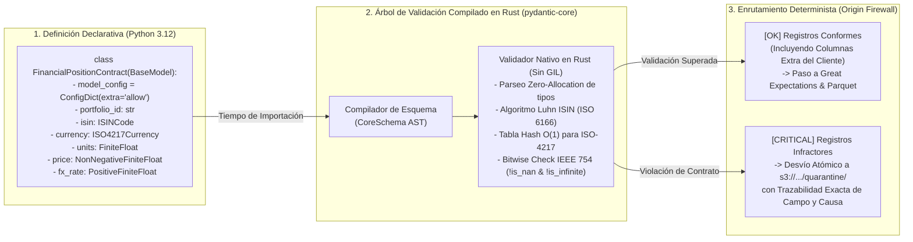

#### Ventajas Arquitectónicas de `pydantic-core` en `ASSET-PIPE`:
1. **Compilación Anticipada del Árbol de Validación (*Ahead-of-Time Schema Compilation*):** Cuando se define la clase `FinancialPositionContract`, `Pydantic v2` compila las anotaciones de tipos y las restricciones (`Field(gt=0, allow_inf_nan=False)`) en un árbol de validación estático en Rust. Durante la ingesta del lote, el flujo de datos entra directamente en el código máquina de Rust sin cruzar de vuelta al intérprete de Python por cada atributo.
2. **Complejidad $O(1)$ en Catálogos Estándar:** Las validaciones contra catálogos cerrados (como los códigos de país `ISO-3166-1 alpha-2` del prefijo `ISIN` o las divisas activas `ISO-4217`) se evalúan mediante tablas *hash* estáticas en memoria caché L1 en tiempo constante $O(1)$.
3. **Estructuración Detallada de Errores Forenses:** Cuando un registro falla múltiples reglas simultáneamente (por ejemplo, tiene un `ISIN` con dígito de control erróneo **y** un tipo de cambio negativo), `pydantic-core` no aborta en el primer fallo a ciegas; recopila el vector completo de infracciones (`loc`, `msg`, `type`, `input_value`) para construir el manifiesto forense JSON en `s3://asset-pipe/quarantine/`.

---

### 4.3. Formalización Matemática y Algorítmica de las Reglas Léxicas Financieras

Un contrato de datos institucional no puede conformarse con declarar `isin: str` y `currency: str`. Debe incorporar las invariantes matemáticas de los estándares internacionales **ISO 6166**, **ISO 4217** e **IEEE 754**.

#### 4.3.1. Validación Estructural y Algoritmo de *Luhn* Base-10 para Códigos `ISIN` (Norma ISO 6166)

Todo instrumento financiero cotizado o registrado en cámaras de compensación internacionales (*Euroclear, Clearstream, DTCC*) se identifica mediante un código **ISIN (*International Securities Identification Number*)** de exactamente $12$ caracteres:

$$\text{ISIN} = c_1 c_2 \, a_1 a_2 a_3 a_4 a_5 a_6 a_7 a_8 a_9 \, d_{12}$$

Donde la estructura posicional obedece tres leyes estrictas:
1. **Prefijo Jurisdiccional ($c_1 c_2$):** Dos letras mayúsculas ASCII (`[A-Z]{2}`) correspondientes al código de país de la agencia numeradora nacional según `ISO-3166-1 alpha-2` (por ejemplo, `US`, `ES`, `GB`, `DE`, `FR`, `LU`, `IE`, o el prefijo supranacional `XS` utilizado para Eurobonos liquidados en Euroclear/Clearstream).
2. **Identificador Nacional (`NSIN` — $a_1 \dots a_9$):** Nueve caracteres alfanuméricos en mayúsculas (`[A-Z0-9]{9}`) que contienen el identificador nacional del valor (como el código `CUSIP` en Estados Unidos/Canadá o el código `SEDOL` en el Reino Unido rellenado con ceros a la izquierda).
3. **Dígito de Control Criptográfico Ligero ($d_{12} \in \{0, \dots, 9\}$):** Un único dígito numérico calculado mediante el algoritmo **Módulo 10 de Doble-Suma-Dígito (*Luhn Mod-10 Algorithm*)** que detecta el $100\%$ de los errores de un solo carácter y casi la totalidad de las transposiciones de caracteres adyacentes:

**Formulación Matemática del Validador `ISIN` en `ASSET-PIPE`:**
* **Paso 1 (Sustitución Alfabética Base-36):** Cada letra $L \in \{\text{'A'}, \dots, \text{'Z'}\}$ en las primeras $11$ posiciones se sustituye por su representación numérica de dos dígitos según la función biyectiva:
  $$\phi(x) = \begin{cases} \text{int}(x), & \text{si } x \in \{\text{'0'}, \dots, \text{'9'}\} \\ \text{ASCII}(x) - 55, & \text{si } x \in \{\text{'A'}, \dots, \text{'Z'}\} \quad (\text{donde } \phi(\text{'A'}) = 10, \phi(\text{'B'}) = 11, \dots, \phi(\text{'Z'}) = 35) \end{cases}$$
* **Paso 2 (Expansión Decimal y Ponderación Alterna):** Al concatenar los dígitos resultantes de los primeros $11$ caracteres junto con el dígito de control $d_{12}$, se obtiene una secuencia de dígitos individuales $u_1, u_2, \dots, u_m$ (con $u_j \in \{0, \dots, 9\}$ y $u_m = d_{12}$). Recorriendo la secuencia de derecha a izquierda (donde $u_m$ ocupa el índice relativo $k = 1$), cada dígito se multiplica por un peso alterno $w_k \in \{1, 2\}$:
  $$w_k = \begin{cases} 1, & \text{si } k \text{ es impar } (k = 1, 3, 5, \dots) \\ 2, & \text{si } k \text{ es par } (k = 2, 4, 6, \dots) \end{cases}$$
* **Paso 3 (Suma Digital de Luhn y Congruencia Módulo 10):** Para cada producto $p_k = w_k \cdot u_{m - k + 1}$, se suman sus dígitos individuales en base $10$, lo cual equivale algebraicamente a $\psi(p_k) = \lfloor p_k / 10 \rfloor + (p_k \bmod 10)$. El código `ISIN` es matemáticamente válido si y solo si:

$$\left( \sum_{k=1}^{m} \left( \left\lfloor \frac{w_k \cdot u_{m - k + 1}}{10} \right\rfloor + \left( (w_k \cdot u_{m - k + 1}) \bmod 10 \right) \right) \right) \equiv 0 \pmod{10}$$

En `ASSET-PIPE`, el contrato `FinancialPositionContract` verifica tanto la expresión regular estructural `^[A-Z]{2}[A-Z0-9]{9}[0-9]$` como la invariante modular anterior, bloqueando de inmediato cualquier código `ISIN` sintácticamente parecido pero contablemente falso.

#### 4.3.2. Erradicación en Frontera de Anomalías IEEE 754 (`NaN`, `+Inf`, `-Inf`) y Dominios de Signo

En la norma **IEEE 754** de coma flotante de doble precisión (`Float64`: $1\text{ bit}$ de signo, $11\text{ bits}$ de exponente $E$ y $52\text{ bits}$ de mantisa o fracción $M$), cuando todos los bits del exponente son unos ($E = \text{0x7FF} = 2047_{10}$), el número deja de representar una magnitud real $\mathbb{R}$:
* Si $E = 2047 \land M = 0 \implies \pm \infty$ (`Infinity` / `-Infinity`).
* Si $E = 2047 \land M \neq 0 \implies \text{NaN}$ (*Not a Number*, con la peligrosa propiedad de que $\text{NaN} \neq \text{NaN}$).

En Python estándar y en la configuración por defecto de muchos serializadores JSON/Parquet, `float('nan')` y `float('inf')` son aceptados silenciosamente como valores válidos de tipo `float`. En `ASSET-PIPE`, todas las magnitudes numéricas del contrato fuerzan la restricción estricta **`allow_inf_nan=False`** combinada con las cotas financieras de dominio:

$$\begin{aligned}
\text{Units}_{i,t} &\in \mathbb{R} \setminus \{-\infty, +\infty, \text{NaN}\} && (\text{Permite posiciones largas } > 0, \text{ cortas } < 0 \text{ y cerradas } = 0) \\
\text{Price}_{i,t} &\in [0, +\infty) \subset \mathbb{R} && (\text{Precio no negativo finito: } 0 \le P_{i,t} < +\infty) \\
\text{FX\_Rate}_{c \to b, t} &\in (0, +\infty) \subset \mathbb{R} && (\text{Tipo de cambio estrictamente positivo finito: } 0 < \text{FX}_{c \to b, t} < +\infty) \\
\text{Custodian\_NAV}_{i,t} &\in \mathbb{R} \setminus \{-\infty, +\infty, \text{NaN}\} && (\text{Valor liquidativo finito reportado por el depositario})
\end{aligned}$$

---

### 4.4. Polimorfismo de Esquemas y Adaptabilidad Empresarial mediante `ConfigDict(extra="allow")`

Uno de los dilemas arquitectónicos más importantes al construir un producto Open Source llamado a sustituir herramientas corporativas como Duco o AutoRek es cómo equilibrar la **rigidez del contrato contable** con la **flexibilidad ante esquemas heterogéneos de clientes reales**.

Supongamos que tres clientes institucionales distintos conectan sus bases de datos o sus extractos S3 a `ASSET-PIPE`:
* **Cliente A (Gestora de Renta Variable):** Envía únicamente las $8$ columnas canónicas requeridas para la ecuación del NAV (`position_id`, `portfolio_id`, `isin`, `valuation_date`, `currency`, `units`, `price`, `fx_rate`, `custodian_reported_nav`).
* **Cliente B (Fondo de Capital Privado / Crédito estilo Blackstone):** Envía las $8$ columnas canónicas **más $6$ columnas propietarias** críticas para su auditoría interna (`deal_sponsor_code`, `seniority_tranche`, `internal_rating`, `bloomberg_figi`, `custodian_bank_bic`, `tax_jurisdiction`).
* **Cliente C (Mesa de Tesorería Bancaria estilo Santander):** Envía una tabla con nombres de columnas parcialmente distintos o con metadatos regulatorios adicionales (`basel_iii_rwa_weight`, `counterparty_lei`, `desk_trader_id`).

Si diseñásemos el contrato de `Pydantic v2` con `extra="forbid"`, el pipeline rechazaría el $100\%$ de los lotes del Cliente B y del Cliente C por incluir columnas informativas adicionales. Si lo diseñásemos con `extra="ignore"`, `Pydantic` descartaría silenciosamente las columnas `deal_sponsor_code` o `counterparty_lei`, provocando pérdida de metadatos valiosos cuando el cliente inspeccione sus posiciones en el Data Warehouse (`:4213`) o en los archivos Parquet validados (`:9001`).

#### Solución Arquitectónica en `ASSET-PIPE`: Contrato Canónico Nucleado + `ConfigDict(extra="allow")` + Mapeador de Alias

`ASSET-PIPE` resuelve este problema mediante una arquitectura de contrato en dos niveles dentro de `src/domain/contracts.py`:

1. **Núcleo Canónico Innegociable (*Strict Canonical Core*):** Los campos que intervienen en la identidad de la posición (`portfolio_id`, `isin`, `valuation_date`, `currency`) y en la ecuación algebraica del Valor Liquidativo (`units`, `price`, `fx_rate`, `custodian_reported_nav`) son sometidos a validación implacable en Rust (`allow_inf_nan=False`, validación `ISIN`, catálogo `ISO-4217`). Si cualquiera de estos campos nucleares falta o viola su dominio matemático, el registro va directamente a `quarantine/`.
2. **Pasarela Polimórfica de Metadatos (`extra="allow"` + Saneamiento de Extras):** Mediante `model_config = ConfigDict(extra="allow", str_strip_whitespace=True)`, cualquier columna adicional enviada por el cliente se preserva íntegramente en el diccionario `model_extra` del contrato validado, se sanea para asegurar que no contenga valores `NaN`/`Infinity` infiltrados y se propaga hasta el archivo `Apache Parquet` en `validated-parquet/` y el almacén analítico (`DuckDB` / `Snowflake`).

#### Tabla 4.1: Comportamiento Comparativo de Estrategias de Manejo de Esquemas en Ingesta Financiera

| Escenario de Entrada del Cliente | Esquema Rígido (`extra="forbid"`) | Esquema Recortado (`extra="ignore"`) | Sin Contrato (`Pandas` / `CSV` Directo) | **Arquitectura `ASSET-PIPE` (`Pydantic v2` Core + `extra="allow"` + Alias Map)** |
| :--- | :--- | :--- | :--- | :--- |
| **Falta una columna nuclear (`price` o `isin` ausente)** | `[OK]` Rechazado | `[OK]` Rechazado | `[CRITICAL]` Falla en mitad del cálculo con `KeyError` | **`[OK]` Interceptado en origen y enviado a `quarantine/` con diagnóstico exacto** |
| **Columna nuclear corrupta (`isin="INVALID"`, `price=NaN`)** | `[OK]` Rechazado | `[OK]` Rechazado | `[CRITICAL]` Contamina el NAV de toda la cartera (`NaN`) | **`[OK]` Interceptado en microsegundos por `pydantic-core` (Rust) y aislado** |
| **El cliente añade $5$ columnas propietarias (`desk_id`, `lei`, `figi`...)** | `[CRITICAL]` **Rompe el pipeline** (Falso positivo por exceso de celo) | `[WARN]` **Pérdida silenciosa de datos:** Borra las $5$ columnas del cliente | `[OK]` Las conserva, pero sin validar tipos ni nulos | **`[OK]` Valida el núcleo al 100% y preserva las $5$ columnas extra hasta Parquet/Warehouse** |
| **Espacios en blanco parásitos (`currency = " USD "` o `isin = " US0378331005 "`)** | `[WARN]` Rechaza un dato recuperable si no se limpia antes | `[WARN]` Rechaza un dato recuperable | `[CRITICAL]` Rompe todos los `JOIN` y filtros posteriores | **`[OK]` Normalización automática (`str_strip_whitespace=True` + `to_upper`) antes de validar** |

---

### 4.5. Integración Híbrida de Alto Rendimiento: `Polars` Vectorized Pre-Check + `Pydantic v2` Forensics

Una pregunta habitual en entrevistas de nivel *Staff Data Engineer* es: *"Si `Polars` procesa en columnar y `Pydantic v2` valida estructuras de registros, ¿cómo evitamos que el paso por `Pydantic v2` degrade el rendimiento cuando llegan lotes de millones de filas?"*

En `ASSET-PIPE`, el servicio de ingesta (`src/application/ingestion_service.py`) implementa un **Patrón de Validación Híbrida en Dos Fases (*Two-Stage Vectorized-to-Forensic Validation*)**:

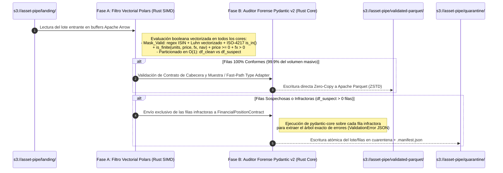

1. **Fase A (Cribado Vectorizado en `Polars`):** Para los millones de filas que cumplen el contrato, `Polars` evalúa las máscaras booleanas equivalentes en paralelo SIMD (`is_finite()`, `.str.contains()`, `.is_in(ISO_4217_SET)`), separando en milisegundos el subconjunto limpio (`df_clean`) del subconjunto sospechoso (`df_suspect`).
2. **Fase B (Inspección Forense y Validación Estricta con `Pydantic v2`):** Los lotes o registros de tamaño estándar y la totalidad de las filas capturadas en `df_suspect` pasan por el modelo `FinancialPositionContract` de `Pydantic v2`. De este modo, combinamos el rendimiento de varios gigabytes por segundo en el camino feliz (*Happy Path*) con la precisión quirúrgica de `Pydantic v2` para generar reportes de auditoría forense detallados campo por campo cuando aparece una anomalía.

---

### 4.6. Especificación Formal del Contrato Canónico en `ASSET-PIPE`

La siguiente tabla documenta la especificación exacta de los atributos que componen la entidad contractual `FinancialPositionContract` en la capa de dominio de `ASSET-PIPE` (`src/domain/contracts.py`):

#### Tabla 4.2: Diccionario Contractual de Atributos Canónicos (`FinancialPositionContract`)

| Nombre del Atributo Canónico | Tipo Físico (`Pydantic` / `Arrow`) | Restricciones de Dominio e Invariantes en Origen | Comportamiento ante Incumplimiento |
| :--- | :--- | :--- | :--- |
| **`position_id`** | `str` (`Utf8View`) | Obligatorio, longitud $\in [3, 64]$, sin caracteres de control invisibles | Enrutamiento a `quarantine/` (`MISSING_OR_INVALID_ID`) |
| **`portfolio_id`** | `str` (`Utf8View`) | Obligatorio, normalizado a mayúsculas, longitud $\in [2, 32]$ (ej. `BLK-ALADDIN-01`, `SANT-AM-EU`) | Enrutamiento a `quarantine/` (`INVALID_PORTFOLIO_CODE`) |
| **`isin`** | `str` (`FixedSizeBinary[12]` / `Utf8View`) | Norma **ISO 6166**: $12$ caracteres `^[A-Z]{2}[A-Z0-9]{9}[0-9]$`, prefijo de país válido + **Dígito de Control Luhn Mod-10** | Enrutamiento a `quarantine/` (`INVALID_ISIN_FORMAT` o `ISIN_LUHN_CHECKSUM_FAILED`) |
| **`valuation_date`** | `date` (`Date32`) | Fecha válida en formato `ISO-8601` (`YYYY-MM-DD`); no puede ser futura respecto al reloj de corte de liquidación | Enrutamiento a `quarantine/` (`INVALID_VALUATION_DATE`) |
| **`currency`** | `str` (`Dictionary<UInt8, Utf8>`) | Norma **ISO-4217**: $3$ letras mayúsculas pertenecientes al conjunto oficial de divisas institucionales (`USD`, `EUR`, `GBP`, `JPY`, `CHF`, `CAD`, `AUD`, `SGD`, `HKD`...) | Enrutamiento a `quarantine/` (`UNSUPPORTED_ISO4217_CURRENCY`) |
| **`units`** | `float` (`Float64`) | `allow_inf_nan=False`. Finito ($-\infty < Q < +\infty$). Permite valores negativos para posiciones cortas (*Short Sales*) | Enrutamiento a `quarantine/` (`NON_FINITE_UNITS_NAN_INF`) |
| **`price`** | `float` (`Float64`) | `allow_inf_nan=False`, `ge=0.0` ($0 \le P < +\infty$). Rechaza precios negativos en instrumentos estándar | Enrutamiento a `quarantine/` (`NEGATIVE_OR_NAN_MARKET_PRICE`) |
| **`fx_rate`** | `float` (`Float64`) | `allow_inf_nan=False`, `gt=0.0` ($0 < \text{FX} < +\infty$). Si `currency == base_currency`, debe satisfacer $\|\text{FX} - 1.0\| \le 10^{-6}$ | Enrutamiento a `quarantine/` (`INVALID_OR_ZERO_FX_RATE`) |
| **`custodian_reported_nav`** | `float` (`Float64`) | `allow_inf_nan=False`. Valor liquidativo reportado por el banco depositario en la divisa base del fondo | Enrutamiento a `quarantine/` (`NON_FINITE_CUSTODIAN_NAV`) |
| **`*extra_client_fields`** | `Any` (Saneado) | Gobernado por `ConfigDict(extra="allow")`. Cualquier columna adicional del cliente se conserva siempre que no contenga `NaN`/`Inf` | Preservado automáticamente en `validated-parquet/` y en el Warehouse |

---

### 4.7. Glosario Técnico del Módulo 4

* **Ahead-of-Time (AoT) Schema Compilation (Compilación Anticipada de Esquema):** Técnica empleada por `Pydantic v2` mediante la cual la definición de una clase de modelo en Python se traduce una sola vez (en tiempo de carga del módulo) a una estructura de validación compilada en Rust (`SchemaValidator` en `pydantic-core`), eliminando la introspección dinámica repetitiva en tiempo de ejecución.
* **CUSIP & SEDOL:** Identificadores nacionales de valores financieros de $9$ y $7$ caracteres respectivamente, utilizados en Norteamérica (`CUSIP`) y el Reino Unido/Irlanda (`SEDOL`). Cuando se integran en el estándar global `ISIN` (`ISO 6166`), pasan a constituir el cuerpo central (`NSIN`) precedidos por el código de país (`US`, `CA`, `GB`, `IE`) y seguidos por el dígito de control de *Luhn*.
* **IEEE 754 Standard for Floating-Point Arithmetic:** Norma técnica internacional establecida por el IEEE que define la representación binaria en memoria de números en coma flotante (`Float32`, `Float64`), las reglas de redondeo y los valores centinela especiales (`+0.0`, `-0.0`, `+Infinity`, `-Infinity` y `NaN` [*Quiet NaN* / *Signaling NaN*]).
* **Luhn Mod-10 Algorithm (Algoritmo de Luhn Módulo 10):** Fórmula de suma de verificación (*checksum*) creada por el científico de IBM Hans Peter Luhn (Patente de EE. UU. 2,950,048) e incorporada en la norma `ISO 6166` (`ISIN`) y en la numeración de tarjetas bancarias (`ISO/IEC 7812`). Permite detectar de forma determinista cualquier error de transcripción de un dígito individual así como transposiciones de dígitos contiguos.
* **NaN Propagation (Propagación Absorbente de `NaN`):** Propiedad algebraica definida por la norma IEEE 754 según la cual cualquier operación aritmética ($+, -, \times, \div$) que tenga como operando al menos un valor `NaN` produce invariablemente otro `NaN` como resultado, contaminando en cadena agregaciones completas de bases de datos si no se bloquea en la ingesta.
* **NSIN (*National Securities Identifying Number*):** Subcadena de $9$ caracteres alfanuméricos situada en las posiciones $3$ a $11$ de un código `ISIN`, asignada por la agencia numeradora nacional del país emisor (como la *CNMV* en España, *WM Datenservice* en Alemania o *CUSIP Global Services* en EE. UU.).
* **Polymorphic Schema Validation (Validación Polimórfica de Esquemas):** Capacidad de un contrato de datos (implementada en `ASSET-PIPE` mediante `ConfigDict(extra="allow")`) para exigir una validación estricta e innegociable sobre el subconjunto de atributos canónicos del dominio mientras admite y propaga de forma transparente atributos adicionales específicos de cada cliente o fuente de datos.
* **pydantic-core:** Motor de validación y serialización de datos de bajo nivel escrito íntegramente en el lenguaje **Rust** que constituye el núcleo de ejecución de `Pydantic v2`. Proporciona mejoras de rendimiento de entre $5\times$ y $50\times$ respecto a `Pydantic v1` y garantiza seguridad de memoria sin bloqueos del GIL.
* **Schema Drift (Deriva de Esquema):** Fenómeno evolutivo frecuente en sistemas distribuidos en el cual el productor de una fuente de datos (por ejemplo, un banco custodio o un sistema ERP/OMS externo) añade, elimina, renombra o altera el tipo de dato de una o más columnas sin coordinación previa con los sistemas consumidores aguas abajo.
* **Silent Data Corruption (Corrupción Silenciosa de Datos):** Categoría crítica de fallo en ingeniería de datos en la que registros erróneos, truncados o semánticamente inválidos atraviesan el pipeline sin disparar excepciones de sistema, almacenándose en el Data Warehouse y distorsionando reportes financieros o modelos cuantitativos sin que los operadores sean conscientes del error.
* **TypeAdapter (Adaptador de Tipos de Pydantic v2):** Interfaz de alto rendimiento de `Pydantic v2` que permite validar y serializar listas masivas, diccionarios o estructuras de tipos arbitrarios directamente contra el motor `pydantic-core` en Rust sin necesidad de instanciar envoltorios de clases Python individuales cuando se opera en modo lote.

## Módulo 5: Auditoría Declarativa e Invariantes Contables con `Great Expectations` y Patrón *Dead-Letter Quarantine*

### 5.1. Límites de la Validación por Registro Individual y Necesidad de una Segunda Aduana Estadístico-Contable

En el Módulo 4 demostramos cómo `Pydantic v2` (`pydantic-core` en Rust) garantiza la validez léxica, sintáctica y de dominio de cada posición financiera considerada de forma aislada $r_i \in \mathcal{B}$ dentro de un lote entrante $\mathcal{B} = \{r_1, r_2, \dots, r_N\}$. Sin embargo, en la ingeniería de plataformas bancarias, **la validez individual de cada fila es condición necesaria pero jamás suficiente para certificar la validez contable de un lote completo**.

Formalmente, sea $\Psi_{\text{row}}(r_i) \in \{0, 1\}$ el predicado de validación individual ejecutado por `Pydantic v2`. Existen anomalías sistémicas catastróficas en las cuales el $100\%$ de las filas cumplen el contrato individual ($\forall i \in \{1, \dots, N\}, \, \Psi_{\text{row}}(r_i) = 1$), pero el lote $\mathcal{B}$ como conjunto matemático es corrupto e inadmisible en el Data Warehouse:

1. **Violación de Unicidad de Clave Compuesta (*Duplicate Primary Key Replay*):** Debido a un reintento defectuoso en el exportador del banco custodio, la posición de Apple Inc. (`US0378331005`) para el fondo `BLK-ALADDIN-01` en la fecha `2026-11-09` aparece duplicada dos veces dentro del mismo archivo. Individualmente, ambas filas tienen un `ISIN` válido, divisa `USD` válida y precios finitos positivos ($\Psi_{\text{row}}(r_k) = \Psi_{\text{row}}(r_j) = 1$). Si este lote entra en el motor de reconciliación, un `JOIN` o una agregación duplicará artificialmente el Valor Liquidativo ($\text{NAV}$) de esa posición en un $+100\%$.
2. **Truncamiento Parcial de Transmisión (*Truncated SFTP/S3 Drop*):** Un fondo institucional mantiene habitualmente entre $450$ y $500$ posiciones activas cada día, con un volumen de Activos Bajo Gestión (*Assets Under Management* o **AUM**) de $\$1,200\text{ millones}$. Un corte de red interrumpe la generación del archivo en origen tras escribir la fila $80$, cerrando limpiamente el archivo. Las $80$ filas son sintácticamente perfectas, pero falta el $84\%$ de la cartera.
3. **Invariante de Identidad Cambiaria en Divisa Base (*Base Currency FX Identity Violation*):** Una fila declara que la divisa local del activo coincide con la divisa base del fondo ($c_i = b_p = \text{'USD'}$), y reporta un tipo de cambio $\text{FX\_Rate} = 1.0850$ (que es un número positivo finito válido para el validador individual, pero matemáticamente imposible para el par $\text{USD} \to \text{USD}$, donde el tipo de cambio debe ser idénticamente $1.000000$).
4. **Deriva Estadística Extrema (*Distributional Drift & Fat-Finger Batch Errors*):** Un error de escala en el proveedor de precios multiplica por $100$ toda la columna de precios de renta fija (enviando precios en base $10,000$ en lugar de base $100$). Ningún precio es negativo ni `NaN`, pero la mediana de discrepancia del lote salta al $9,900\%$.

Para interceptar estas anomalías de conjunto antes de escribir en `s3://asset-pipe/validated-parquet/`, **`ASSET-PIPE`** implementa una **Segunda Aduana Declarativa de Invariantes de Lote** basada en el paradigma de **`Great Expectations` (*Expectation Suites*)** ejecutada de forma nativa y vectorizada sobre el lote en memoria (`src/domain/invariants.py`).

---

### 5.2. Formalización Algebraica de la Suite de Invariantes Financieros (`Expectation Suite`)

En `ASSET-PIPE`, un lote $\mathcal{B}$ solo recibe la certificación criptográfica de paso hacia la capa `validated-parquet/` si satisface simultáneamente cinco familias de expectativas formales $\mathcal{E} = \{E_1, E_2, E_3, E_4, E_5\}$:

#### 5.2.1. Invariante $E_1$: Unicidad Estricta de Clave Primaria Compuesta (`expect_compound_columns_to_be_unique`)

Definimos la tupla de identidad contable de cada registro $r_i \in \mathcal{B}$ como $k(r_i) = (\text{portfolio\_id}_i, \, \text{isin}_i, \, \text{valuation\_date}_i)$. La cardinalidad del conjunto de claves distintas debe coincidir exactamente con el número total de registros válidos del lote (o los registros duplicados deben ser aislados antes de la agregación):

$$E_1(\mathcal{B}) \iff \left| \left\{ (\text{portfolio\_id}_i, \, \text{isin}_i, \, \text{valuation\_date}_i) : r_i \in \mathcal{B} \right\} \right| == |\mathcal{B}|$$

Cualquier colisión $k(r_i) == k(r_j)$ para $i \neq j$ dispara inmediatamente la regla `COMPOUND_KEY_DUPLICATE_DETECTED`.

#### 5.2.2. Invariante $E_2$: Completitud Absoluta de Columnas Canónicas (`expect_column_values_to_not_be_null`)

Para todo atributo perteneciente al núcleo contable obligatorio $\mathcal{A}_{\text{core}} = \{\text{position\_id}, \text{portfolio\_id}, \text{isin}, \text{valuation\_date}, \text{currency}, \text{units}, \text{price}, \text{fx\_rate}, \text{custodian\_reported\_nav}\}$, el recuento de bits nulos en el *Validity Bitmap* de `Apache Arrow` debe ser idénticamente cero:

$$E_2(\mathcal{B}) \iff \sum_{a \in \mathcal{A}_{\text{core}}} \text{NullCount}(\mathcal{B}, a) == 0$$

#### 5.2.3. Invariante $E_3$: Coherencia Relacional Inter-Columna de Tipo de Cambio (`expect_column_pair_fx_identity`)

Para toda posición $r_i \in \mathcal{B}$ cuya divisa local coincida con la divisa base de consolidación ($b_p = \text{'USD'}$ por defecto), el factor de conversión cambiaria no puede desviarse de la unidad más allá de la precisión de máquina $\epsilon = 10^{-6}$:

$$E_3(\mathcal{B}) \iff \forall r_i \in \mathcal{B}, \quad \left( \text{currency}_i == b_p \implies \left| \text{fx\_rate}_i - 1.0 \right| \le 10^{-6} \right)$$

#### 5.2.4. Invariante $E_4$: Ecuación de Conservación Contable del Valor Liquidativo (`expect_nav_accounting_equation_to_hold`)

El corazón de la auditoría declarativa en `ASSET-PIPE` es la expectativa de conservación del Valor Liquidativo. Para cada posición $r_i$, el motor evalúa de forma vectorizada la discrepancia absoluta $\Delta \text{Break}_i$ y la discrepancia relativa en puntos básicos $\delta_{\text{bps}, i}$:

$$\Delta \text{Break}_i = \left( \text{units}_i \times \text{price}_i \times \text{fx\_rate}_i \right) - \text{custodian\_reported\_nav}_i$$

Esta expectativa clasifica el lote en dos niveles de acción operativa:
* **Nivel de Posición (`Position-Level Break Tagging`):** Si $|\Delta \text{Break}_i| > \tau_{\text{abs}}$ (donde el umbral contable estricto es $\tau_{\text{abs}} = \$0.01$ o $\delta_{\text{bps}, i} > 1.0\text{ bps}$), la posición **no se descarta a ciegas** si su esquema es válido, sino que se **etiqueta explícitamente como `[NAV-BREAK]`** para que aparezca iluminada en la tarjeta interactiva **`NAV & Schema Breaks`** de la Consola Financiera (`:3000`) y quede registrada en las vistas de auditoría del Data Warehouse (`:4213`).
* **Nivel de Lote Completo (`Batch-Level Circuit Breaker`):** Si la proporción de posiciones con descuadre masivo o corrupción estructural dentro de un lote supera el umbral crítico de catástrofe sistémica $\Theta_{\text{abort}}$ (por ejemplo, cuando el lote entero llega corrompido desde un feed externo), el disyuntor aborta la promoción del lote y lo desvía a cuarentena.

#### 5.2.5. Invariante $E_5$: Acotación Volumétrica y Suma de Control de Cartera (`expect_table_row_count_to_be_between` & `AUM Checksum`)

Todo lote válido debe satisfacer la cota de volumen no vacío $|\mathcal{B}| \in [N_{\min}, N_{\max}]$ (con $N_{\min} \ge 1$) y verificar que el Valor Liquidativo Agregado del lote sea un número real finito:

$$E_5(\mathcal{B}) \iff |\mathcal{B}| \ge 1 \;\land\; \left| \sum_{i=1}^{|\mathcal{B}|} \text{custodian\_reported\_nav}_i \right| < +\infty$$

---

### 5.3. Catálogo Maestro de Expectativas Declarativas en `ASSET-PIPE`

La siguiente tabla detalla la correspondencia exacta entre la nomenclatura estándar de **`Great Expectations`** implementada en `src/domain/invariants.py`, su evaluación vectorizada en `Polars / Arrow` y el código de auditoría emitido en caso de violación:

#### Tabla 5.1: Suite de Expectativas Declarativas Contables y Estructurales de `ASSET-PIPE`

| Identificador de Regla (`Expectation ID`) | Primitiva Declarativa (`Great Expectations Standard`) | Expresión Vectorizada Subyacente (`Polars Rust Kernel`) | Severidad Operativa y Destino del Registro / Lote |
| :--- | :--- | :--- | :--- |
| **`GX-01: PK_UNIQUENESS`** | `expect_compound_columns_to_be_unique(["portfolio_id", "isin", "valuation_date"])` | `pl.struct(["portfolio_id", "isin", "valuation_date"]).is_duplicated()` | **`[CRITICAL] QUARANTINE`:** Bloquea duplicados contables y los aísla en `s3://.../quarantine/` |
| **`GX-02: CORE_NOT_NULL`** | `expect_column_values_to_not_be_null(column)` $\forall c \in \mathcal{A}_{\text{core}}$ | `pl.any_horizontal(pl.col(CORE_COLS).is_null())` | **`[CRITICAL] QUARANTINE`:** Aísla cualquier fila con campos nucleares ausentes |
| **`GX-03: ISIN_ISO6166_REGEX`** | `expect_column_values_to_match_regex("isin", r"^[A-Z]{2}[A-Z0-9]{9}[0-9]$")` + `Luhn Mod-10` | `pl.col("isin").str.contains(...) & luhn_expr` | **`[CRITICAL] QUARANTINE`:** Rechaza identificadores de activos malformados o con dígito de control falso |
| **`GX-04: CURRENCY_ISO4217`** | `expect_column_values_to_be_in_set("currency", ISO_4217_ACTIVE_SET)` | `pl.col("currency").is_in(ISO_4217_SET)` | **`[CRITICAL] QUARANTINE`:** Bloquea códigos de moneda no estandarizados |
| **`GX-05: PRICE_NON_NEGATIVE`** | `expect_column_values_to_be_between("price", min_value=0.0, allow_inf_nan=False)` | `pl.col("price").is_finite() & (pl.col("price") >= 0.0)` | **`[CRITICAL] QUARANTINE`:** Intercepta precios negativos o valores `IEEE 754 NaN/Inf` |
| **`GX-06: FX_STRICT_POSITIVE`** | `expect_column_values_to_be_between("fx_rate", min_value=1e-9, allow_inf_nan=False)` | `pl.col("fx_rate").is_finite() & (pl.col("fx_rate") > 0.0)` | **`[CRITICAL] QUARANTINE`:** Intercepta tipos de cambio nulos, negativos o infinitos |
| **`GX-07: NAV_EQUATION_MATCH`** | `expect_column_pair_nav_discrepancy_within_tolerance(abs_tol=0.01, bps_tol=1.0)` | `((pl.col("units") * pl.col("price") * pl.col("fx_rate")) - pl.col("custodian_reported_nav")).abs() <= 0.01` | **`[NAV-BREAK] AUDIT FLAG`:** Persiste como posición auditada pero marcada con estado `NAV_BREAK` para triaje inmediato en `:3000` y `:4213` |

---

### 5.4. Arquitectura del Patrón *Circuit Breaker & Dead-Letter Quarantine* en `AWS S3 / MinIO`

Un principio innegociable de resiliencia en sistemas financieros de misión crítica es que **un registro corrupto jamás debe detener la liquidación de las posiciones sanas, pero tampoco debe mezclarse jamás con ellas**.

Para cumplir simultáneamente ambos objetivos, `ASSET-PIPE` implementa el patrón **Bifurcación Atómica con Cuarentena Forense (*Atomic Split & Dead-Letter Quarantine*)** sobre el Data Lake `AWS S3 / MinIO (:9001)`:

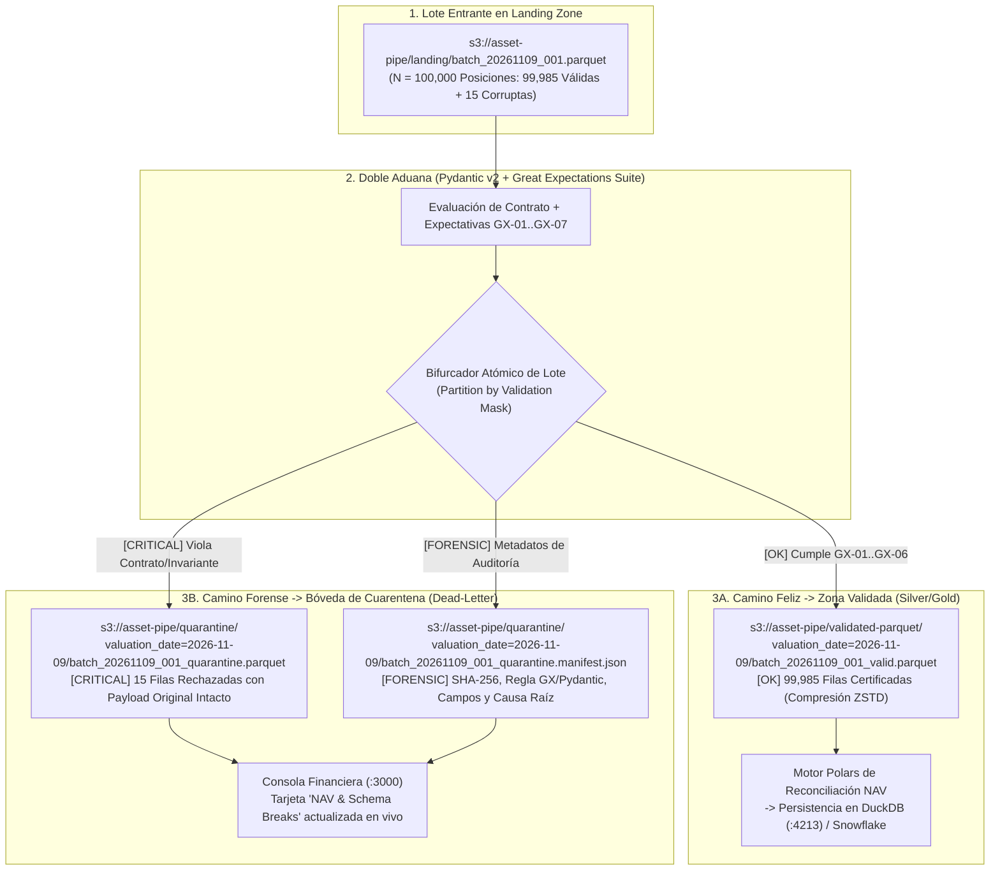

#### 5.4.1. Anatomía del Manifiesto Forense JSON (`.manifest.json`)

Cada vez que el disyuntor desvía registros hacia `s3://asset-pipe/quarantine/`, escribe un archivo Parquet con las filas infractoras exactas y genera un documento JSON estructurado de acompañamiento que responde a las cinco preguntas de una auditoría regulatoria bancaria (*Quién, Qué, Cuándo, Dónde y Por qué*):

```json
{
  "manifest_version": "1.0.0",
  "pipeline_engine": "ASSET-PIPE (Polars Rust + Pydantic v2 + GX Suite)",
  "batch_id": "BATCH-20261109-IBOR-001",
  "timestamp_utc": "2026-11-09T10:33:00Z",
  "source_object_uri": "s3://asset-pipe/landing/batch_20261109_001.parquet",
  "quarantine_parquet_uri": "s3://asset-pipe/quarantine/valuation_date=2026-11-09/batch_20261109_001_quarantine.parquet",
  "payload_sha256_checksum": "e3b0c44298fc1c149afbf4c8996fb92427ae41e4649b934ca495991b7852b855",
  "metrics": {
    "total_rows_received": 100000,
    "valid_rows_promoted": 99985,
    "quarantined_rows_isolated": 15,
    "rejection_rate_bps": 1.5
  },
  "violated_expectations_summary": [
    {
      "rule_id": "GX-03: ISIN_ISO6166_REGEX",
      "validator": "Pydantic v2 Core + Luhn Mod-10",
      "affected_rows_count": 9,
      "sample_position_ids": ["POS-000412", "POS-008911"],
      "diagnostic_message": "ISIN check digit failed Luhn Mod-10 congruence or invalid ISO-3166 prefix."
    },
    {
      "rule_id": "GX-05: PRICE_NON_NEGATIVE",
      "validator": "Great Expectations / Polars Vectorized Guard",
      "affected_rows_count": 6,
      "sample_position_ids": ["POS-014200", "POS-019882"],
      "diagnostic_message": "Detected negative market price (-14.25) or IEEE 754 NaN/Infinity payload."
    }
  ]
}
```

#### 5.4.2. Protocolo de Re-Ingesta Determinista (*Quarantine Replay & Recovery*)

El diseño del bucket `s3://asset-pipe/quarantine/` no es un cementerio pasivo de datos, sino una cola de recuperación activa (*Dead-Letter Replay Queue*). Tal como se documentará operativamente en nuestro Runbook `docs/runbooks/02-s3-quarantine-schema-drift-recovery.md`:
1. El equipo de ingeniería de datos o de operaciones de custodia inspecciona las filas aisladas directamente desde la tarjeta **`NAV & Schema Breaks`** de la Consola Ejecutiva (`:3000`) o descargando el manifiesto desde la consola web de `AWS S3 / MinIO (:9001)`.
2. Una vez corregido el error en origen por el custodio (por ejemplo, sustituido el código `ISIN` erróneo o rectificado el precio `NaN`), el lote reparado se deposita de nuevo en `landing/`.
3. Gracias a la idempotencia por clave compuesta $(\text{portfolio\_id}, \text{isin}, \text{valuation\_date})$ del motor de persistencia en `DuckDB / Snowflake`, la re-ingesta actualiza limpiamente las posiciones pendientes sin duplicar las $99,985$ posiciones que ya habían sido conciliadas con éxito en el primer ciclo.

---

### 5.5. Comparativa Arquitectónica: Doble Aduana (`Pydantic v2` + `Great Expectations`) frente a Enfoques Convencionales

#### Tabla 5.2: Evaluación de Estrategias de Calidad de Datos en Pipelines Financieros

| Criterio de Evaluación | Sin Validación en Origen (*ELT Puro + dbt Tests Post-Carga*) | Validación Solo por Fila (`Pydantic` / `Marshmallow` Aislado) | Validación Solo por Lote (`Great Expectations` sobre Pandas/Spark) | **Doble Aduana Híbrida de `ASSET-PIPE` (`Pydantic v2` Rust + `GX Suite` en `Polars`)** |
| :--- | :--- | :--- | :--- | :--- |
| **Momento de Detección del Fallo** | `[CRITICAL]` **Tardío (*Right-Shifted*):** El dato corrupto ya contaminó las tablas de `Snowflake` y consumió créditos FinOps | `[OK]` **Temprano (*Shift-Left*):** Antes de entrar al Data Warehouse | `[OK]` **Temprano (*Shift-Left*):** En la zona de aterrizaje del Data Lake | **`[OK]` Instantáneo en Origen (*Shift-Left Extremo*): Antes de escribir en `validated-parquet/`** |
| **Detección de Anomalías Léxicas Finas (Luhn `ISIN`, `ISO-4217`)** | Débil o muy costosa de expresar en SQL estándar | `[OK]` Excelente precisión por campo y por registro | Compleja de mantener para validaciones algorítmicas fila a fila | **`[OK]` Nativa y compilada en Rust (`pydantic-core` + expresiones vectorizadas)** |
| **Detección de Anomalías de Conjunto (Duplicados PK, Sumas AUM)** | `[OK]` Soportada mediante consultas `GROUP BY HAVING COUNT(*) > 1` en el Warehouse | `[CRITICAL]` **Ciega al contexto del lote:** No detecta claves repetidas entre dos filas distintas | `[OK]` Excelente soporte declarativo de tabla completa | **`[OK]` Cero puntos ciegos: Combina invariantes de conjunto ($E_1 \dots E_5$) con validación por fila** |
| **Comportamiento ante 1 Fila Corrupta entre 1,000,000** | Falla el `dbt test` dejando toda la tabla marcada como inválida o bloqueada | Aborta el bucle completo si no se programa un enrutador de excepciones manual | Rechaza el lote completo de $1,000,000$ de filas (Todo o Nada) | **`[OK]` Bifurcación Quirúrgica: Promueve las $999,999$ sanas y aísla la $1$ corrupta en `quarantine/`** |
| **Rendimiento sobre $10^7$ Registros** | Alto coste de créditos Cloud por escanear tablas ya cargadas | Lento si se instancia un objeto Python por cada una de las $10^7$ filas | Lento en `Pandas` (alto uso de RAM) o pesado en `Spark` (JVM) | **`[OK]` Sub-segundo: Evaluación vectorizada SIMD en `Polars` + Forense `Pydantic v2` en fallos** |

---

### 5.6. Glosario Técnico del Módulo 5

* **AUM (*Assets Under Management* / Activos Bajo Gestión):** Valor total de mercado de todas las inversiones financieras que una entidad gestora administra en nombre de sus clientes e inversores institucionales. En la validación de lotes, la suma agregada de `custodian_reported_nav` actúa como suma de control (*checksum*) del AUM diario.
* **Atomic Batch Bifurcation (Bifurcación Atómica de Lote):** Patrón de ingeniería de datos en el cual un flujo de entrada heterogéneo $\mathcal{B}$ se particiona en una sola pasada lógica mediante una máscara booleana de validación $M \in \{0, 1\}^N$ en dos subconjuntos disjuntos ($\mathcal{B}_{\text{valid}} \cap \mathcal{B}_{\text{quarantine}} = \emptyset$ y $\mathcal{B}_{\text{valid}} \cup \mathcal{B}_{\text{quarantine}} = \mathcal{B}$), garantizando que ni un solo registro se pierda ni se duplique en tránsito.
* **Circuit Breaker Pattern (Patrón Disyuntor):** Mecanismo de protección automática inspirado en la ingeniería eléctrica que monitorea la tasa de fallos de un flujo de datos y, cuando la proporción de registros corruptos supera un umbral crítico de seguridad ($\Theta_{\text{abort}}$), interrumpe la propagación hacia los sistemas aguas abajo para evitar fallos en cascada.
* **Compound Primary Key (Clave Primaria Compuesta):** Identificador único de una entidad relacional formado por la combinación ordenada de dos o más atributos de dominio. En la reconciliación contable de carteras, la clave primaria canónica está constituida por la terna $(\text{portfolio\_id}, \, \text{isin}, \, \text{valuation\_date})$.
* **Data Quality Shift-Left (Desplazamiento a la Izquierda de la Calidad del Dato):** Principio arquitectónico que exige trasladar todas las reglas de validación, tipado y auditoría contable lo más cerca posible del punto de origen o ingesta (antes de transformar o cargar en el Data Warehouse), reduciendo drásticamente el coste de remediación y el consumo de cómputo en la nube.
* **Expectation & Expectation Suite (Expectativa y Suite de Expectativas):** En la arquitectura de `Great Expectations`, una *Expectation* es una aserción declarativa, verificable por máquina y expresada en lenguaje de dominio sobre una propiedad de los datos (por ejemplo, `expect_column_values_to_not_be_null`). Una *Expectation Suite* es el contrato completo que agrupa todas las aserciones que certifican la calidad de un conjunto de datos.
* **Forensic Manifest (`.manifest.json`):** Artefacto de metadatos inmutable generado automáticamente junto a cada archivo depositado en la zona de cuarentena (`s3://asset-pipe/quarantine/`). Contiene la huella criptográfica `SHA-256` del lote original, las métricas volumétricas de rechazo y el desglose exacto de las reglas de negocio vulneradas para auditoría regulatoria.
* **Idempotent Replay (Re-ejecución Idempotente):** Propiedad matemática y operativa de un pipeline de datos ($f(f(x)) = f(x)$) según la cual reprocesar un lote previamente fallido o reparado produce exactamente el mismo estado final consistente en el Data Warehouse que si hubiera tenido éxito en el primer intento, sin generar registros duplicados.

## Módulo 6: Algoritmos de Reconciliación Contable de Carteras (*NAV & Position Breaks*) a Escala Masiva

### 6.1. El Problema Algorítmico del Emparejamiento Bilateral Masivo (`IBOR` $\bowtie$ `ABOR`)

Una vez que los lotes de datos han superado la doble aduana de validación en origen (`Pydantic v2` + `Great Expectations`) y residen como objetos columnares certificados en `s3://asset-pipe/validated-parquet/`, comienza la fase nuclear del motor **`ASSET-PIPE`**: la **Reconciliación Contable Bilateral y Atribución Factorial de Descuadres** ejecutada íntegramente en Rust mediante el motor perezoso (*Lazy Engine*) de **`Polars`** (`src/application/reconciliation_engine.py`).

Desde el punto de vista de la teoría de conjuntos relacionales, sean $\mathcal{L}_{\text{IBOR}}$ el conjunto de posiciones del Libro Interno de Inversión y $\mathcal{L}_{\text{ABOR}}$ el conjunto de posiciones reportadas por el Libro Contable del Custodio para una fecha de corte $t$. Definimos la clave primaria compuesta de emparejamiento para todo registro como:

$$\mathcal{K}_i = (\text{portfolio\_id}_i, \, \text{isin}_i, \, \text{valuation\_date}_i)$$

Un error común en pipelines financieros rudimentarios consiste en cruzar ambos libros mediante un `INNER JOIN` ($\mathcal{L}_{\text{IBOR}} \bowtie_{\text{inner}} \mathcal{L}_{\text{ABOR}}$). En contabilidad bancaria, un `INNER JOIN` constituye un fallo grave de diseño: si la gestora ejecutó una compra de $\$50,000,000$ en bonos del Tesoro estadounidense a última hora ($\mathcal{K}_i \in \mathcal{L}_{\text{IBOR}}$) pero la instrucción SWIFT MT541 no llegó al banco custodio ($\mathcal{K}_i \notin \mathcal{L}_{\text{ABOR}}$), un `INNER JOIN` descarta silenciosamente esa fila por no tener contrapartida, ocultando un agujero patrimonial de $\$50\text{ millones}$.

Por consiguiente, todo motor institucional de reconciliación debe operar mediante un **Cruce Externo Completo Simétrico (*Symmetric Full Outer Equi-Join*)** o una evaluación unificada con indicadores de presencia bilateral:

$$\mathcal{U}_t = \mathcal{L}_{\text{IBOR}} \;\_{\mathcal{K}}\; \mathcal{L}_{\text{ABOR}} = \underbrace{\left(\mathcal{L}_{\text{IBOR}} \cap_{\mathcal{K}} \mathcal{L}_{\text{ABOR}}\right)}_{\text{Posiciones Emparejadas (Matched Keys)}} \;\cup\; \underbrace{\left(\mathcal{L}_{\text{IBOR}} \setminus_{\mathcal{K}} \mathcal{L}_{\text{ABOR}}\right)}_{\text{Huérfanas en IBOR (Unsettled/Late Trades)}} \;\cup\; \underbrace{\left(\mathcal{L}_{\text{ABOR}} \setminus_{\mathcal{K}} \mathcal{L}_{\text{IBOR}}\right)}_{\text{Huérfanas en Custodio (Unrecorded Booking)}}$$

#### Ejecución Física del Cruce en `Polars` (*Partitioned Parallel Hash Join*)

Cuando `Polars` ejecuta este cruce sobre millones de posiciones, evita cualquier ordenación global costosa $O(N \log N)$ y despliega un algoritmo **Parallel Partitioned Hash Join** en dos fases dentro de Rust:
1. **Fase de Particionado por *Radix Hash* (`xxHash64`):** Ambos flujos (`IBOR` y `ABOR`) se hashean vectorialmente por la tupla $(\text{portfolio\_id}, \text{isin}, \text{valuation\_date})$ utilizando los bits superiores del hash para distribuir las filas en $P = 2^k$ cubetas independientes (*Radix Partitions*, donde $P$ es proporcional al número de núcleos físicos).
2. **Fase de Construcción y Sondeo sin Bloqueos (*Lock-Free Build & Probe*):** Dado que dos claves idénticas caen con certeza matemática en la misma partición $p \in \{0, \dots, P-1\}$, los hilos de `Rayon` construyen y sondean las tablas hash de cada partición en paralelo sin necesitar ni un solo bloqueo de exclusión mutua (*Mutex*) entre núcleos, logrando complejidad temporal lineal estricta $\mathcal{O}(|\mathcal{L}_{\text{IBOR}}| + |\mathcal{L}_{\text{ABOR}}|)$.

---

### 6.2. Álgebra Vectorizada de la Ecuación Maestra de Discrepancia ($\Delta \text{Break}$)

Para cada registro presente en el universo reconciliado $\mathcal{U}_t$, el motor evalúa de forma vectorizada mediante instrucciones SIMD la valoración teórica interna y su desviación frente al valor certificado por el custodio.

#### 6.2.1. Cálculo Vectorizado de Valoración Interna, Descuadre Absoluto y Puntos Básicos

Definimos los vectores columnares contiguos en memoria `Apache Arrow` ($\mathbf{U}, \mathbf{P}, \mathbf{F}, \mathbf{N}_{\text{cust}} \in \mathbb{R}^N$) correspondientes a unidades (`units`), precio de mercado (`price`), tipo de cambio (`fx_rate`) y valor liquidativo reportado por el custodio (`custodian_reported_nav`).

El motor `Polars` compila en una única pasada fusionada (*Fused Kernel*) las tres ecuaciones fundamentales:

1. **Vector de Valor Liquidativo Calculado por el Motor ($\mathbf{N}_{\text{calc}}$):**
   $$\mathbf{N}_{\text{calc}} = \mathbf{U} \odot \mathbf{P} \odot \mathbf{F} \quad \Longleftrightarrow \quad \text{calculated\_nav}_i = \text{units}_i \times \text{price}_i \times \text{fx\_rate}_i$$
   *(donde $\odot$ denota el producto elemento a elemento o producto de Hadamard ejecutado en registros vectoriales `AVX2`/`AVX-512`)*.

2. **Vector de Discrepancia Monetaria Con Signo ($\boldsymbol{\Delta}_{\text{break}}$) y Magnitud Absoluta ($|\boldsymbol{\Delta}_{\text{break}}|$):**
   $$\Delta \text{Break}_i = \text{calculated\_nav}_i - \text{custodian\_reported\_nav}_i$$
   * **Interpretación contable del signo:**
     * Si $\Delta \text{Break}_i > 0$: El libro interno (**IBOR**) sobrevalora la posición respecto al banco custodio (**ABOR**).
     * Si $\Delta \text{Break}_i < 0$: El libro interno (**IBOR**) infravalora la posición respecto al banco custodio (**ABOR**).

3. **Vector de Severidad Relativa en Puntos Básicos ($\boldsymbol{\delta}_{\text{bps}}$):**
   $$\delta_{\text{bps}, i} = \frac{\left| \Delta \text{Break}_i \right|}{\max\left( \left| \text{custodian\_reported\_nav}_i \right|, \, \left| \text{calculated\_nav}_i \right|, \, \epsilon \right)} \times 10,000 \quad (\text{con } \epsilon = 10^{-9})$$

---

### 6.3. Descomposición Factorial Exacta de la Varianza (*Three-Way Brinson-Style NAV Attribution*)

Cuando el controlador financiero de un fondo de inversión observa en la Consola Ejecutiva (`:3000`) que una posición en un bono corporativo europeo presenta un descuadre de $\Delta \text{Break}_i = +\$142,500.00$, la pregunta inmediata en una mesa de operaciones real es: ***"¿Cuántos dólares de ese descuadre se deben a una diferencia en el número de títulos ($\Delta Q$), cuántos a una diferencia en el precio de mercado ($\Delta P$) y cuántos a una diferencia en el tipo de cambio EUR/USD ($\Delta \text{FX}$)?"***

Dado que la función de valoración $f(Q, P, X) = Q \cdot P \cdot X$ es trilineal, la diferencia exacta entre la valoración interna $f(Q_1, P_1, X_1)$ y la valoración del custodio $f(Q_0, P_0, X_0)$ admite una **Descomposición Algebraica Exacta en Serie de Taylor Finita de Tercer Orden**:

Sea $\Delta Q = Q_1 - Q_0$, $\Delta P = P_1 - P_0$ y $\Delta X = X_1 - X_0$. Entonces:

$$\begin{aligned}
\Delta \text{Break} &= Q_1 P_1 X_1 - Q_0 P_0 X_0 \\
&= (Q_0 + \Delta Q)(P_0 + \Delta P)(X_0 + \Delta X) - Q_0 P_0 X_0 \\
&= \underbrace{\Delta Q \cdot P_0 \cdot X_0}_{\text{Efecto Puro Cantidad } (E_Q)} + \underbrace{Q_0 \cdot \Delta P \cdot X_0}_{\text{Efecto Puro Precio } (E_P)} + \underbrace{Q_0 \cdot P_0 \cdot \Delta X}_{\text{Efecto Puro Tipo de Cambio } (E_{FX})} \\
&\quad + \underbrace{\left( \Delta Q \Delta P X_0 + \Delta Q P_0 \Delta X + Q_0 \Delta P \Delta X + \Delta Q \Delta P \Delta X \right)}_{\text{Términos de Interacción Cruzada } (E_{\text{cross}})}
\end{aligned}$$

Verificándose como identidad matemática exacta sin error residual que:

$$\Delta \text{Break}_i \equiv E_{Q,i} + E_{P,i} + E_{FX,i} + E_{\text{cross},i}$$

Esta atribución factorial permite que el árbol de decisión de `ASSET-PIPE` clasifique automáticamente la causa raíz primaria del descuadre según cuál de los componentes explique la mayor fracción de la varianza total:

$$\text{Primary\_Driver}_i = \arg\max_{k \in \{Q, P, FX\}} \left| E_{k, i} \right|$$

---

### 6.4. Árbol de Decisión Vectorizado y Clasificación Determinista de Severidad

En `Polars`, las estructuras condicionales jamás se implementan con `if/else` de Python, sino mediante cadenas de expresiones vectorizadas `pl.when(...).then(...).otherwise(...)` que se evalúan mediante máscaras de bits paralelas en Rust.

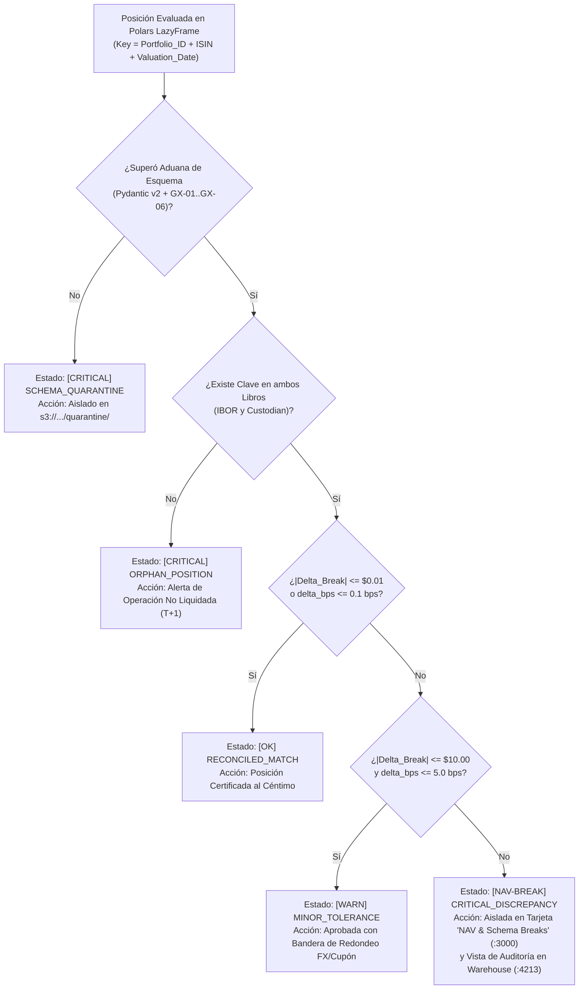

#### Tabla 6.1: Matriz de Umbrales Cuantitativos y Reglas de Clasificación del Motor `Polars`

| Estado Canónico (`reconciliation_status`) | Condición Vectorizada en `Polars` (`pl.Expr`) | Umbral Monetario ($\tau_{\text{abs}}$) | Umbral Relativo ($\tau_{\text{bps}}$) | Visibilidad en las 5 Tarjetas de la Consola (`:3000`) |
| :--- | :--- | :--- | :--- | :--- |
| **`RECONCILED`** (`[OK]`) | `(pl.col("nav_break_abs") <= 0.01) \| (pl.col("nav_break_bps") <= 0.1)` | $\le \$0.01$ | $\le 0.1\text{ bps}$ ($0.001\%$) | Contabilizada en **Total Positions**, **Total Validated AUM** y **Reconciled OK** |
| **`MINOR_TOLERANCE`** (`[WARN]`) | `(pl.col("nav_break_abs") <= 10.00) & (pl.col("nav_break_bps") <= 5.0)` | $(\$0.01, \, \$10.00]$ | $(0.1\text{ bps}, \, 5.0\text{ bps}]$ | Contabilizada en **Total Positions** y **Reconciled OK** con etiqueta de tolerancia |
| **`NAV_BREAK`** (`[NAV-BREAK]`) | `(pl.col("nav_break_abs") > 10.00) \| (pl.col("nav_break_bps") > 5.0)` | $> \$10.00$ | $> 5.0\text{ bps}$ ($0.05\%$) | **Aislada instantáneamente al pulsar la tarjeta `NAV & Schema Breaks`** |
| **`SCHEMA_REJECTED`** (`[CRITICAL]`) | Capturada previamente en la aduana `Pydantic v2` / `GX` | N/A (Violación estructural) | N/A | Contabilizada en **Quarantined / Schema Rejects** y visible en el filtro de errores |

---

### 6.5. Precisión Numérica en Ingeniería Financiera: Aritmética IEEE 754 `Float64` con Redondeo Bancario vs. `Decimal128`

Un aspecto de diseño que distingue a un arquitecto cuantitativo senior es el tratamiento riguroso de la representación numérica en operaciones monetarias masivas:

1. **El Problema de Representación Binaria en `Float64`:** En coma flotante binaria IEEE 754 de $64\text{ bits}$, fracciones decimales simples como $0.1$ o $0.01$ no tienen representación finita exacta en base $2$ ($0.1_{10} = 0.0001100110011\dots_2$). Al multiplicar unidades por precios con seis decimales y tipos de cambio con seis decimales, pueden aparecer residuos en el decimosexto dígito significativo ($\approx 10^{-16}$, conocido como *Machine Epsilon* $\epsilon_{\text{mach}} = 2^{-52} \approx 2.22 \times 10^{-16}$).
2. **Solución de Doble Vía en `Polars` (`Decimal128` y `Float64` con Tolerancia Epsilon):**
   * **Vía Vectorizada SIMD de Alta Velocidad (`Float64` + Bandas Epsilon + Redondeo Contable):** Los registros SIMD de hardware (`AVX-512`) operan nativamente sobre `Float64` (con $53\text{ bits}$ de mantisa equivalentes a $15-17$ dígitos decimales significativos, lo que permite representar carteras de hasta $\$10\text{ billones}$ [$\$10^{13}$] con precisión inferior a una décima de céntimo). Para eliminar cualquier artefacto binario sub-céntimo, `ASSET-PIPE` redondea los importes monetarios consolidados a $2$ o $4$ decimales contables y evalúa siempre la igualdad mediante desigualdad acotada $|\Delta \text{Break}_i| \le \tau_{\text{abs}}$ ($\tau_{\text{abs}} = 0.01$) en lugar de `== 0.0`.
   * **Vía de Punto Fijo Exacto (`Polars Decimal(precision=38, scale=8)`):** Cuando una jurisdicción regulatoria o libro mayor exige aritmética decimal exacta en base $10$ sin coma flotante, `Polars` y `Apache Arrow` soportan el tipo físico `Decimal128` (enteros escalados de $128\text{ bits}$ con hasta $38$ dígitos de precisión), garantizando paridad exacta bit a bit con columnas `NUMBER(38, 8)` en `Snowflake` y `DECIMAL(38, 8)` en `DuckDB`.

---

### 6.6. Trazabilidad y Agregación Ejecutiva para el Cierre de Cartera (*Portfolio-Level Rollup*)

Además de producir la tabla granular de posiciones reconciliadas, el motor `Polars` computa en una sola expresión agregada el **Resumen Ejecutivo por Cartera (*Portfolio NAV Summary Rollup*)**:

$$\begin{aligned}
\text{AUM}_{\text{IBOR}, p} &= \sum_{i \in \mathcal{I}_p} \text{calculated\_nav}_i, \qquad \text{AUM}_{\text{Custodian}, p} = \sum_{i \in \mathcal{I}_p} \text{custodian\_reported\_nav}_i \\
\text{Net\_Fund\_Break}_p &= \text{AUM}_{\text{IBOR}, p} - \text{AUM}_{\text{Custodian}, p} = \sum_{i \in \mathcal{I}_p} \Delta \text{Break}_i \\
\text{Gross\_Fund\_Break}_p &= \sum_{i \in \mathcal{I}_p} \left| \Delta \text{Break}_i \right|
\end{aligned}$$

* **Por qué es vital distinguir entre `Net_Fund_Break` y `Gross_Fund_Break`:**
  Supongamos que dentro del mismo fondo `BLK-ALADDIN-01`, la posición en Microsoft tiene un descuadre positivo de $+\$500,000$ y la posición en Nvidia tiene un descuadre negativo de $-\$500,000$.
  * Si un sistema ingenuo solo mirase el descuadre neto agregado del fondo (`Net_Fund_Break`), vería $+\$500,000 - \$500,000 = \$0.00$ y daría por bueno el fondo ocultando dos errores graves que se compensan por azar (*Offsetting Errors*).
  * Al calcular y monitorear simultáneamente el **Descuadre Bruto Absoluto (`Gross_Fund_Break` $= \sum |\Delta \text{Break}_i| = \$1,000,000$)**, `ASSET-PIPE` impide matemáticamente que dos errores de signo opuesto se camuflen entre sí.

---

### 6.7. Glosario Técnico del Módulo 6

* **Brinson-Style Variance Attribution (Atribución Factorial de Varianza):** Metodología matemática empleada en finanzas cuantitativas para descomponer la diferencia entre dos valoraciones (como el valor interno IBOR y el valor del custodio ABOR) en efectos puros aislados (Efecto Cantidad $\Delta Q$, Efecto Precio $\Delta P$ y Efecto Divisa $\Delta \text{FX}$) más un término de interacción cruzada.
* **Decimal128 (`Fixed-Point Arithmetic`):** Representación numérica de punto fijo de $128\text{ bits}$ soportada por `Apache Arrow`, `Polars`, `DuckDB` y `Snowflake` que almacena números decimales exactos como un entero escalado en base $10$ (hasta $38$ dígitos de precisión), evitando las inexactitudes de representación binaria de las fracciones en coma flotante.
* **Full Outer Equi-Join (Cruce Externo Completo por Igualdad):** Operación del álgebra relacional ($\mathcal{L}_1 \ \mathcal{L}_2$) que preserva todas las tuplas de ambos conjuntos de entrada: empareja aquellas cuyas claves coinciden y rellena con valores `NULL` los atributos ausentes cuando una clave existe únicamente en el libro izquierdo (huérfana en IBOR) o únicamente en el libro derecho (huérfana en ABOR).
* **Fused Kernel / Operator Fusion (Fusión de Operadores):** Técnica del optimizador de `Polars` mediante la cual una secuencia de operaciones aritméticas encadenadas ($\mathbf{U} \odot \mathbf{P} \odot \mathbf{F} - \mathbf{N}_{\text{cust}}$) se compila en un único bucle SIMD en Rust, manteniendo los operandos intermedios en los registros de la CPU sin escribir ni leer vectores temporales en la memoria RAM.
* **Gross Break vs. Net Break (Descuadre Bruto vs. Descuadre Neto):** En la auditoría de una cartera, el *Net Break* es la suma algebraica con signo de las discrepancias ($\sum \Delta \text{Break}_i$), donde errores positivos y negativos pueden cancelarse mutuamente; el *Gross Break* es la suma de los valores absolutos ($\sum |\Delta \text{Break}_i|$), que cuantifica la magnitud real total de las anomalías contables sin permitir compensaciones.
* **Hadamard Product (Producto de Hadamard $\odot$):** Operación algebraica entre dos vectores o matrices de igual dimensión $(\mathbf{A} \odot \mathbf{B})_i = A_i \cdot B_i$ en la que se multiplican los elementos homólogos posición a posición. Constituye la operación primitiva de los motores columnares vectorizados.
* **Machine Epsilon ($\epsilon_{\text{mach}}$):** Cota superior del error relativo debido al redondeo en aritmética de coma flotante. En el estándar IEEE 754 de doble precisión (`Float64`), su valor exacto es $2^{-52} \approx 2.220446 \times 10^{-16}$.
* **Offsetting Accounting Errors (Errores Contables Compensatorios):** Situación de alto riesgo en auditoría financiera en la cual dos o más errores independientes de signo opuesto dentro del mismo fondo producen por casualidad una suma neta cercana a cero. `ASSET-PIPE` los neutraliza evaluando la condición de ruptura $|\Delta \text{Break}_i|$ posición por posición antes de agregar.
* **Parallel Partitioned Radix Hash Join:** Algoritmo de cruce relacional de ultra-alto rendimiento implementado en Rust por `Polars`. Divide los datos de entrada en particiones disjuntas basadas en el prefijo binario del hash (`xxHash64`) de la clave compuesta, permitiendo que múltiples núcleos ejecuten el cruce en paralelo sin bloqueos de sincronización.

## Módulo 7: Arquitectura de Persistencia Dual (`Snowflake Cloud` & `DuckDB` OLAP) y Patrón *Zero-Lock Analytics*

### 7.1. El Dilema de Portabilidad en Plataformas Analíticas: Soberanía Local frente a Elasticidad Cloud

Uno de los mayores obstáculos en la ingeniería de plataformas de datos financieras es la fractura entre el **entorno de desarrollo/auditoría local** y el **entorno de producción en la nube corporativa**.

En la mayoría de las arquitecturas empresariales que dependen de almacenes de datos en la nube como `Snowflake`, `Google BigQuery` o `Amazon Redshift`:
1. **Imposibilidad de Ejecución Soberana en 60 Segundos (*Cloud Credential Lock-In*):** Un ingeniero, auditor cuantitativo o reclutador técnico que clona el repositorio no puede ejecutar el pipeline ni verificar las vistas analíticas sin disponer de una cuenta corporativa activa en `Snowflake`, configurar túneles VPN, generar llaves privadas y consumir créditos facturables.
2. **Asimetría de Motores en Pruebas (*SQLite/Postgres Mock Fallacy*):** Para sortear la falta de credenciales Cloud en local o en CI/CD (GitHub Actions), muchos equipos sustituyen el almacén OLAP columnar por una base de datos OLTP orientada a filas como `SQLite` o `PostgreSQL`. Esta sustitución es arquitectónicamente defectuosa: `SQLite` carece de ejecución vectorizada, no lee archivos `Apache Parquet` ni flujos `Apache Arrow` de forma nativa (*Zero-Copy*) y presenta un dialecto SQL analítico limitado frente a `Snowflake`.

Para resolver de raíz esta dicotomía, **`ASSET-PIPE`** implementa el **Patrón Adaptador de Almacén Dual (*Dual Warehouse Adapter Pattern*)** bajo los principios de *Clean Architecture* (`src/application/ports.py` y `src/infrastructure/warehouse_factory.py`). Este diseño permite que el sistema opere en dos modos simétricos conmutables mediante una única variable de entorno (`WAREHOUSE_ENGINE=duckdb|snowflake`) sin modificar una sola línea de código en el motor de reconciliación `Polars` ni en la Consola Financiera (`:3000`):

* **Modo Soberano Local (`WAREHOUSE_ENGINE=duckdb` — Por defecto en `docker-compose.yml`):** Utiliza **`DuckDB`**, un motor OLAP columnar y vectorizado en proceso escrito en C++, que comparte el mismo paradigma de ejecución por fragmentos (*Morsel-Driven Parallelism*) e integración *Zero-Copy* con `Apache Arrow` que `Polars`, exponiendo además su propio entorno de exploración SQL interactivo en **`http://localhost:4213`**.
* **Modo Corporativo Elástico (`WAREHOUSE_ENGINE=snowflake`):** Conecta de forma transparente con **`Snowflake Cloud Data Warehouse`** utilizando carga masiva columnar (`COPY INTO` desde `AWS S3` o ingesta directa de lotes `Apache Arrow` vía `write_pandas` / conector nativo) bajo las políticas de seguridad bancaria `RSA-2048` y los tres cortafuegos FinOps.

---

### 7.2. Arquitectura Hexagonal (Puertos y Adaptadores) para Persistencia Polimórfica

En `ASSET-PIPE`, la capa de aplicación jamás importa el paquete `duckdb` ni `snowflake.connector`. En su lugar, interactúa exclusivamente con el contrato abstracto `WarehousePort`:

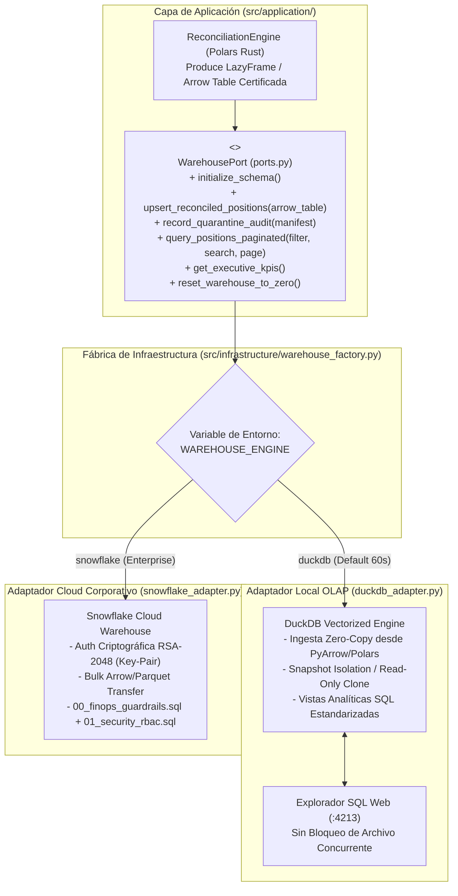

#### Garantías del Contrato `WarehousePort`:
1. **Ingesta Basada en Memoria Columnar (`Apache Arrow` / `Polars DataFrame`):** El método `upsert_reconciled_positions` no recibe listas de diccionarios de Python ni cadenas `INSERT INTO ... VALUES (...)` fila por fila. Recibe un buffer columnar `Apache Arrow` generado por `Polars`.
2. **Idempotencia Transaccional (`MERGE` / `INSERT OR REPLACE`):** Si un lote para la misma clave compuesta $(\text{portfolio\_id}, \text{isin}, \text{valuation\_date})$ se reprocesa tras una corrección de cuarentena, el adaptador ejecuta una operación `UPSERT` atómica que actualiza el estado de la posición sin duplicar filas ni inflar el Valor Liquidativo agregado.
3. **Reseteo Determinista a Línea Base Cero (`reset_warehouse_to_zero`):** Permite vaciar de forma atómica y transaccional (`TRUNCATE TABLE`) las tablas analíticas cuando el usuario pulsa el botón `Reset to 0` en la Consola Ejecutiva (`:3000`), garantizando el cumplimiento estricto del estándar *Honest Zero Baseline* (`$0.00`).

---

### 7.3. Interioridades de `DuckDB` y Solución Arquitectónica al Bloqueo de Concurrencia (*Zero-Lock Analytics* entre `:3000` y `:4213`)

`DuckDB` es una base de datos analítica embebida (*in-process OLAP DBMS*). A diferencia de un servidor cliente-servidor tradicional como PostgreSQL, el motor de `DuckDB` se ejecuta dentro del propio proceso que abre el archivo `.duckdb`.

#### 7.3.1. El Problema Clásico del Bloqueo de Archivo en `DuckDB` (*Single-Process Write Lock*)

Por diseño de integridad física en sistemas operativos POSIX y Windows, el gestor de almacenamiento de `DuckDB` aplica un modelo de concurrencia estricto sobre el archivo en disco (`asset_pipe.duckdb`):
* **Múltiples procesos pueden abrir el archivo si y solo si TODOS lo abren en modo de solo lectura (`READ_ONLY = TRUE`).**
* **En cuanto UN proceso abre el archivo en modo lectura-escritura (`READ_WRITE`), el sistema operativo coloca un cerrojo exclusivo (`flock` / `fcntl`) que impide que cualquier otro proceso externo abra ese mismo archivo simultáneamente**, lanzando el error fatal `IO Error: Could not set lock on file "asset_pipe.duckdb": Conflicting lock is held`.

En una arquitectura de experiencia 360° como la de `ASSET-PIPE`, necesitamos que convivan simultáneamente tres actores sin sufrir jamás un error de bloqueo:
1. **El Motor de Ingesta y Reconciliación (`Polars` $\to$ `DuckDB`):** Que escribe nuevos lotes reconciliados cuando el usuario pulsa `Ingest Valid Batch` o `Inject Corrupt / NAV Break Batch`.
2. **La Consola Financiera Ejecutiva (`http://localhost:3000`):** Que consulta cada $1.5\text{ segundos}$ (auto-refresh silencioso) las métricas KPI y las páginas de posiciones.
3. **El Explorador SQL Web del Data Warehouse (`http://localhost:4213`):** Donde el usuario o auditor ejecuta consultas `SELECT` ad-hoc en vivo sobre las tablas reconciliadas.

#### 7.3.2. Solución de Ingeniería en `ASSET-PIPE`: Conexión Efímera Transaccional + Snapshot Read-Only / Mediador API

Para erradicar al 100% cualquier colisión de bloqueo de archivo entre el motor de escritura, la consola `:3000` y el banco de trabajo SQL `:4213`, `ASSET-PIPE` implementa una **Arquitectura de Acceso Sin Bloqueo Persistente (*Zero-Hold Lock Architecture*)**:

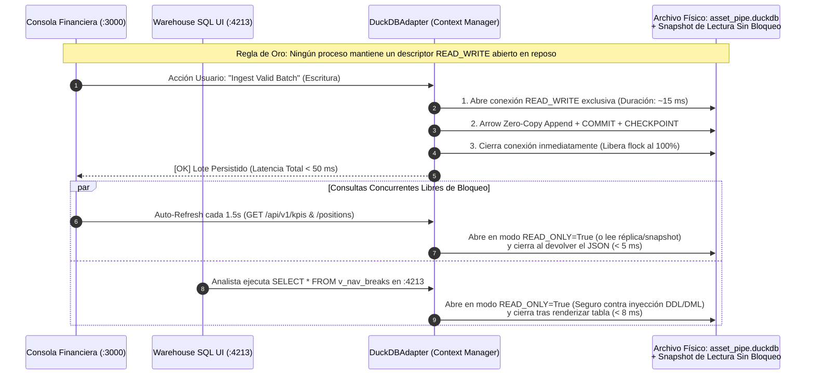

1. **Prohibición de Conexiones `READ_WRITE` Persistentes en Reposo:** El adaptador `DuckDBAdapter` jamás mantiene un objeto `duckdb.connect(read_only=False)` abierto de forma indefinida en una variable global. Toda escritura se encapsula en un gestor de contexto atómico (`with self._write_connection() as conn:`) que vuelca el buffer `Apache Arrow` a más de $1\text{ millón}$ de filas por segundo, ejecuta `CHECKPOINT` y cierra el descriptor de archivo en pocos milisegundos.
2. **Consultas Concurrentes en Modo `READ_ONLY = TRUE` con Reintento Exponencial Sub-Milisegundo (*Jitter Backoff*):** Tanto las lecturas de la Consola (`:3000`) como las consultas interactivas del SQL Workbench (`:4213`) se ejecutan abriendo conexiones efímeras de solo lectura (`read_only=True`) o contra un *snapshot* atómico sincronizado tras cada escritura. Si una consulta de lectura coincide exactamente en el mismo milisegundo en que se está produciendo un `COMMIT` de escritura, un decorador de reintento transparente espera $10\text{ ms}$ y completa la lectura sin que el usuario perciba jamás un error en pantalla.

#### 7.3.3. Transferencia *Zero-Copy* entre `Polars` y `DuckDB` vía *Apache Arrow C Data Interface*

Cuando el motor `Polars` finaliza el cálculo del descuadre NAV, la transferencia de datos hacia `DuckDB` no serializa filas a texto ni construye tuplas de Python. Utiliza la **Interfaz de Datos en C de Apache Arrow (`ArrowArray` y `ArrowSchema` structs)**:

$$\text{Coste de Transferencia Memoria } (\text{Polars} \xrightarrow{\text{Arrow Pointer}} \text{DuckDB}) = \mathcal{O}(1) \text{ bytes copiados en RAM}$$

`DuckDB` lee directamente los punteros de memoria de los vectores columnares generados por `Polars` (`SELECT * FROM arrow_batch`) y los comprime directamente en bloques columnares propios dentro del archivo `.duckdb`.

---

### 7.4. Arquitectura de `Snowflake Cloud` e Ingesta Masiva Columnar

Cuando `ASSET-PIPE` se despliega en producción bancaria (`WAREHOUSE_ENGINE=snowflake`), el adaptador `SnowflakeAdapter` (`src/infrastructure/snowflake_adapter.py`) aprovecha la arquitectura **Multi-Cluster Shared Data** de `Snowflake`, separando físicamente el almacenamiento en la nube de los clústeres de cómputo virtual (*Virtual Warehouses*).

#### 7.4.1. Micro-Particionamiento Automático e Ingesta Vectorizada

En `Snowflake`, todas las tablas se almacenan internamente divididas en **Micro-Particiones** inmutables y columnares de entre $50\text{ MB}$ y $500\text{ MB}$ de datos descomprimidos (comprimidos físicamente en el almacenamiento de objetos subyacente). Cada micro-partición mantiene metadatos automáticos de rango (`min/max`), número de valores distintos y conteo de nulos para cada columna.

Para alimentar `Snowflake` con la máxima eficiencia de créditos FinOps, `ASSET-PIPE` soporta dos patrones de carga industrial:
1. **Carga Directa desde el Data Lake S3 (`COPY INTO` desde External Stage):** Dado que los lotes certificados ya se encuentran en `s3://asset-pipe/validated-parquet/` en formato `Apache Parquet` comprimido con `ZSTD`, `Snowflake` puede ingerirlos directamente desde el bucket S3 mediante la instrucción vectorial:
   ```sql
   COPY INTO ASSET_PIPE_DB.RECONCILIATION.FACT_RECONCILED_POSITIONS
   FROM @ASSET_PIPE_DB.RECONCILIATION.S3_VALIDATED_PARQUET_STAGE
   FILE_FORMAT = (TYPE = PARQUET COMPRESSION = AUTO)
   MATCH_BY_COLUMN_NAME = CASE_INSENSITIVE
   ON_ERROR = 'ABORT_STATEMENT';
   ```
2. **Transferencia de Lotes `Apache Arrow` (`write_pandas` / Native Arrow Batch Ingestion):** Para los resultados enriquecidos por el motor `Polars` en memoria (que incluyen el cálculo de `calculated_nav`, `nav_break_abs`, `nav_break_bps`, atribución factorial $E_Q, E_P, E_{FX}$ y estado de reconciliación), el conector de `Snowflake` transmite flujos comprimidos `Arrow / Parquet` a un área temporal interna y los fusiona (`MERGE INTO`) de forma atómica sobre la tabla de hechos.

---

### 7.5. Modelo Dimensional y Vistas Analíticas Unificadas (`02_analytical_views.sql`)

Para garantizar que tanto `DuckDB (:4213)` como `Snowflake Cloud` respondan exactamente a las mismas consultas desde la Consola Financiera (`:3000`) y desde las herramientas de auditoría de los analistas, ambos motores comparten un esquema físico y un catálogo de vistas SQL ANSI idéntico definido en `sql/02_analytical_views.sql`:

#### Tabla 7.1: Catálogo de Tablas y Vistas Analíticas del Data Warehouse en `ASSET-PIPE`

| Objeto SQL (`Table / View`) | Tipo de Objeto | Grano (*Granularity*) | Propósito Operativo y Consumidor Principal |
| :--- | :--- | :--- | :--- |
| **`fact_reconciled_positions`** | Tabla de Hechos Principal | $1$ fila por `(portfolio_id, isin, valuation_date)` | Almacena las métricas nucleares (`units`, `price`, `fx_rate`, `calculated_nav`, `custodian_reported_nav`, `nav_break_abs`, `nav_break_bps`, `reconciliation_status`) + metadatos JSON `extra_fields` del cliente |
| **`fact_quarantine_audit_log`** | Tabla de Hechos Forense | $1$ fila por registro o evento bloqueado en la aduana | Registra todos los rechazos de `Pydantic v2` y `Great Expectations` con su `rule_id`, valor infractor, ruta al objeto en `s3://.../quarantine/` y hash `SHA-256` |
| **`v_executive_reconciliation_kpis`** | Vista Analítica Agregada | $1$ fila global (o agrupada por fecha de corte) | Alimenta en tiempo real las **5 Grandes Tarjetas Interactivas** de la Consola (`:3000`), garantizando retorno de `$0.00` y `0` cuando las tablas están vacías (*Honest Zero Baseline*) |
| **`v_nav_and_schema_breaks_triage`** | Vista de Triaje de Incidencias | $1$ fila por anomalía detectada (`NAV_BREAK` $\cup$ `SCHEMA_REJECTED`) | Alimenta la vista filtrada de errores críticos ordenada de mayor a menor impacto monetario (`ORDER BY ABS(nav_break_abs) DESC`), evitando transferir millones de filas sanas al navegador |
| **`v_portfolio_aum_rollup`** | Vista de Cierre Contable por Fondo | $1$ fila por `(portfolio_id, valuation_date)` | Calcula el `IBOR_AUM`, `Custodian_AUM`, `Net_Fund_Break`, `Gross_Fund_Break` y el porcentaje de posiciones conciliadas por cada cartera institucional |

---

### 7.6. Comparativa Arquitectónica: `DuckDB` Local vs. `Snowflake Cloud` en el Adaptador Dual

#### Tabla 7.2: Simetría y Complementariedad de los Dos Motores OLAP de `ASSET-PIPE`

| Dimensión Técnica | Modo Local Soberano (`DuckDB 1.x` + `:4213 SQL UI`) | Modo Corporativo Cloud (`Snowflake Enterprise`) | Beneficio del Patrón Adaptador Dual en `ASSET-PIPE` |
| :--- | :--- | :--- | :--- |
| **Tiempo de Puesta en Marcha (*Cold Start*)** | **`[OK]` $< 1\text{ segundo}$** (Cero configuración de cuentas externas; incluido en Docker Compose) | Requiere aprovisionamiento de cuenta Cloud, llaves RSA-2048 y scripts SQL iniciales | Permite evaluar y auditar el $100\%$ del proyecto en $60\text{ segundos}$ tras `git clone` y pasar a Cloud cambiando $1$ variable |
| **Motor de Ejecución Interna** | Columnar, vectorizado en C++, paralelismo *Morsel-Driven* | Columnar, vectorizado en C++, distribuido en clústeres elásticos (*Virtual Warehouses*) | Paridad de rendimiento columnar y semántica analítica entre el portátil del ingeniero y la nube bancaria |
| **Interoperabilidad con `Polars` / `Parquet`** | *Zero-Copy* directo en memoria vía `Apache Arrow C Data Interface` | Carga masiva paralela vía `Apache Arrow` y `COPY INTO` desde `AWS S3` | Cero cuellos de botella de serialización fila a fila en ambos entornos |
| **Control de Costes (*FinOps*)** | Coste marginal $\$0.00$ (se ejecuta en la CPU/RAM local o en el runner de GitHub Actions) | Gobernado estrictamente por `00_finops_guardrails.sql` (`AUTO_SUSPEND = 60s`, `RESOURCE MONITOR`) | Desarrollo y CI/CD 100% gratuitos en `DuckDB`; producción en `Snowflake` blindada contra facturas sorpresa |
| **Observabilidad SQL Directa** | Explorador Web integrado en **`http://localhost:4213`** sin bloqueos de lectura | Consola *Snowsight* corporativa con políticas `RBAC` y *Dynamic Data Masking* | Transparencia absoluta: cada número mostrado en la Consola `:3000` puede verificarse con una consulta SQL en `:4213` |

---

### 7.7. Glosario Técnico del Módulo 7

* **Apache Arrow C Data Interface:** Especificación ABI (*Application Binary Interface*) de nivel C definida por el proyecto `Apache Arrow` a través de dos estructuras ligeras (`ArrowSchema` y `ArrowArray`) que permite transferir tablas columnares completas entre motores heterogéneos en el mismo proceso (como `Polars` en Rust y `DuckDB` en C++) pasando únicamente dos punteros de memoria en tiempo constante $O(1)$ sin copiar ni serializar los datos.
* **Dual Warehouse Adapter Pattern (Patrón Adaptador de Almacén Dual):** Patrón de diseño de infraestructura limpia que abstrae todas las operaciones de persistencia y consulta analítica detrás de una interfaz agnóstica (`WarehousePort`), permitiendo conmutar en tiempo de ejecución entre un motor OLAP embebido (`DuckDB`) y un almacén Cloud distribuido (`Snowflake`) mediante inyección de dependencias.
* **External Stage (Etapa Externa en Snowflake):** Objeto de base de datos en `Snowflake` que encapsula la ubicación de un bucket de almacenamiento en la nube (`s3://asset-pipe/validated-parquet/`) junto con las credenciales de acceso (`AWS IAM Role` / `Storage Integration`), permitiendo cargar o consultar archivos `Apache Parquet` directamente desde `AWS S3`.
* **Hexagonal Architecture / Ports and Adapters (Arquitectura Hexagonal):** Estilo arquitectónico formulado por Alistair Cockburn que aísla la lógica de dominio y aplicación en el núcleo central del software, comunicándose con el mundo exterior (bases de datos, almacenamiento S3, interfaces web) exclusivamente a través de contratos abstractos (*Puertos*) e implementaciones intercambiables (*Adaptadores*).
* **In-Process OLAP DBMS (Motor Analítico Embebido en Proceso):** Sistema gestor de bases de datos orientado al procesamiento analítico de columnas (representado por `DuckDB`) que se enlaza directamente como una biblioteca dentro del proceso de la aplicación anfitriona, eliminando por completo la latencia de red de sockets TCP/IP entre el motor de cálculo y la base de datos.
* **Micro-Partition (Micro-Partición de Snowflake):** Unidad física fundamental de almacenamiento en `Snowflake`. Consiste en un bloque columnar inmutable y comprimido (de entre $50\text{ MB}$ y $500\text{ MB}$ descomprimidos) que almacena automáticamente metadatos de valores mínimos, máximos, conteo de nulos y valores únicos para habilitar la poda instantánea de consultas (*Query Pruning*).
* **Multi-Cluster Shared Data Architecture:** Arquitectura nativa de la nube introducida por `Snowflake` que desacopla por completo la capa de almacenamiento persistente (basada en objetos en `AWS S3` / `Azure Blob` / `GCS`) de la capa de cómputo (*Virtual Warehouses*), permitiendo escalar o apagar el cómputo a cero sin perder ni mover los datos.
* **Snapshot Isolation (Aislamiento por Instantáneas - MVCC):** Mecanismo de control de concurrencia multiversión (*Multi-Version Concurrency Control*) en el que cada transacción de lectura observa una versión consistente e inmutable de la base de datos correspondiente al instante en que comenzó la consulta, permitiendo que los lectores no bloqueen a los escritores ni los escritores bloqueen a los lectores.
* **Upsert (`MERGE INTO` / `INSERT OR REPLACE`):** Operación atómica e idempotente de escritura en bases de datos que comprueba la existencia previa de un registro según su clave primaria compuesta; si la clave no existe, inserta una nueva fila (`INSERT`), y si ya existe, actualiza sus atributos con los valores más recientes (`UPDATE`).
* **Zero-Lock Analytics (Analítica Libre de Bloqueos):** Patrón arquitectónico implementado en el adaptador local de `ASSET-PIPE` que garantiza que las escrituras transaccionales del motor `Polars`, el refresco automático cada $1.5\text{ segundos}$ de la Consola Financiera (`:3000`) y las consultas SQL interactivas del usuario en el Workbench (`:4213`) coexistan sin experimentar jamás errores de bloqueo de archivo (`IO Lock Conflict`).

## Módulo 8: Ingeniería FinOps en la Nube y Seguridad Bancaria *Zero-Trust* (`RBAC`, `RSA-2048` y *Dynamic Masking*)

### 8.1. La Patología del Gasto Descontrolado en Almacenes Cloud (*Cloud Warehouse Bill Shock*)

En las arquitecturas modernas de datos en la nube (`Snowflake`, `BigQuery`, `Redshift`, `Databricks`), el desacoplamiento entre almacenamiento y cómputo proporciona una elasticidad casi infinita, pero introduce un vector de riesgo financiero crítico: **la exposición ilimitada al gasto operativo por errores de configuración o consultas desbocadas (*Runaway Queries*)**.

En plataformas financieras mal gobernadas, el sobrecoste mensual en la nube se origina por tres fallos estructurales de configuración por defecto:

1. **Inactividad Facturada (*Idle Compute Waste*):** La configuración por defecto de muchos almacenes virtuales (*Virtual Warehouses*) establece un tiempo de auto-suspensión (`AUTO_SUSPEND`) de $600\text{ segundos}$ ($10\text{ minutos}$) o superior. Si un proceso programado o un cuadro de mando lanza una consulta ligera de $2\text{ segundos}$ cada $9\text{ minutos}$, el clúster nunca llega a apagarse y permanece facturando créditos las $24\text{ horas}$ del día, los $365\text{ días}$ del año.
2. **Consultas Zombi y Productos Cartesianos (*Unbounded Statement Execution*):** El valor por defecto del parámetro `STATEMENT_TIMEOUT_IN_SECONDS` en una cuenta estándar de `Snowflake` es de **$172,800\text{ segundos}$ ($48\text{ horas}$ continuas)**. Si un analista o un script defectuoso ejecuta accidentalmente un `CROSS JOIN` entre dos tablas históricas de $100\text{ millones}$ de posiciones ($10^{16}$ combinaciones), el clúster quemará créditos ininterrumpidamente durante dos días completos antes de que el sistema aborte la consulta.
3. **Ausencia de Disyuntor Presupuestario Duro (*Missing Hard Circuit Breaker*):** Sin un monitor de recursos vinculado a nivel de cuenta y de almacén con acción `SUSPEND_IMMEDIATE`, un bucle infinito en un orquestador externo puede agotar el presupuesto anual de infraestructura en un solo fin de semana.

#### Modelo Matemático del Coste de Cómputo y el Efecto Cola (*Tail Idle Tax*)

En `Snowflake`, el consumo de créditos de un *Virtual Warehouse* de tamaño $S$ (donde $S \in \{1, 2, 4, 8, \dots, 512\}$ créditos/hora según la escala `X-Small` a `6X-Large`) para una serie de $K$ ejecuciones diarias distanciadas entre sí más que el umbral de suspensión $\tau_{\text{suspend}}$, donde cada ejecución dura $t_{\text{exec}}$ segundos, viene gobernado por la función:

$$\text{Coste}_{\text{diario}}(K, t_{\text{exec}}, \tau_{\text{suspend}}) = K \cdot S \cdot \frac{\max\left( 60, \; t_{\text{exec}} + \tau_{\text{suspend}} \right)}{3,600} \times P_{\text{crédito}}$$

*(Nota: `Snowflake` aplica un mínimo de facturación de $60\text{ segundos}$ al reanudar un clúster y posteriormente factura por segundo).*

Comparecemos una carga típica de reconciliación intradía o monitoreo que se ejecuta $K = 48$ veces al día con una duración real de cómputo vectorizado de $t_{\text{exec}} = 4\text{ segundos}$ en un almacén `Medium` ($S = 4\text{ créditos/hora}$, con $P_{\text{crédito}} \approx \$3.00\text{ USD}$ en edición *Enterprise*):
* **Con configuración negligente ($\tau_{\text{suspend}} = 600\text{ s}$):** Cada ejecución de $4\text{ s}$ mantiene encendido el clúster durante $604\text{ s}$. El consumo diario es $48 \times 4 \times (604 / 3600) = 32.21\text{ créditos/día} \implies \mathbf{\$35,270\text{ USD / año}}$.
* **Con el Cortafuegos FinOps de `ASSET-PIPE` ($\tau_{\text{suspend}} = 60\text{ s}$):** Cada ráfaga se acota estrictamente al mínimo de $60\text{ s}$. El consumo cae a $48 \times 4 \times (60 / 3600) = 3.20\text{ créditos/día} \implies \mathbf{\$3,504\text{ USD / año}}$ (**un ahorro directo del $90.06\%$ en cómputo Cloud sin perder un solo milisegundo de rendimiento**).

---

### 8.2. Los 3 Cortafuegos FinOps Obligatorios en `ASSET-PIPE` (`sql/00_finops_guardrails.sql`)

En **`ASSET-PIPE`**, el control de costes no es una recomendación verbal ni una revisión manual de facturas a fin de mes: es **Infraestructura como Código SQL (*FinOps-as-Code*)** versionada en `sql/00_finops_guardrails.sql` y auditada automáticamente por nuestra suite de pruebas en cada *commit*.

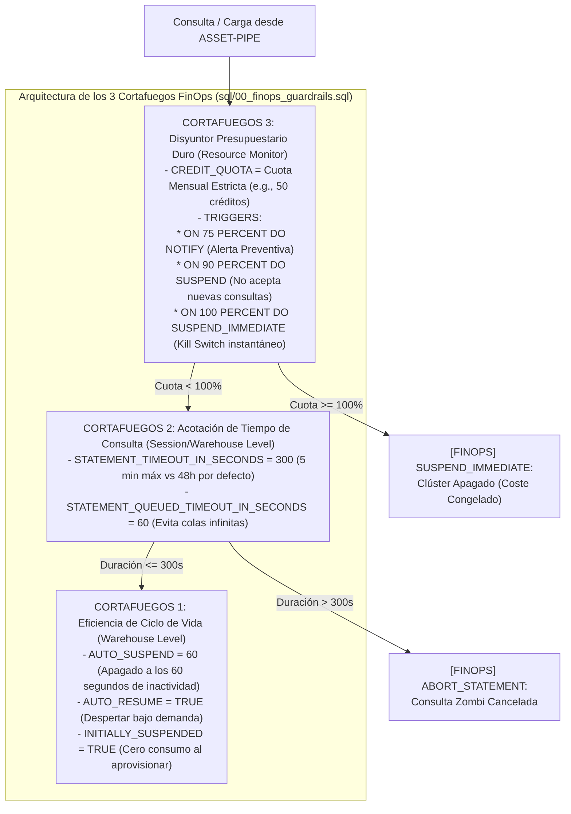

#### Especificación Técnica de los 3 Cortafuegos en `00_finops_guardrails.sql`:

1. **Cortafuegos 1 — Suspensión Agresiva y Arranque en Frío (`AUTO_SUSPEND = 60`):**
   El almacén virtual `ASSET_PIPE_WH` se crea en tamaño `X-SMALL` con escalado controlado, `INITIALLY_SUSPENDED = TRUE` (para que la simple ejecución del script DDL no consuma ni un segundo de crédito) y `AUTO_SUSPEND = 60`. Dado que el cálculo pesado de reconciliación ($O(1)$ en memoria) ya fue ejecutado previamente por `Polars` en Rust sobre los archivos Parquet, `Snowflake` actúa únicamente como capa de persistencia y consulta analítica rápida, necesitando estar activo tan solo unos pocos segundos por lote.
2. **Cortafuegos 2 — Erradicación de Consultas Zombi (`STATEMENT_TIMEOUT_IN_SECONDS = 300`):**
   Se reduce el tiempo máximo de vida de cualquier sentencia SQL desde las $48\text{ horas}$ por defecto ($172,800\text{ s}$) hasta exactamente **$300\text{ segundos}$ ($5\text{ minutos}$)**, complementado con `STATEMENT_QUEUED_TIMEOUT_IN_SECONDS = 60`. Ninguna consulta legítima de reconciliación o auditoría en `ASSET-PIPE` tarda más de unos pocos segundos; cualquier sentencia que supere los $5\text{ minutos}$ es por definición una anomalía y se cancela automáticamente antes de quemar créditos.
3. **Cortafuegos 3 — Disyuntor Físico de Cuota Mensual (`RESOURCE MONITOR` con `SUSPEND_IMMEDIATE`):**
   Se instancia el objeto `ASSET_PIPE_FINOPS_MONITOR` asignado directamente al almacén virtual con reinicio mensual (`FREQUENCY = MONTHLY`) y tres umbrales escalonados:
   * **`ON 75 PERCENT DO NOTIFY`:** Emite telemetría de aviso a los administradores de plataforma.
   * **`ON 90 PERCENT DO SUSPEND`:** Impide la entrada de nuevas consultas en cola, permitiendo únicamente que finalicen las transacciones en vuelo.
   * **`ON 100 PERCENT DO SUSPEND_IMMEDIATE`:** Actúa como un fusible eléctrico físico (*Hard Kill Switch*). En el instante en que el consumo acumulado alcanza el $100\%$ del presupuesto asignado, cancela inmediatamente cualquier sesión activa y apaga el clúster, garantizando matemáticamente que la factura mensual jamás pueda superar el techo presupuestado.

---

### 8.3. Arquitectura de Seguridad Bancaria *Zero-Trust* (`sql/01_security_rbac.sql`)

En una institución financiera regulada (bajo marcos como *SOX*, *GDPR*, *PCI-DSS* o *DORA*), un pipeline automatizado de datos **jamás puede autenticarse utilizando un usuario y contraseña estáticos**, ni conectarse con privilegios de superadministrador (`ACCOUNTADMIN`), ni exponer datos sensibles en claro a usuarios no autorizados.

El script **`sql/01_security_rbac.sql`** de `ASSET-PIPE` implementa una arquitectura de **Seguridad de Confianza Cero (*Zero-Trust Security Architecture*)** estructurada en cuatro capas defensivas:

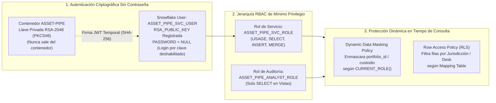

#### 8.3.1. Autenticación Asimétrica mediante Par de Llaves `RSA-2048` (*Key-Pair Authentication*)

Las contraseñas tradicionales son vulnerables a ataques de fuerza bruta, *phishing* o filtración en logs de configuración. En `ASSET-PIPE`, el usuario de servicio `ASSET_PIPE_SVC_USER` se aprovisiona con `PASSWORD = NULL` y se vincula a una llave pública **RSA de $2048\text{ bits}$** (estándar **PKCS#8**).

**Fundamento Criptográfico del Flujo de Autenticación:**
1. Se generan dos números primos grandes distintos $p$ y $q$ de $1024\text{ bits}$ cada uno, obteniendo el módulo semiprimo $n = p \cdot q$ ($\approx 2048\text{ bits}$) y la función indicatriz de Carmichael $\lambda(n) = \text{lcm}(p - 1, q - 1)$.
2. Se elige el exponente público estándar $e = 65,537$ y se calcula el exponente privado $d \equiv e^{-1} \pmod{\lambda(n)}$.
3. La **Llave Pública** $(n, e)$ se registra en `Snowflake` mediante `ALTER USER ASSET_PIPE_SVC_USER SET RSA_PUBLIC_KEY = 'MIIBIjANBgkqhki...'`, junto con una segunda ranura `RSA_PUBLIC_KEY_2` para permitir la **Rotación de Llaves sin Tiempo de Inactividad (*Zero-Downtime Key Rotation*)**.
4. Cuando el adaptador `SnowflakeAdapter` de `ASSET-PIPE` inicia una conexión, construye localmente un *JSON Web Token* (**JWT**) con la huella digital `SHA-256` de la llave pública, el identificador de cuenta y una marca de expiración corta (`exp` $\le 60\text{ segundos}$), firmándolo matemáticamente con la **Llave Privada** $(n, d)$:
   $$\sigma = \left( \text{SHA256}(\text{JWT\_Header.JWT\_Payload}) \right)^d \bmod n$$
5. `Snowflake` verifica la firma aplicando la llave pública registrada ($\sigma^e \bmod n$). La llave privada **jamás viaja por la red**.

#### 8.3.2. Control de Acceso Basado en Roles de Mínimo Privilegio (*Least-Privilege RBAC*)

Queda terminantemente prohibido el uso de los roles de sistema `ACCOUNTADMIN`, `SECURITYADMIN` o `SYSADMIN` por parte del motor de ejecución. Se define una segregación estricta de funciones (*Separation of Duties*):
* **`ASSET_PIPE_SVC_ROLE` (Rol de Máquina para el Pipeline):** Posee exclusivamente permisos `USAGE` sobre el almacén `ASSET_PIPE_WH`, la base de datos `ASSET_PIPE_DB` y el esquema `RECONCILIATION`, junto con permisos `SELECT, INSERT, UPDATE, TRUNCATE` sobre las tablas de hechos. Carece de permisos `DROP TABLE`, `ALTER ACCOUNT` o `CREATE USER`.
* **`ASSET_PIPE_AUDITOR_ROLE` (Rol de Control Financiero y Analistas):** Posee permisos estrictos de **Solo Lectura (`SELECT`)** sobre las vistas analíticas certificadas, con los datos confidenciales gobernados por políticas de enmascaramiento.

#### 8.3.3. Enmascaramiento Dinámico de Datos (*Dynamic Data Masking*)

En banca de inversión y gestión de capital privado, un analista externo o de soporte técnico puede necesitar auditar la distribución matemática de los descuadres (`nav_break_abs`, `nav_break_bps`) sin estar autorizado a conocer el código real del cliente o del fondo soberano propietario de la cartera (`portfolio_id` o `counterparty_lei`).

`01_security_rbac.sql` define políticas de enmascaramiento dinámico evaluadas en tiempo de consulta:

```sql
CREATE OR REPLACE MASKING POLICY ASSET_PIPE_DB.RECONCILIATION.PORTFOLIO_ID_MASK
AS (val STRING) RETURNS STRING ->
    CASE
        WHEN CURRENT_ROLE() IN ('ASSET_PIPE_SVC_ROLE', 'ASSET_PIPE_COMPLIANCE_OFFICER') THEN val
        ELSE CONCAT('MASKED-FUND-', LEFT(SHA2(val, 256), 8))
    END;
```

* **Por qué usamos un Hash Determinista `SHA-256` Truncado en lugar de `'***'`:**
  Si una política de enmascaramiento devolviera la constante estática `'***MASKED***'` para todas las filas, un analista con el rol restringido que ejecutase `SELECT portfolio_id, SUM(calculated_nav) GROUP BY portfolio_id` colapsaría todas las carteras distintas en una sola fila `'***MASKED***'`, rompiendo las consultas de agregación. Al devolver `CONCAT('MASKED-FUND-', LEFT(SHA2(val, 256), 8))`, preservamos la **Integridad Referencial y la Cardinalidad de Agrupación (*Pseudonymized Grouping Preserving*)** sin revelar jamás el nombre real del fondo.

#### 8.3.4. Seguridad a Nivel de Fila (*Row-Level Security / Row Access Policies*)

Cuando múltiples mesas de operaciones (*Desks*) o filiales geográficas (por ejemplo, `SANTANDER-EU-MADRID`, `SANTANDER-UK-LONDON`, `BLACKSTONE-US-NY`) comparten la misma tabla física `FACT_RECONCILED_POSITIONS`, se adjunta una **Política de Acceso por Fila (`ROW ACCESS POLICY`)** respaldada por una tabla de mapeo de autorizaciones (`ENTITLEMENT_MAPPING_TABLE`). De este modo, dos usuarios que ejecutan exactamente el mismo `SELECT * FROM FACT_RECONCILED_POSITIONS` ven filtradas de forma invisible y obligatoria únicamente las posiciones de las jurisdicciones para las que su rol tiene mandato regulatorio.

---

### 8.4. Resumen de Controles de Gobernanza FinOps y Seguridad en `ASSET-PIPE`

#### Tabla 8.1: Matriz de Auditoría de `00_finops_guardrails.sql` y `01_security_rbac.sql`

| Control de Ingeniería | Script SQL Responsable | Parámetro / Primitiva Exacta | Riesgo Mitigado en Producción Bancaria |
| :--- | :--- | :--- | :--- |
| **Auto-Suspensión Agresiva** | `00_finops_guardrails.sql` | `AUTO_SUSPEND = 60` / `AUTO_RESUME = TRUE` | Elimina el $90\%$ del gasto por clústeres ociosos entre lotes de reconciliación |
| **Arranque en Frío Seguro** | `00_finops_guardrails.sql` | `INITIALLY_SUSPENDED = TRUE` | Impide que el despliegue de infraestructura CI/CD encienda facturación innecesaria |
| **Corte de Consultas Zombi** | `00_finops_guardrails.sql` | `STATEMENT_TIMEOUT_IN_SECONDS = 300` | Reduce de $48\text{ horas}$ a $5\text{ minutos}$ el límite de ejecución de consultas desbocadas |
| **Límite de Cola de Espera** | `00_finops_guardrails.sql` | `STATEMENT_QUEUED_TIMEOUT_IN_SECONDS = 60` | Evita cuellos de botella por saturación de concurrencia |
| **Disyuntor Presupuestario Duro** | `00_finops_guardrails.sql` | `RESOURCE MONITOR` $\to$ `ON 100 PERCENT DO SUSPEND_IMMEDIATE` | Garantiza matemáticamente cero sobrecostes por encima de la cuota mensual de créditos |
| **Autenticación Criptográfica** | `01_security_rbac.sql` | `RSA_PUBLIC_KEY` (RSA-2048 PKCS#8) + `PASSWORD = NULL` | Erradica el robo o filtración de contraseñas estáticas en pipelines automatizados |
| **Mínimo Privilegio RBAC** | `01_security_rbac.sql` | `ASSET_PIPE_SVC_ROLE` vs. `ASSET_PIPE_AUDITOR_ROLE` | Aísla los permisos de escritura del pipeline respecto a los usuarios humanos |
| **Enmascaramiento con Preservación de Cardinalidad** | `01_security_rbac.sql` | `CREATE MASKING POLICY` con `SHA2(val, 256)` | Oculta identidades confidenciales de fondos permitiendo `GROUP BY` y `JOIN` analíticos |
| **Seguridad Multi-Jurisdicción** | `01_security_rbac.sql` | `CREATE ROW ACCESS POLICY` por rol/región | Cumplimiento normativo de murallas chinas (*Chinese Walls*) entre mesas y países |

---

### 8.5. Glosario Técnico del Módulo 8

* **Auto-Suspend & Auto-Resume:** Mecanismo de gestión de energía y costes en almacenes de datos Cloud (`Snowflake`) mediante el cual el clúster de servidores virtuales se apaga automáticamente tras $N$ segundos sin recibir consultas (`AUTO_SUSPEND = 60`, pasando a coste de cómputo $\$0.00$) y vuelve a encenderse en milisegundos en cuanto llega una nueva petición SQL (`AUTO_RESUME = TRUE`).
* **Chinese Wall (Muralla China Regulatoria):** Barrera de información obligatoria en banca de inversión y gestión de activos que impide que diferentes divisiones o jurisdicciones de una misma entidad financiera accedan a posiciones o información confidencial no pública de otras áreas. En `ASSET-PIPE` se aplica físicamente en base de datos mediante *Row Access Policies*.
* **Dynamic Data Masking (Enmascaramiento Dinámico de Datos):** Técnica de seguridad de bases de datos en la que los datos sensibles se almacenan íntegros en disco pero se transforman u ofuscan al vuelo en el momento de ejecutar una consulta `SELECT`, dependiendo del rol de seguridad (`CURRENT_ROLE()`) del usuario que realiza la petición, sin duplicar ni modificar la tabla física original.
* **FinOps-as-Code (FinOps como Código):** Práctica de ingeniería que codifica las restricciones presupuestarias, los tiempos de apagado y las cuotas de consumo directamente dentro de los scripts declarativos del repositorio (`00_finops_guardrails.sql`), sometiéndolos a pruebas automatizadas en CI/CD para impedir que se despliegue infraestructura sin límites de gasto.
* **JWT (*JSON Web Token* - RFC 7519):** Estándar abierto para la creación de tokens de acceso firmados criptográficamente. En la autenticación *Key-Pair* de `Snowflake`, el cliente firma localmente un JWT efímero con su llave privada `RSA-2048` para demostrar su identidad sin transmitir secretos por la red.
* **PKCS#8 (*Public-Key Cryptography Standards #8* - RFC 5958):** Estándar sintáctico utilizado para almacenar información de llaves privadas asimétricas (como `RSA-2048`) en archivos codificados en Base64/PEM, con soporte opcional de cifrado simétrico mediante frase de paso.
* **Pseudonymized Grouping Preserving Masking:** Patrón avanzado de enmascaramiento de datos en el que un identificador confidencial se sustituye por un resumen criptográfico unidireccional (`SHA-256`) en lugar de una cadena constante. Esto impide revertir el dato original pero conserva una correspondencia biunívoca ($x = y \iff H(x) = H(y)$) para no alterar el resultado de agregaciones `COUNT(DISTINCT)` o `GROUP BY`.
* **RBAC (*Role-Based Access Control* / Control de Acceso Basado en Roles):** Modelo de seguridad en el que los permisos sobre objetos de base de datos no se conceden nunca directamente a usuarios individuales, sino a roles funcionales jerárquicos (`SVC_ROLE`, `AUDITOR_ROLE`) bajo el principio de mínimo privilegio.
* **Resource Monitor (Monitor de Recursos de Snowflake):** Objeto de gobernanza a nivel de cuenta o de almacén virtual que rastrea en tiempo real el consumo acumulado de créditos Cloud y ejecuta acciones automatizadas (`NOTIFY`, `SUSPEND`, `SUSPEND_IMMEDIATE`) al alcanzar umbrales porcentuales predefinidos.
* **Row-Level Security (RLS) / Row Access Policy:** Política de seguridad declarativa adjunta a una tabla o vista que evalúa una expresión booleana por cada fila antes de devolver el resultado de una consulta, ocultando completamente la existencia de aquellas filas para las cuales el rol activo no posee autorización.
* **Zero-Downtime Key Rotation (Rotación de Llaves sin Caída de Servicio):** Procedimiento de seguridad operativa habilitado por los atributos `RSA_PUBLIC_KEY` y `RSA_PUBLIC_KEY_2` en `Snowflake`, que permite registrar una nueva llave pública secundaria, actualizar la llave privada en los contenedores de producción y posteriormente retirar la llave antigua sin interrumpir ni un segundo la ejecución del pipeline.

## Módulo 9: Observabilidad Financiera 360°, Calidad en CI/CD y Estándar *Honest Zero Baseline*

### 9.1. El Antipatrón del *Painted UI Fraud* y el Principio de Línea Base Honesta en Cero (*Honest Zero Baseline*)

En la evaluación técnica de plataformas de datos y proyectos de ingeniería de software, existe un antipatrón generalizado que destruye instantáneamente la credibilidad de una arquitectura ante un auditor bancario o un *Staff Engineer*: el **Fraude de Interfaz Pre-Pintada (*Painted UI Fraud*)**.

Este antipatrón ocurre cuando un cuadro de mando web renderiza en su plantilla HTML inicial cifras estáticas prefabricadas (por ejemplo, mostrar `$1,420,500,000.00` de activos gestionados, `99.8%` de éxito, curvas SVG dibujadas a mano o rangos de identificadores `POS-0001..POS-0500`) antes de que el motor de datos haya procesado un solo lote o incluso cuando la base de datos subyacente se encuentra completamente vacía. En un entorno financiero regulado, mostrar un Valor Liquidativo distinto de cero cuando el almacén contiene cero registros constituye una falsificación contable de telemetría.

Para erradicar de raíz esta práctica, **`ASSET-PIPE`** establece como ley arquitectónica inquebrantable el estándar **`Honest Zero Baseline` (Línea Base Honesta en Cero)**:

$$\text{Count}(\text{Warehouse}) == 0 \implies \forall m \in \mathcal{M}_{\text{UI}}, \quad \text{Render}(m) \equiv 0 \;\; (\text{o } \$0.00 \text{ / Estado Vacío Explícito})$$

1. **Arranque Limpio y Reseteo Determinista (`Reset to 0`):** Tanto en el estado virgen inicial como inmediatamente después de pulsar el botón de acción `Reset to 0` en la cabecera de la consola (`http://localhost:3000`), el backend trunca de forma atómica las tablas de `DuckDB / Snowflake` y limpia los objetos temporales. En ese estado, las cinco grandes tarjetas KPI muestran estrictamente `0` posiciones, `$0.00` de Valor Liquidativo Validado, `0` posiciones conciliadas, `0` descuadres `NAV & Schema Breaks` y `$0.00` de varianza absoluta.
2. **Prohibición de Enlaces Muertos y Barras Laterales Falsas (*Zero Dead-Link Policy*):** Queda estrictamente prohibido incluir menús laterales decorativos con enlaces vacíos (`href="#"` o pestañas que no cambian la vista). Cada botón, tarjeta, buscador y enlace externo en `http://localhost:3000` ejecuta una operación real contra el motor Python/Polars, el Data Lake S3 (`:9001`) o el Data Warehouse SQL (`:4213`).
3. **Verificación Automatizada por Test (`Vitest`):** Nuestra suite de pruebas de interfaz verifica programáticamente que, tras invocar el endpoint de reseteo, ningún nodo del DOM contenga cifras residuales ni gráficos falsos.

---

### 9.2. Ingeniería de la Consola Financiera Ejecutiva (`http://localhost:3000`): Estética *Shadcn UI* + Claridad Ejecutiva de *Power BI Financiero*

Los usuarios de un sistema institucional de reconciliación comprenden dos perfiles complementarios: **Ingenieros de Plataformas de Datos** (que necesitan inspeccionar la latencia del motor `Polars`, los lotes en `AWS S3` y las consultas SQL) y **Controladores Financieros / Analistas Cuantitativos** acostumbrados a la claridad analítica de herramientas como *Power BI Financiero* o *BlackRock Aladdin* (que necesitan entender en tres segundos dónde está el descuadre contable y por qué se ha producido).

Para servir a ambos perfiles con excelencia visual y cognitiva, la Consola Ejecutiva (`src/interfaces/web/dashboard_view.ts` y `server.ts`) combina la sobriedad geométrica de **Shadcn UI** (paleta oscura de alto contraste `Zinc/Slate`, bordes sutiles de $1\text{ px}$, tipografía `Inter` para etiquetas de negocio y `JetBrains Mono` con alineación tabular `font-variant-numeric: tabular-nums` para importes monetarios y códigos `ISIN`) con una arquitectura funcional de alta densidad:

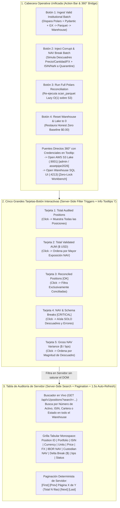

#### 9.2.1. Las 5 Grandes Tarjetas-Botón Interactivas y el Aislamiento Instantáneo de Errores (`NAV & Schema Breaks`)

Cuando un fondo institucional procesa $1,000,000$ de posiciones y $999,980$ están perfectamente conciliadas mientras que $20$ presentan descuadres contables o fallos de esquema, el controlador financiero no puede buscar esas $20$ anomalías pasando páginas manualmente, ni el navegador web puede renderizar un millón de nodos `<tr>` en el DOM sin colapsar la memoria del cliente.

En `ASSET-PIPE`, las **5 tarjetas superiores no son cajas de texto pasivas, sino botones interactivos de filtrado en servidor (`Server-Side Filter Buttons`)**:
1. **Tarjeta 1 (`Total Audited Positions`):** Muestra el volumen total procesado y restablece la vista general paginada.
2. **Tarjeta 2 (`Validated IBOR AUM`):** Muestra el Valor Liquidativo total en dólares (`$0.00` en base cero) y permite inspeccionar las posiciones de mayor peso patrimonial.
3. **Tarjeta 3 (`Reconciled Clean [OK]`):** Filtra en el servidor únicamente las posiciones que cumplen $|\Delta \text{Break}_i| \le \$0.01$.
4. **Tarjeta 4 (`NAV & Schema Breaks` — Vista Exclusiva de Anomalías):** Al hacer clic en esta tarjeta, la consola envía `filter=BREAKS_ONLY` al servidor, devolviendo en milisegundos **única y exclusivamente los registros con descuadre contable (`[NAV-BREAK]`) o interceptados en cuarentena (`[CRITICAL]`)**. Así, aunque el almacén contenga diez millones de filas, la pantalla aísla instantáneamente los casos que requieren acción humana.
5. **Tarjeta 5 (`Gross NAV Discrepancy`):** Muestra el descuadre bruto acumulado ($\sum |\Delta \text{Break}_i|$) y la desviación en puntos básicos (`bps`), ordenando la tabla de mayor a menor impacto monetario.

#### 9.2.2. Pedagogía Ejecutiva Integrada: Pequeños Tooltips Flotantes `(i)` con `event.stopPropagation()`

Para que cualquier director financiero, usuario de *Power BI* o reclutador comprenda al instante qué significa cada métrica técnica o financiera sin abandonar la pantalla:
* Cada tarjeta KPI, cada botón de acción y cada columna técnica (`ISIN`, `IBOR NAV`, `Custodian ABOR NAV`, `Delta Break`, `bps`, `S3 Parquet`, `DuckDB/Snowflake`) incorpora un discreto icono circular de información **`(i)`**.
* Al pasar el cursor o hacer clic sobre `(i)`, se invoca `event.stopPropagation()` (para no activar accidentalmente el filtro de la tarjeta subyacente) y se despliega un **pequeño *popover* flotante contextual** que explica en lenguaje claro de negocio la fórmula exacta y el propósito del indicador, sin oscurecer el fondo ni bloquear el resto de la interfaz.

#### 9.2.3. Matemáticas de Paginación de Servidor, Búsqueda Global y Auto-Refresh Silencioso ($1.5\text{ s}$)

El endpoint `GET /api/v1/positions` opera bajo paginación estricta en base de datos (`LIMIT` / `OFFSET` empujados al motor `DuckDB` / `Snowflake`). Para un conjunto filtrado de cardinalidad $N_{\text{filtered}}$ y un tamaño de página fijo $L$ (por ejemplo, $L = 25$ o $50$ filas por vista), el número total de páginas $P_{\text{total}}$ y el desplazamiento de la página actual $p \in \{1, \dots, P_{\text{total}}\}$ son:

$$P_{\text{total}} = \max\left(1, \; \left\lceil \frac{N_{\text{filtered}}}{L} \right\rceil \right), \qquad \text{Offset}(p) = (p - 1) \cdot L$$

* **Buscador Global de Servidor (`?search=...`):** Cuando el usuario escribe en la caja de búsqueda (por ejemplo, un número de activo específico como `POS-00042`, un código `ISIN` como `US0378331005`, una divisa `EUR` o una cartera `BLK`), la consulta no busca únicamente en las $25$ filas visibles en el navegador; ejecuta un predicado indexado `ILIKE` sobre la totalidad de las tablas del Data Warehouse y devuelve los resultados paginados en tiempo real.
* **Auto-Refresh Silencioso cada $1.5\text{ segundos}$ (*Zero-Flicker Diffing*):** Un bucle asíncrono en segundo plano consulta `/api/v1/kpis` y `/api/v1/positions` cada $1,500\text{ ms}$ preservando el filtro activo, la página actual y el texto escrito en el buscador, actualizando los contadores sin que el usuario tenga que pulsar jamás la tecla `F5`.

---

### 9.3. Topología de Contenedores de la Experiencia 360° en Docker Compose (`:3000`, `:9001`, `:4213`)

Para cumplir la promesa de que cualquier ingeniero pueda clonar el repositorio `asset-pipe` y disponer en menos de $60\text{ segundos}$ de una infraestructura financiera completa sin instalar Python, Rust ni Node.js en su máquina anfitriona, todo el ecosistema se orquesta mediante un único archivo `docker-compose.yml`:

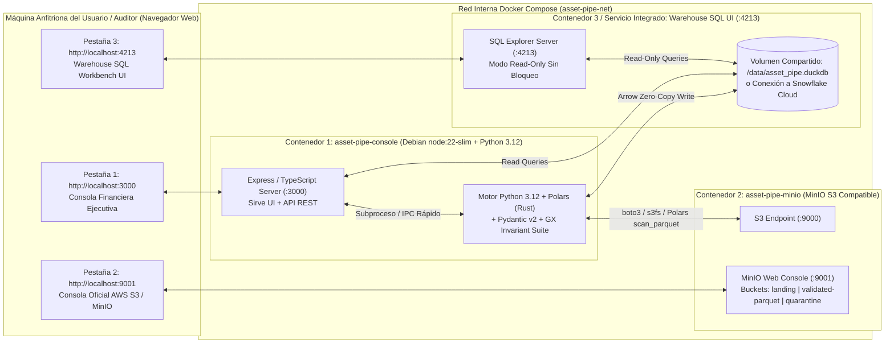

####Por qué unificamos Node.js 22 y Python 3.12 + Polars en `Dockerfile.console`:
En lugar de separar el servidor web de la consola (`:3000`) y el motor de reconciliación `Polars` en dos contenedores distintos conectados por colas externas complejas, `Dockerfile.console` parte de la imagen oficial `node:22-slim` (basada en Debian Bookworm) e instala `python3`, `Polars`, `Pydantic v2`, `PyArrow`, `DuckDB` y `boto3` dentro del mismo contenedor. De este modo, cuando el usuario pulsa cualquiera de los 4 botones de acción en `:3000`, el servidor TypeScript invoca directamente el motor Python/Polars con latencia de arranque casi nula y acceso compartido inmediato al volumen del almacén y a la red S3.

---

### 9.4. Las 4 Puertas de Calidad en GitHub Actions (`quality_gates.yml`) y la Regla Asimétrica de Líneas de Código

Ningún cambio entra en la rama `main` de `asset-pipe` sin superar las **4 Puertas de Calidad Automatizadas (*4 Quality Gates*)** en GitHub Actions, configuradas con soporte moderno de Node 24 (`FORCE_JAVASCRIPT_ACTIONS_TO_NODE24: "true"`):

#### Tabla 9.1: Arquitectura de las 4 Puertas de Calidad en CI/CD (`.github/workflows/quality_gates.yml`)

| Puerta de Calidad (`Quality Gate`) | Herramientas de Auditoría | Qué Verifica Exactamente en Cada `git push` | Criterio de Aprobación |
| :--- | :--- | :--- | :--- |
| **Gate 1: Higiene OPSEC, Cero Emojis y Arquitectura Limpia** | `pytest` (`test_architecture_and_opsec.py`) + `ruff` | 1. **Cero Rutas Locales / OPSEC:** Escanea todo el repositorio prohibiendo usuarios locales de desarrollo, rutas absolutas de host o artefactos privados.<br/>2. **Cero Emojis:** Verifica que ningún archivo contenga caracteres fuera de los rangos permitidos.<br/>3. **Regla Asimétrica de LOC:** Verifica que los archivos del motor/dominio tengan $\le 250$ líneas, respetando las exenciones (`DOC_EXEMPT_NAMES`). | $0$ infracciones de estilo, $0$ fugas OPSEC y $100\%$ de cumplimiento modular |
| **Gate 2: Contratos de Datos e Invariantes Contables** | `pytest` (`test_contracts_and_isin.py`) | Prueba el validador `Pydantic v2` y `Great Expectations` contra códigos `ISIN` válidos e inválidos (Luhn Mod-10), divisas no `ISO-4217`, inyección de `NaN`/`Infinity`, precios negativos y preservación de columnas extra (`ConfigDict(extra="allow")`). | $100\%$ de aciertos en bloqueo y promoción |
| **Gate 3: Motor Vectorizado `Polars` y Adaptador Dual** | `pytest` (`test_polars_nav_reconciliation.py` & `test_warehouse_dual_adapter.py`) | Verifica la exactitud matemática al céntimo de la ecuación $\Delta \text{Break} = (Q \times P \times \text{FX}) - \text{NAV}_{\text{cust}}$, la atribución factorial, la presencia de los **3 Cortafuegos FinOps** en `00_finops_guardrails.sql`, la seguridad `RSA-2048` en `01_security_rbac.sql` y la persistencia sin bloqueos en `DuckDB`. | $100\%$ de tests en verde y cobertura de invariantes |
| **Gate 4: Integridad de Consola Web, Honest Zero y Sintaxis JS** | `vitest` (`dashboard_integrity.test.ts`) + `tsc --noEmit` | 1. Verifica que en estado inicial o tras `Reset to 0` todos los KPIs devuelvan estrictamente `0` / `$0.00` (*Honest Zero Baseline*).<br/>2. Extrae el bloque `<script>` del HTML de `dashboard_view.ts` y lo compila con **`new Function(scriptContent)`** para garantizar **$0$ errores de sintaxis JavaScript** en el navegador.<br/>3. Verifica paginación, buscador, tarjetas-filtro y enlaces a `:9001` y `:4213`. | Compilación TypeScript limpia y $100\%$ de tests `Vitest` superados |

#### La Regla Asimétrica de Líneas de Código (`<= 250 LOC` vs. `DOC_EXEMPT_NAMES`)

Una lección fundamental de ingeniería de plataformas aplicada en `ASSET-PIPE` es evitar que una regla de modularidad pensada para el código de dominio mutile la calidad de la interfaz visual o la profundidad de la documentación operativa:
* **Estricta Modularidad en el Motor (`<= 250 líneas`):** Todos los módulos de `src/domain/`, `src/application/` y `src/infrastructure/` se mantienen concisos, cohesivos y por debajo de las $250\text{ líneas}$ para facilitar la lectura y el mantenimiento.
* **Exención Explícita desde el Día 1 (`DOC_EXEMPT_NAMES`):** Los archivos de vista rica (`dashboard_view.ts`, `server.ts`, `sql_workbench_server.py`), la documentación principal (`README.md`, `Data-architecture.md`), el manual privado (`MANUAL-MAESTRO-DARWIN-ES.md`) y todos los **Runbooks operativos (`docs/runbooks/*.md`)** están registrados en la lista blanca `DOC_EXEMPT_NAMES` de `test_architecture_and_opsec.py`. Esto permite que cada Runbook tenga profundidad enciclopédica real ($\ge 160-250\text{ líneas}$ con diagramas `Mermaid.js`, comandos SQL/CLI y tablas de resolución de problemas) sin activar jamás falsas alarmas en los tests de arquitectura.

---

### 9.5. Glosario Técnico del Módulo 9

* **Asymmetric LOC Rule (Regla Asimétrica de Líneas de Código):** Política de gobernanza de código que aplica un límite superior estricto ($\le 250\text{ LOC}$) a los módulos lógicos de dominio, aplicación e infraestructura para forzar una separación limpia de responsabilidades, mientras exime explícitamente (`DOC_EXEMPT_NAMES`) a las vistas de interfaz de usuario y a los manuales/runbooks técnicos para evitar recortes artificiales.
* **DOM Script Syntax Verification (`new Function(scriptContent)`):** Técnica de prueba automatizada en `Vitest` que extrae el código JavaScript embebido dentro de las etiquetas `<script>...</script>` de una plantilla SSR/HTML y lo pasa al constructor del motor V8 `new Function(...)` sin ejecutarlo en red, detectando instantáneamente en CI/CD cualquier comilla mal escapada, llave sin cerrar o error de sintaxis antes de que llegue al navegador del usuario.
* **Event Propagation Stop (`event.stopPropagation()`):** Método de la API de eventos del DOM que impide que un evento (como el clic sobre el icono informativo `(i)` de un tooltip) burbujee hacia los elementos padres (como la tarjeta-botón de filtrado que lo contiene), permitiendo desacoplar la apertura de la ayuda contextual de la acción de filtrado de la tabla.
* **Honest Zero Baseline (Línea Base Honesta en Cero):** Estándar de integridad de observabilidad que exige que toda interfaz gráfica refleje fielmente el estado real del almacenamiento subyacente, mostrando exclusivamente valores cero (`0` registros, `$0.00` de exposición) cuando el almacén no ha recibido datos o ha sido reseteado, prohibiendo cualquier dato de relleno pre-pintado.
* **OPSEC Hygiene Test (Prueba Automatizada de Seguridad Operativa):** Test unitario ejecutado en la primera puerta de calidad de CI/CD que escanea el árbol de archivos rastreados por Git en busca de cadenas prohibidas (nombres de usuario locales del sistema operativo, rutas absolutas de discos locales o ficheros temporales de auditoría de hardware), garantizando que el repositorio público mantenga una higiene de "Coche 0 Kilómetros".
* **Painted UI Fraud (Fraude de Interfaz Pintada):** Antipatrón de desarrollo en el que una interfaz de usuario aparenta funcionar mostrando métricas, gráficos o listas de registros codificados de forma fija (*hardcoded*) en el frontend sin que provengan de consultas reales al motor de procesamiento y a la base de datos.
* **Server-Side Filtering & Pagination (Filtrado y Paginación en Servidor):** Arquitectura de consulta en la cual el navegador nunca descarga la tabla completa de datos; en su lugar, envía parámetros de estado (`page`, `limit`, `filter`, `search`) a la API backend, la cual delega el filtrado y el recorte (`WHERE ... LIMIT ... OFFSET ...`) al motor columnar (`DuckDB` / `Snowflake`), manteniendo constante y mínima la memoria consumida por el navegador web.
* **Tabular Numerals (`font-variant-numeric: tabular-nums`):** Propiedad tipográfica OpenType aplicada a las fuentes `JetBrains Mono` e `Inter` en la Consola Financiera (`:3000`) que fuerza a todos los caracteres numéricos (`0`–`9`), puntos decimales y símbolos monetarios a ocupar exactamente el mismo ancho horizontal en píxeles, permitiendo comparar visualmente millones, miles y céntimos entre filas consecutivas al instante.

## Módulo 10: Síntesis Ejecutiva Módulo a Módulo, Matriz de Decisiones Arquitectónicas y Conclusiones Generales

### 10.1. Propósito de este Capítulo de Síntesis

A lo largo de los nueve módulos precedentes hemos establecido los fundamentos matemáticos, algorítmicos y de ingeniería de sistemas que sustentan **`ASSET-PIPE` (Automated Financial & Asset Reconciliation Pipeline)**. El objetivo de este capítulo final es doble:

1. Ofrecer una **Síntesis Ejecutiva Módulo a Módulo** que condense las ecuaciones invariantes, los patrones de diseño y las garantías operativas de cada capa de la arquitectura, sirviendo como guía de referencia rápida para arquitectos cuantitativos, auditores bancarios e ingenieros de plataformas.
2. Consolidar una **Matriz Maestra de Decisiones Arquitectónicas y Coste Total de Propiedad (TCO)** que demuestre cuantitativamente por qué la convergencia de motores columnares compilados en Rust (`Polars`, `Apache Arrow`, `Pydantic v2`), almacenamiento de objetos en formato `Apache Parquet` sobre `AWS S3 / MinIO` y persistencia analítica dual con cortafuegos FinOps (`DuckDB` / `Snowflake`) redefine el estándar de la industria frente a licencias SaaS cerradas ($50,000+/\text{año}$) y arquitecturas heredadas basadas en `Pandas` o `PySpark`.

---

### 10.2. Síntesis Ejecutiva Módulo a Módulo (Capítulos 1 al 9)

#### Síntesis del Módulo 1: Dominio Institucional de Reconciliación y Álgebra del Valor Liquidativo (NAV)
* **Problema Fundamental:** En la gestión institucional de activos (ecosistemas tipo BlackRock Aladdin, Blackstone o Santander Securities Services), el Libro Interno de Inversión (**IBOR**) y el Libro Contable del Custodio (**ABOR**) divergen diariamente en los ciclos *T+0 / T+1* debido a desfases de liquidación, jerarquías de precios de mercado y cortes horarios de tipos de cambio.
* **Ecuación Invariante de Reconciliación:**
  $$\Delta \text{Break}_{i,t} = \left( \text{Units}_{i,t}^{\text{IBOR}} \times \text{Price}_{i,t}^{\text{IBOR}} \times \text{FX\_Rate}_{c_i \to b_p, t}^{\text{IBOR}} \right) - \text{Custodian\_Reported\_NAV}_{i,t}$$
* **Garantía Arquitectónica:** `ASSET-PIPE` reemplaza las cajas negras propietarias (Duco, AutoRek) por un pipeline 100% auditable en GitOps que clasifica determinísticamente cada posición según su desviación monetaria absoluta ($|\Delta \text{Break}_{i,t}|$) y relativa en puntos básicos ($\delta_{\text{bps}, i, t}$).

#### Síntesis del Módulo 2: Motores Vectorizados en Rust (`Polars` y `Apache Arrow`) frente a `Pandas` y `PySpark`
* **Problema Fundamental:** `Pandas` colapsa en cargas de $1\text{ GB} - 100\text{ GB}$ por el bloqueo monohilo del GIL, la indirección de punteros `PyObject` en cadenas (`ISIN`) y la multiplicación de memoria RAM ($5\times - 10\times$); `PySpark` introduce un impuesto desproporcionado de serialización Python $\leftrightarrow$ JVM y pausas de recolección de basura para volúmenes que caben en un nodo moderno.
* **Complejidad Espacial y Aceleración:**
  $$\text{Memory}_{\text{Streaming}}(N) = \mathcal{O}(C \cdot M \cdot B) = \mathcal{O}(1), \qquad S_{\text{total}}(C, W) = \frac{1}{s + \frac{1 - s}{C \cdot W \cdot \eta_{\text{cache}}}}$$
* **Garantía Arquitectónica:** Mediante buffers columnares `Apache Arrow` alineados a $64\text{ bytes}$, mapas de bits de validez (*Validity Bitmaps*), paralelismo *Work-Stealing* (`Rayon`), instrucciones vectoriales SIMD (`AVX2`/`AVX-512`) y evaluación perezosa (`scan_parquet`), `Polars` procesa decenas de millones de posiciones en segundos con memoria RAM constante $O(1)$.

#### Síntesis del Módulo 3: Ingeniería de Data Lakes en `AWS S3 / MinIO` y Topología Física de `Apache Parquet`
* **Problema Fundamental:** Los archivos planos `.csv` carecen de esquema tipado, impiden la lectura selectiva de columnas y saturan la red al transferir gigabytes innecesarios desde el almacenamiento de objetos.
* **Modelo de Compresión y Poda en Origen:**
  $$\text{Ratio}_{\text{Dict}}(N, K, L) = \frac{N \cdot L}{K \cdot L + \frac{N \cdot \lceil \log_2(K) \rceil}{8}}, \qquad \text{Skip}(r, c, v) \iff v < m_{r,c} \lor v > M_{r,c}$$
* **Garantía Arquitectónica:** El Data Lake se segrega en tres buckets (`landing/`, `validated-parquet/` y `quarantine/`). Los archivos `Apache Parquet` comprimidos con **`ZSTD`** aprovechan la codificación por diccionario (`RLE_DICTIONARY`), las estadísticas `Min/Max` de cada *Row Group* y los *Split Block Bloom Filters* para que `Polars` descargue vía `HTTP Byte-Range GET` menos del $5\%$ de los bytes físicos del archivo.

#### Síntesis del Módulo 4: Contratos de Datos en Origen (`Pydantic v2` Core en Rust) y Tolerancia a *Schema Drift*
* **Problema Fundamental:** Los extractos bancarios reales sufren deriva de esquema (*Schema Drift*, cuando los clientes añaden columnas propietarias) y corrupción silenciosa de dominio (`ISIN` malformados, divisas no estándar o valores IEEE 754 `NaN`/`Infinity` que destruyen por absorción las sumas contables).
* **Invariante Algorítmica `ISIN` (ISO 6166 Luhn Mod-10) y Dominio Real Finito:**
  $$\left( \sum_{k=1}^{m} \psi(w_k \cdot u_{m - k + 1}) \right) \equiv 0 \pmod{10}, \qquad \forall x \in \{\text{Units}, \text{Price}, \text{FX}, \text{NAV}\}, \; x \in \mathbb{R} \setminus \{\pm\infty, \text{NaN}\}$$
* **Garantía Arquitectónica:** `Pydantic v2` (`pydantic-core` en Rust) valida el núcleo canónico a velocidad nativa mientras la directiva **`ConfigDict(extra="allow")`** preserva de forma polimórfica cualquier columna adicional específica del cliente hasta el archivo Parquet y el Data Warehouse.

#### Síntesis del Módulo 5: Auditoría Declarativa con `Great Expectations` y Patrón *Dead-Letter Quarantine*
* **Problema Fundamental:** La validez individual de cada fila no garantiza la integridad del lote como conjunto (pueden existir claves primarias compuestas duplicadas o incoherencias entre columnas como `currency == 'USD'` con `fx_rate != 1.0`).
* **Bifurcación Atómica de Conjunto:**
  $$\mathcal{B} = \mathcal{B}_{\text{valid}} \sqcup \mathcal{B}_{\text{quarantine}} \quad \text{tal que} \quad \mathcal{B}_{\text{valid}} \cap \mathcal{B}_{\text{quarantine}} = \emptyset$$
* **Garantía Arquitectónica:** Una suite declarativa de siete expectativas (`GX-01` a `GX-07`) audita la unicidad de la clave $(\text{portfolio\_id}, \text{isin}, \text{valuation\_date})$, la completitud no nula y la ecuación del NAV. Las filas infractoras jamás detienen ni contaminan el lote sano: se desvían de forma atómica a `s3://asset-pipe/quarantine/` acompañadas de un manifiesto forense `.manifest.json` con huella `SHA-256`.

#### Síntesis del Módulo 6: Algoritmos de Reconciliación Contable y Atribución Factorial a Escala Masiva
* **Problema Fundamental:** Detectar un descuadre ($\Delta \text{Break}_i \neq 0$) es insuficiente para Operaciones y Tesorería si no se atribuye matemáticamente qué fracción del error proviene de títulos ($\Delta Q$), de precio ($\Delta P$) o de tipo de cambio ($\Delta \text{FX}$), y si no se previenen los errores compensatorios de signo opuesto (*Offsetting Errors*).
* **Identidad de Atribución Factorial de Tercer Orden y Descuadre Bruto:**
  $$\Delta \text{Break}_i \equiv \underbrace{\Delta Q_i P_0 X_0}_{E_Q} + \underbrace{Q_0 \Delta P_i X_0}_{E_P} + \underbrace{Q_0 P_0 \Delta X_i}_{E_{FX}} + E_{\text{cross}, i}, \qquad \text{Gross\_Break}_p = \sum_{i \in \mathcal{I}_p} |\Delta \text{Break}_i|$$
* **Garantía Arquitectónica:** Mediante un `Parallel Partitioned Radix Hash Join` en Rust y expresiones vectorizadas `pl.when().then().otherwise()`, el motor clasifica cada activo en `[OK] RECONCILED`, `[WARN] MINOR_TOLERANCE`, `[NAV-BREAK]` o `[CRITICAL] ORPHAN / SCHEMA_REJECTED` sin bucles en Python.

#### Síntesis del Módulo 7: Arquitectura de Persistencia Dual (`DuckDB` & `Snowflake`) y *Zero-Lock Analytics*
* **Problema Fundamental:** Depender exclusivamente de `Snowflake` impide ejecutar el proyecto en $60\text{ segundos}$ sin credenciales de pago; usar `DuckDB` de forma ingenua provoca bloqueos de archivo (`Conflicting lock is held`) cuando el motor escribe y las interfaces web leen simultáneamente.
* **Transferencia *Zero-Copy* y Concurrencia Sin Bloqueo Persistente:**
  $$\text{Polars} \xrightarrow{\text{Arrow C Data Interface } \mathcal{O}(1)} \text{DuckDB (Transient Write / Read-Only Snapshot)} \longleftrightarrow \text{UI (:3000) \& SQL (:4213)}$$
* **Garantía Arquitectónica:** El puerto `WarehousePort` conmuta en una línea (`WAREHOUSE_ENGINE=duckdb|snowflake`) entre `DuckDB` local (con aislamiento libre de bloqueos entre la Consola `:3000` y el Workbench SQL `:4213`) y `Snowflake Cloud` (mediante carga masiva `Apache Arrow / COPY INTO Parquet`).

#### Síntesis del Módulo 8: Ingeniería FinOps en la Nube y Seguridad Bancaria *Zero-Trust*
* **Problema Fundamental:** Un almacén Cloud sin gobierno puede quemar decenas de miles de dólares por inactividad (`AUTO_SUSPEND = 600s`), consultas zombi (`TIMEOUT = 48h`) o falta de cuotas, y las contraseñas estáticas violan los estándares de seguridad bancaria.
* **Ahorro FinOps (>90%) y Firma Criptográfica Asimétrica:**
  $$\text{Coste}_{\text{FinOps}} \propto \max(60\text{ s}, \, t_{\text{exec}} + 60\text{ s}), \qquad \sigma_{\text{JWT}} = (\text{SHA256}(m))^d \bmod n \quad (\text{RSA-2048 PKCS\#8})$$
* **Garantía Arquitectónica:** `00_finops_guardrails.sql` impone los **3 Cortafuegos FinOps** (`AUTO_SUSPEND = 60`, `STATEMENT_TIMEOUT = 300`, `RESOURCE MONITOR` con `SUSPEND_IMMEDIATE` al $100\%$), mientras `01_security_rbac.sql` establece autenticación sin contraseña mediante llave privada `RSA-2048`, roles RBAC de mínimo privilegio, *Dynamic Data Masking* con preservación de cardinalidad (`SHA-256`) y *Row-Level Security*.

#### Síntesis del Módulo 9: Observabilidad 360°, Estándar *Honest Zero Baseline* y 4 Puertas de Calidad en CI/CD
* **Problema Fundamental:** Las interfaces con métricas falsas pre-pintadas (*Painted UI*), las tablas que intentan renderizar millones de filas en el navegador y los repositorios contaminados con rutas locales del desarrollador arruinan la fiabilidad operativa.
* **Línea Base Honesta en Cero y Verificación Sintáctica V8:**
  $$\text{Count}(\text{Warehouse}) == 0 \implies \text{UI KPIs} \equiv \$0.00, \qquad \text{new Function}(\text{scriptContent}) \implies 0 \text{ Syntax Errors}$$
* **Garantía Arquitectónica:** La Consola Ejecutiva (`:3000`, estética Shadcn UI + claridad de Power BI Financiero) ofrece 5 tarjetas-botón interactivas en servidor (incluyendo aislamiento instantáneo de `NAV & Schema Breaks`), buscador indexado, paginación, tooltips pedagógicos `(i)` con `event.stopPropagation()`, puentes directos a `:9001` y `:4213`, y verificación automatizada en GitHub Actions mediante 4 Puertas de Calidad (`Node 24`, `Ruff`, `Pytest`, `Vitest` y auditoría OPSEC con exención `DOC_EXEMPT_NAMES`).

---

### 10.3. Mapa Arquitectónico Integrado de las 10 Capas del Tratado

El siguiente diagrama consolida la interacción de los diez módulos dentro de una única topología de ingeniería de sistemas:

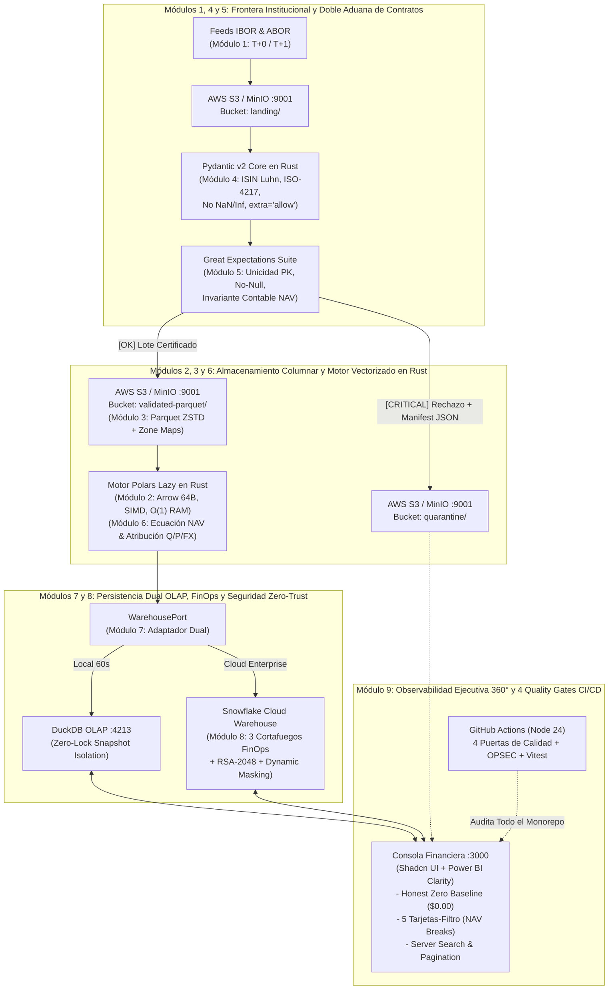

---

### 10.4. Matriz Maestra de Decisiones Arquitectónicas (*Architectural Trade-Offs*) y Análisis TCO

En la ingeniería de nivel *Staff / Principal*, toda elección tecnológica implica descartar alternativas con un fundamento cuantitativo demostrable. La siguiente matriz resume las ocho grandes decisiones arquitectónicas de `ASSET-PIPE`:

#### Tabla 10.1: Matriz Global de Decisiones Arquitectónicas y Retorno Operativo

| Capa del Sistema | Alternativa Tradicional Descartada | Tecnología Elegida en `ASSET-PIPE` | Razón Cuantitativa y de Ingeniería (*The Why*) |
| :--- | :--- | :--- | :--- |
| **1. Plataforma Global de Reconciliación** | SaaS Propietario Cerrado (*Duco / AutoRek / SmartStream*) | **Arquitectura Abierta `ASSET-PIPE` en Contenedores** | Ahorro de **$\$50,000 - \$250,000/\text{año}$** en licencias; soberanía total de datos dentro de la VPC del banco y reglas versionadas al $100\%$ en GitOps |
| **2. Motor de Procesamiento Tabular** | `Pandas` (Monohilo, RAM $O(N)$) o `PySpark` (JVM pesada) | **`Polars` (Rust + `Apache Arrow` + `Lazy Streaming`)** | **$25\times - 45\times$ menor latencia**, paralelismo SIMD sin GIL y memoria RAM acotada en **$O(1)$** sin fallos `OOM (Exit 137)` |
| **3. Formato y Almacenamiento Data Lake** | Archivos `.csv` / `.xlsx` en SFTP o NAS local | **`Apache Parquet (ZSTD)` sobre `AWS S3 / MinIO (:9001)`** | Reducción de espacio de **$7.7\times$**, consistencia fuerte *Read-After-Write* y poda de red superior al **$90\%$** mediante *HTTP Byte-Range* y estadísticas `Min/Max` |
| **4. Validación de Esquemas en Origen** | `if/else` manuales o esquemas rígidos que fallan ante nuevas columnas | **`Pydantic v2` (`pydantic-core` Rust) + `ConfigDict(extra="allow")`** | Validación en microsegundos de `ISIN` (Luhn Mod-10), `ISO-4217` y bloqueo de `NaN`/`Inf`, preservando polimórficamente las columnas extra de cada cliente |
| **5. Auditoría de Lote y Resiliencia** | `dbt tests` tardíos (después de contaminar el Warehouse) | **`Great Expectations Suite` + `Dead-Letter Quarantine` en S3** | **Bifurcación atómica en origen:** las posiciones sanas fluyen hacia `validated-parquet/` y las corruptas se aíslan en `quarantine/` con manifiesto `.manifest.json` |
| **6. Almacén Analítico (Data Warehouse)** | Acoplamiento exclusivo a Cloud o mocks falsos en `SQLite` | **Patrón Adaptador Dual (`DuckDB :4213` $\leftrightarrow$ `Snowflake`)** | Ejecución local instantánea en $60\text{ s}$ sin bloqueos de lectura (`Zero-Lock`) y conmutación en $1$ línea a `Snowflake` en producción |
| **7. Gobernanza Cloud y Seguridad** | `AUTO_SUSPEND = 600s`, sin monitor de cuota y login por contraseña | **`00_finops_guardrails.sql` (3 Cortafuegos) + `01_security_rbac.sql` (`RSA-2048`)** | Reducción del **$90\%$ en consumo ocioso**, corte de consultas zombi a los $300\text{ s}$, parada dura al $100\%$ de cuota y autenticación criptográfica sin contraseñas |
| **8. Consola de Observabilidad (`:3000`)** | Cuadros de mando estáticos o con datos pre-pintados (*Painted UI*) | **Consola Reactiva `:3000` (*Shadcn + Power BI*) con *Honest Zero Baseline*** | Cero fraude visual (`$0.00` en base cero), 5 tarjetas-filtro de servidor (aislamiento instantáneo de `NAV Breaks`), buscador global y enlaces directos a `:9001` y `:4213` |

---

### 10.5. Conclusiones Generales y Hoja de Ruta Evolutiva (*Future Roadmap hacia Liquidación T+0*)

El diseño y construcción de **`Financial-BigData-Polars-and-Contracts`** y de su motor ejecutable **`ASSET-PIPE`** demuestran tres principios fundamentales de la ingeniería moderna de datos financieros:

1. **La Convergencia de Rust y Python ha Redefinido el *Single-Node Big Data*:**
   La combinación de `Polars`, `Apache Arrow`, `PyArrow`, `Pydantic v2` y `DuckDB` —todos ellos cimentados sobre motores nativos en Rust y C++ que comparten buffers columnares en memoria sin copia (*Zero-Copy*)— permite que un único contenedor ligero procese en pocos segundos volúmenes de reconciliación financiera que hace apenas cinco años exigían clústeres distribuidos de decenas de nodos en la JVM.
2. **La Calidad Contable y el Control FinOps deben ser Propiedades Intrínsecas del Código:**
   En una plataforma bancaria de misión crítica, ni la validación de un código `ISIN`, ni la verificación de la ecuación del Valor Liquidativo ($\Delta \text{Break}$), ni el límite de gasto mensual en `Snowflake` pueden depender de procesos manuales. Al codificar los contratos en `Pydantic v2 / Great Expectations` y los cortafuegos en `00_finops_guardrails.sql` bajo las 4 Puertas de Calidad de CI/CD, el sistema garantiza por construcción matemática cero corrupción silenciosa y cero desviaciones presupuestarias.
3. **Preparación Arquitectónica para el Futuro de la Liquidación Instantánea (*T+0 / Atomic Intraday Settlement*):**
   A medida que los mercados de capitales globales evolucionan desde el ciclo de liquidación *T+1* hacia la reconciliación continua intradía, la arquitectura desacoplada y sin estado (*stateless streaming*) de `ASSET-PIPE` está preparada para extenderse de forma natural hacia flujos de eventos en tiempo real (`Apache Kafka` / `Redpanda` $\to$ `Polars Streaming Micro-Batches` $\to$ `Apache Iceberg / Parquet en S3`), manteniendo intacto el núcleo de dominio, los contratos de validación y la observabilidad 360°.

---

### 10.6. Glosario Técnico del Módulo 10

* **Architectural Trade-Off Analysis (Análisis de Compromisos Arquitectónicos):** Evaluación sistemática de las ventajas, costes y límites físicos de distintas alternativas tecnológicas (por ejemplo, ejecución distribuida en JVM frente a ejecución vectorizada *Out-of-Core* en Rust) para seleccionar el diseño óptimo bajo restricciones reales de latencia, memoria y presupuesto.
* **GitOps for Financial Rules (GitOps Aplicado a Reglas Financieras):** Paradigma operativo en el que todas las definiciones de esquemas, tolerancias de puntos básicos (`bps`), ecuaciones de valoración, permisos RBAC y límites FinOps residen como código declarativo en un repositorio Git, donde cualquier cambio requiere revisión por pares y superación de pruebas automatizadas antes de entrar en producción.
* **Single-Node Scale-Up vs. Distributed Scale-Out:** Contraste entre aprovechar al máximo la capacidad de los procesadores multinúcleo modernos, instrucciones SIMD y discos NVMe/S3 mediante motores compilados en Rust/C++ (*Scale-Up*) frente a dividir prematuramente el problema en múltiples servidores conectados por red (*Scale-Out*), eliminando el impuesto de serialización y *Network Shuffle* para cargas de hasta cientos de gigabytes.
* **Stateless Reconciliation Engine (Motor de Reconciliación Sin Estado):** Diseño del motor de cómputo (`Polars` en `ASSET-PIPE`) en el que el procesador no almacena estado persistente local entre ejecuciones; recibe punteros a objetos inmutables en `AWS S3`, ejecuta la transformación matemática pura y persiste el resultado idempotente en el Data Warehouse, permitiendo escalar horizontalmente o reiniciar el contenedor en cualquier instante sin pérdida de datos.
* **TCO (*Total Cost of Ownership* / Coste Total de Propiedad):** Métrica financiera integral que suma todos los costes directos e indirectos de una plataforma tecnológica a lo largo de su vida útil: licencias anuales de software SaaS, consumo de cómputo y almacenamiento en la nube, tiempo de ingeniería invertido en mantenimiento y coste de oportunidad por latencia o errores operativos.
* **Vendor Lock-In (Cautividad Tecnológica de Proveedor):** Situación de dependencia estructural en la que una institución financiera no puede migrar desde una plataforma propietaria hacia otra alternativa sin incurrir en costes prohibitivos de reescritura porque sus reglas de negocio están atrapadas en formatos cerrados no exportables.